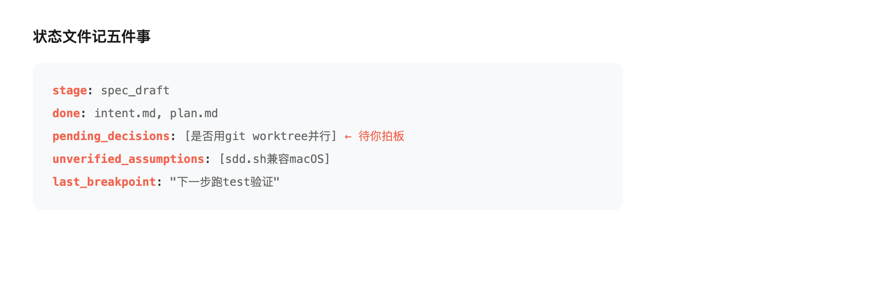

# AI 写代码跑一半就"失忆"？把进度写成机器读得懂的文件

---

用 AI 写代码的人，多半撞过这三个坑。

**坑一**：昨晚让它改一个流水线，今天切回来，它说做完了。可你一查，它改的是另一个文件，验收标准里那两条根本没跑。你更记不清——上次到底让它做到哪一步、哪几个决定是它自己替你拍的。

**坑二**：一个大任务拆给好几个 AI 同时干，结果它俩改到同一个文件，互相等一个没定的接口，最后合并时一团乱。

**坑三**：这个月踩过的坑，下个月换个会话又踩一遍。经验全在对话里，没留下来。

这不是 AI 笨。这是大模型的本性：它是概率性的，上下文一断，就像换了个人。你不拦，它就在你看不见的地方"自由发挥"。

我折腾了几个月，发现靠"多写提示词"没用——换个会话就没了。真正管用的，是把三件事从"我脑子里的记忆"变成"机器读得懂的文件"。

## 一、状态写成文件，不靠脑子记

以前每个任务的状态就是一个 emoji：待办、进行中、完成。那是给人看的。

现在每个 spec 目录里放一份机器可读的状态文件，记五件事：当前在哪个阶段、哪步做完了、哪几个决定还挂着没拍、哪些假设还没验证、上次断点是哪句话。

换会话、换工具、甚至换个 AI 模型接着干，第一件事跑一句命令，三行输出告诉你：上次到哪了、还有什么没定、下一步该干嘛。不用从头翻几个小时的日志。

关键是那个"待拍板"清单——模型自己拍的板一律挂在上面标默认值，没经你确认就不算数。这等于把"模型替你做决定"这个最大的失控口，显式拎到台面上。

## 二、并行用 git 隔离，不是嘴上写个"同时进行"

任务拆给多个 AI 同时跑，最容易翻车的是两件事：改到同一个文件、或者互相等一个没定的接口。

解法不复杂：每个并行任务开一个独立的 git 分支，谁也踩不到谁的主线；跨任务要用的接口，先把签名定死写进契约，再开工。合并的时候不看它说"做完了"，直接对磁盘产物——文件在不在、测试跑没跑、改动有没有越界——跑一遍才算数。

## 三、做完的经验，抽成能检索的库

以前案例跑完就完。现在每个任务收尾，强制把三样东西抽出来：能直接抄的话、踩过的坑、下次别犯的错。下一个任务开工前先搜一句"以前有没有踩过类似的"，有就直接抄作业，不重造轮子。

## 说到底在防什么

防的不是 AI 不够聪明，是它**不确定**。

它不知道你上次为什么这么定，不知道哪句是它自己编的，不知道这次跟上次是不是同一个上下文。你把这些落进文件、变成状态、变成可验收的勾，它就被框在一条道上跑，而不是在概率的迷雾里乱撞。

代码可以让 AI 写，但"写什么、怎么算对、哪里不能动"，必须文件说了算、人来签字。

这不是我一家之言。36氪 9 月的 Agent 报告把「运行数据」写成了新资产：任务轨迹、工具调用记录、失败模式、用户反馈，正在取代训练语料成为最值钱的数据（P17）；报告给的演进方向，也是「执行—反馈—学习—优化—再执行」的闭环（P34）。**把状态写成文件，本质就是报告说的「运行数据资产化」**——只不过企业用平台做，我用一份文件做。（36氪 2026.09 报告口径）

一线受访者的一句话也说到点子上：「今天换成 Claude Code、Codex、Agent 等新工具，本质上没有发生真正的区别，只是工具越来越复杂」（Datawhale FDE案例100 受访者口述口径）。工具年年换，把状态写进文件的工程思想不换。

技术细节会过时，今天的模型明天就换。但"先规格后编码、断点可续、经验可抄"这套工程思想，不会。

---

这套东西我开源了，纯 bash，拷过去就能用：GitHub 搜 xingtu-sdd。

我押的注是：接下来一年，会写代码的人不稀奇，能让 AI 在框里稳定交付的人才稀缺。刹车不是为了慢，是为了敢踩油门。

🔗 相关仓库：[xingtu-sdd](https://github.com/xingtu1996/xingtu-sdd)（本文「进度写成机器读得懂的文件」的规格驱动落地）
