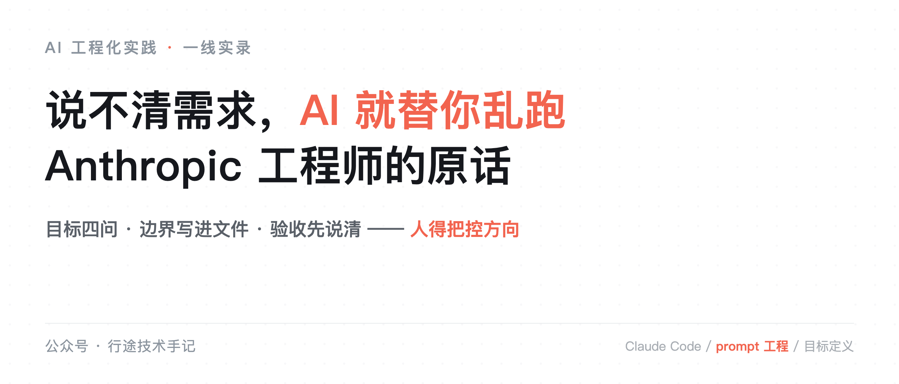
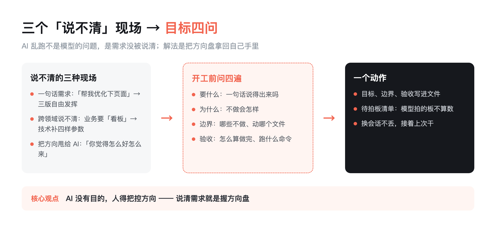
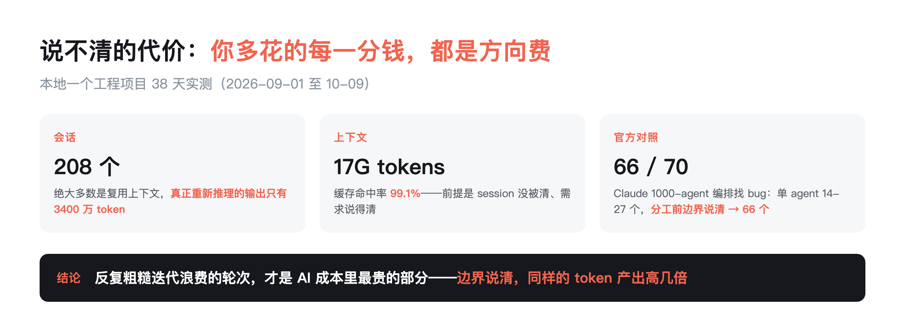

# 说不清需求，AI 就替你乱跑：Anthropic 工程师的原话，和我的三个解法

> 行途技术导读：Anthropic 的 Claude Code 工程师 Thariq 说了一句话，我看了直接坐直：AI 最常见的失败场景，不是模型不行，是「人在自己专业领域之外工作，说不清需求，只能反复粗糙迭代、浪费大量轮次」。这句话把 AI 落地翻车的一大半原因，归到了人身上。

## 先说结论

AI 乱跑，八成不是模型的问题，是需求没被说清。官方工程师亲口承认这一点；我这边 38 天 208 个会话的实测数据也指向同一结论。解法不是更长的 prompt，是把「目标、边界、验收」三件事从脑子里搬进文件——这是 AI 没有目的、人得把控方向的具体落法。

目录：

1. Anthropic 工程师一句话，点破最常见的失败

2. 我见过的三个「说不清」现场

3. 说不清的代价：你多花的每一分钱都是方向费

4. 解法一：目标四问，把需求问到底

5. 解法二：边界写进文件，别让 AI 替你拍板

6. 解法三：验收先说清，再开工

7. 工具与信源

## 1. Anthropic 工程师一句话，点破最常见的失败

10 月 9 号，我在舆情日报里看到 Prompt Engineering News 的周报，引了 Anthropic 的 Claude Code 工程师 Thariq 的一段观察。大意是：

> 最常见的失败场景，是人自己在专业领域之外工作——没法给出精准的 prompt 和 plan，只能反复粗糙地迭代，浪费大量轮次。

我第一反应是坐直了。

这句话狠在哪？它把「AI 翻车」的责任，从模型挪到了人身上。而且是官方工程师亲口说的，不是某个自媒体在骂用户。

同一天，CTech 的报道标题更直白：Claude Code 创始人的提示词公式——「说清楚你要什么，剩下的让 AI 自己想办法」。

两件事合起来就一句话：**你说不清，它就乱跑；你说得清，它才跑得直。**

这不是观点，是官方口径。我拿自己的数据对过，结论一致。

## 2. 我见过的三个「说不清」现场

我是做 AI 工程化的，过去一年帮不同团队把 AI 推到生产里。翻车现场看多了，发现翻法高度雷同。

现场一：一句话需求，三版自由发挥。

「帮我优化下这个页面。」就这一句。AI 先改配色，发现不对；再改布局，又不对；最后把整块逻辑重写了。用户看完说：我没让你动这个啊。

问题不在 AI 自作主张。是「优化」这个词本身就是空的——优化什么？视觉？性能？转化率？全没说。

现场二：跨领域说不清，反复解释。

业务方提需求，习惯说「要个看板，能看到数据变化就行」。技术方翻译成需求，得补：什么数据、什么粒度、什么刷新频率、谁能看。这四样没定，AI 做出来的东西，一定不是业务方要的那个。

我后来发现：人跟 AI 说不清需求，跟跨部门沟通说不清需求，是同一个病。**需求说不清，在哪都翻车。**

现场三：把方向甩给 AI。

最危险的一种：「你觉得怎么好就怎么来。」这是把方向盘递给了一个没有目的的东西。

AI 没有目的。它不会问你要什么，只会顺着你的话往下走。你把它当成有主见的人，它就替你「自由发挥」——发挥得好是运气，发挥不好是必然。

这不是我一个人的体感。

24 个一线 FDE 案例（Datawhale《FDE 案例 100》）几乎条条落在同一个坑：客户说的从来不是真需求。有人提「帮我打通两个系统」，现场录屏一看，背后是库存、物流、补货、广告一整条业务链——需求没被翻译，AI 只能替你乱跑。

行业报告也是同一结论。36氪 9 月的 Agent 行业报告给了个更硬的判断：真正能规模化的智能化，不是把所有业务都交给 Agent 决策，而是「按业务风险、任务复杂度和自动化价值，对 Agent 自主决策与工作流规则控制做合理分工」——**说得清的地方交给规则，说不清的地方才交给模型**。报告里还有一句更直白：任务边界一清晰、流程相对简单时，"单 Agent 往往已经能够满足需求"。（Datawhale 受访者口述口径；36氪 2026.09 报告口径 P19/P23）

就在我改这篇稿子的同一天，一份哈佛的工作论文把这个判断从「体感」变成了「账单」。哈佛的 Fiona Chen 和 James Stratton 用了 Jellyfish 的工程遥测数据——718 家公司、72.6 万名员工、约 3 亿条工作事件，跨度从 2021 年 1 月到 2026 年 3 月，交错双重差分——去看采用编码 Agent 之后到底发生了什么：人均每月新增代码 +1,494 行（+30%），提交 +20%，PR +23%；但 Jira 里已解决的 issue 和 epic，没有统计显著变化，上限被压在 +12% 以内。钱花在哪了？PR 从提交到合入的平均时长 +3.45 天（+49%），要求修改的 PR 占比接近翻倍，每个 PR 的评论 +35%，被拉进评审的人 +14%。截至 2026 年 3 月，80% 的公司在跑 AI 评审，但 AI 只贡献了 23.3% 的评论和 10.8% 的 PR。

换句话说：**上游写得越快，下游评审堵得越死，交付原地不动。** 这不就是「说不清」的代价吗——方向没对齐，每一行多写出来的代码，都是要人 review、要人合入、要人维护的债。作者给的处方原话是：需要在下游评审能力上做配套投入，而不是继续增加代码产出。

（口径说明：这是工作论文，未经同行评审；样本是接入了 Jellyfish 遥测的公司，不是全行业随机抽样。但 72.6 万人的体量加上交错 DiD 的设计，比大多数「AI 提效 X%」的厂商口径硬得多。）

## 3. 说不清的代价：你多花的每一分钱都是方向费

说得清和说不清，差距有多大？我用自己的账算过。

本地一个工程项目，38 天 208 个会话、17G tokens，缓存命中率 99.1%。什么意思？绝大多数上下文都是复用的，真正重新推理的输出只有 3400 万 token。

但这里有个更扎心的账：如果需求说得清，很多轮次根本不会发生。 反复粗糙迭代浪费的轮次，才是 AI 成本里最贵的部分——它花的是你的时间，和模型重新推理的 token。

官方也给了数据：Claude 的 1000 个 agent 编排，单 agent 找 bug 平均 14-27 个，动态编排能到 66 个。编排的价值在于「分工前先把任务边界说清」——**边界说清了，同样的 token 产出高几倍。**

哈佛那份研究还补了一刀：方向费不止花在 token 上，更花在下游——PR 合入时长 +49%、被拉进评审的人 +14%。写得越快，评审越堵，最后交付还是那么多。**省错地方的提效，是把成本从上游挪到了下游，并没有消失。**

交叉印证还有一个：NBER 的工作论文（约 50 万开发者）发现，三代 AI 工具把提交量效应一路推到 +240%，但沿着链路逐级衰减——到项目级只剩 +80%，到发布只剩 +30%；四个主要软件市场里新应用数大涨，总使用量不增。工具一直在变，「写得快」到「交付多」之间的衰减，一直没变。

所以说清需求不是「讲礼貌」，是省钱。方向费，是 AI 时代最贵的费用。

## 4. 解法一：目标四问，把需求问到底

说不清的反面不是「说得多」，是「问到底」。开工前，把目标问四遍：

1. 要什么：这一轮要交付什么？一句话说得出来吗？

2. 为什么：为什么是现在做？不做会怎样？——防止做出来才发现不需要。

3. 边界：哪些不做？动哪个文件？不动哪个？——AI 最需要的是「不做什么」。

4. 验收：怎么算做完？跑什么命令？看什么输出？

这四问是我从 FDE 现场带回来的。业务方给一句话需求，我拿这四问怼回去，通常怼到第二问，他自己就发现需求没想清楚。

四问之后，AI 拿到的不再是「优化下页面」，而是：

> 目标：首页转化率提升 5%。边界：只动首屏，不动后端。验收：跑通 `npm run build`，转化埋点数据对比上周同期。

这句话里没有一个字是魔法。但它把「方向盘」从 AI 手里拿回来了。

## 5. 解法二：边界写进文件，别让 AI 替你拍板

问清楚了，还不够——得写下来。写下来，才换会话不丢。

我现在每个 spec 目录里放一份机器可读的状态文件，记五件事：当前在哪个阶段、哪步做完了、哪几个决定还挂着没拍、哪些假设没验证、上次断点是哪句话。

关键的是那个「待拍板」清单：模型自己拍的板，一律挂上去标默认值，没经你确认不算数。

换会话、换工具、甚至换模型接着干，第一件事跑一句命令，三行输出告诉你：上次到哪了、还有什么没定、下一步该干嘛。不用从头翻几小时的日志。

这一步做的是把「模型替你做决定」这个最大的失控口，显式拎到台面上。你看不见它，它就会替你决定；你把它写出来，它就只能等你拍板。

## 6. 解法三：验收先说清，再开工

最后一个解法，也是我踩过最多次的坑：验收标准不先说清，等于没验收。

以前我验收靠感觉：「看起来差不多。」结果 AI 说做完了，我一查——它改的是另一个文件，验收标准里那两条根本没跑。

现在反着来：开工前先把验收写进需求。跑什么命令、看什么输出、哪些测试必须过。合并不看它说「做完了」，直接对磁盘产物——文件在不在、测试跑没跑、改动有没有越界，跑一遍才算数。

**AI 说做完了 ≠ 做完了。验收标准说做完了，才叫做完了。**

## 7. 工具与信源

**Thariq 观察（Anthropic Claude Code 工程师）** ｜ 10-09 Prompt Engineering News 周报引用：人在专业领域外说不清需求，是 AI 最常见失败场景。链接：https://news.promptengineering.org/2026/10/09/index.html

**Claude Code 提示词公式（CTech）** ｜ 「说清楚你要什么，剩下的让 AI 自己想办法」。链接：https://www.calcalistech.com/ctechnews/article/thariq-claude-code-prompting-formula

**Claude 1000-agent 编排官方数据** ｜ 单 agent 找 bug 14-27 个 vs 动态编排 66 个（70 bug / 116k 行代码库）。链接：https://www.anthropic.com

**哈佛 × Jellyfish 工作论文（2026-10 报道）** ｜ 《Artificial Intelligence in the Firm: Bottlenecks in Software Production》，Fiona Chen & James Stratton：718 公司 / 725,938 人 / 约 3 亿工作事件（2021-01~2026-03，交错 DiD）；代码 +30%、提交 +20%、PR +23%，Jira 解决率无显著变化；PR 合入 +3.45 天（+49%）、评论 +35%、评审人力 +14%；80% 公司跑 AI 评审但只产 23.3% 评论 / 10.8% PR。**预印本，未经同行评审。** 报道来源：FourWeekMBA（https://fourweekmba.com/ai-coding-agents-add-30-more-code-not-more-finished-work/）｜ AI Weekly（https://aiweekly.co/alerts/harvard-study-ai-coding-agents-lift-code-30-shipped-output-flat）

**NBER WP35275（交叉印证）** ｜ 约 50 万开发者，三代工具提交效应 30%→180%→+240%，沿链衰减：项目 +80%、发布仅 +30%；四个市场新应用数大涨、总使用量不增。来源：AIBARS（https://aibars.net/en/news/897426407431606272）

**36氪 Agent 行业报告（2026.09）** ｜ 「按业务风险、任务复杂度和自动化价值，对 Agent 自主决策与工作流规则控制做合理分工」；任务边界清晰时单 Agent 往往够用（口径 P19/P23）。

**Datawhale《FDE 案例 100》** ｜ 24 个一线 FDE 案例：客户说的从来不是真需求（受访者口述口径）。

**数据口径** ｜ 本文 38 天数据来自本地一个工程项目 session 聚合（2026-09-01 至 10-09），含 208 个会话、17G tokens、缓存命中率 99.1%；目标四问与状态文件实践来自本人 FDE 现场与 SDD 引擎 v2（治 AI 失控）落地记录。公开叙事用 token 量与命中率，不用成本数字。
