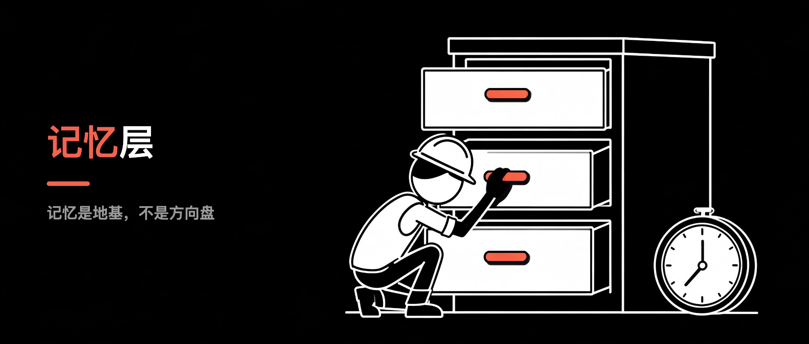
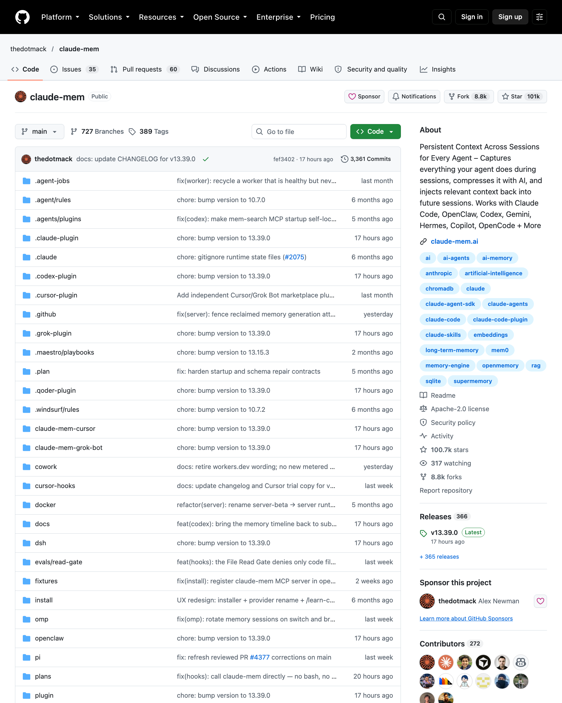
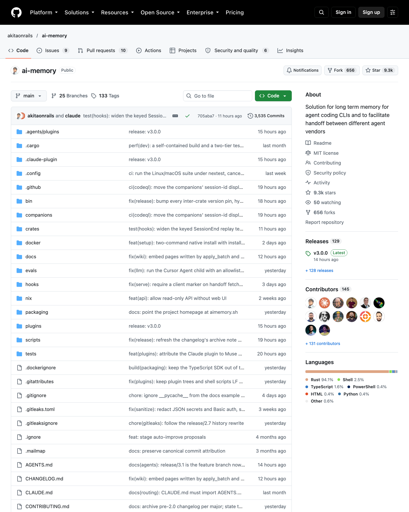
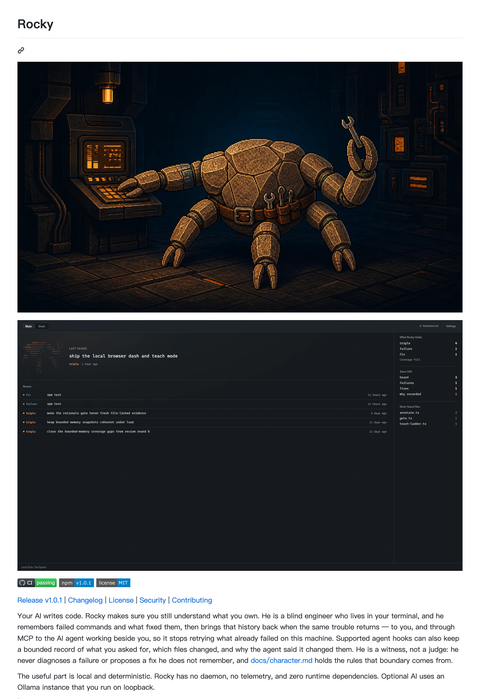

# AI 失忆不是 bug，是架构——记忆层补上了，然后呢？

> **行途技术导读**：Claude Code 默认 30 天清会话，我 5-8 月的对话被后台清空。这周记忆层工具集中爆发，两个记忆项目一周涨了几百星，还有一台叫 Rocky 的 CLI 守在终端里。但我想说的不是工具——记得住，不等于想得对。
>
> **这篇能给你什么**：① 如果你用 Claude Code / Codex 这类 AI 编程工具，你会知道「会话即忘」是架构问题、不是你的问题，以及现在有哪几类解法；② 如果你想给 AI 装长期记忆，这里有三条路线（压缩 / 跨厂商 / 本地确定性）和它们的取舍；③ 最重要的是一个判断框架——记住 ≠ 想得对，别让记忆工具变成另一种依赖。

## 先说结论

AI 失忆不是 bug，是架构。大模型天生无状态，每次对话只看得见你这次给的上下文，会话一关它就变成另一个人。记忆层就是给它在模型和用户之间加一层「永久的笔记本」。但记住只是前提：**记忆是地基，不是方向盘**。地基补上了，方向盘还在你手里——这篇的价值，是让你在装记忆之前先想清楚：你要的到底是「它记得」，还是「它想得对」。

目录：

1. 上周的坑，这周成了风口

2. 记忆层在解决什么问题

3. 三个开源项目：把记忆带走

4. Rocky：一台终端的守门员

5. 我的判断：记忆是地基，不是方向盘

6. 一句话记住

7. 工具与信源

## 1. 上周的坑，这周成了风口

我 5-8 月的对话被后台清空过。不是事故，是默认规则：Claude Code 的 cleanupPeriodDays 默认 30 天，会话历史到期就清。这件事我在[《AI 的记忆只有 30 天》](https://mp.weixin.qq.com/s/x7OtrP0OJzxdcR93anQDiQ)里写过——那篇发出之后，「AI 会话即忘」这件事，在开发者社区里本来就不是秘密，只是多数人默认了它。

这周打开舆情日报，GitHub 上 #记忆层# 工具直接爆发（claude-mem 一周涨 670+ 星、ai-memory 涨 123+；同批监测还有个 freellmapi 涨 518+，但它是 LLM 路由、不是记忆工具，主题不搭，正文不展开）：

- claude-mem（thedotmack）一周涨 670+ 星：压缩 Claude Code 会话历史，跨工具注入记忆。GitHub 总星已 **10 万+**（10 月中旬截图）
- ai-memory（akitaonrails）一周涨 123+ 星：Rust 写的长期记忆，跨厂商交接。总星 9.3k

两个记忆工具同周爆发，说明一个信号：「AI 会话即忘」已经不是个人痛点，是整个开发者社区的共识。

我的判断：记忆层就是 2026 年 AI 工程化的水电煤。谁先铺好，谁的 Agent 就比别人多活几个月。

## 2. 记忆层在解决什么问题

先说清楚：AI 的「失忆」不是 bug，是架构。

大模型是无状态的。每次对话，它只能看到你这次给它的上下文。会话一关、清理任务一跑、或者你换了个工具——它立刻变成另一个人。

记忆层就是在模型和用户之间，加一层「永久的笔记本」。解决三件事：

1. 跨会话：这个月踩的坑，下个月还能想起来
2. 跨工具：Claude Code 里学到的，Codex 里还能用
3. 跨模型：换模型不换记忆，记忆是资产，不是跟模型绑定的

这三件事，就是 #知识复利# 的工程化。上一篇文章的经验，下一篇文章直接用。

其实还有个更基础的问题：Claude Code 官方就给了一套记忆机制——`CLAUDE.md`（项目级长期上下文，每次会话自动加载）、skills（把可复用能力写成资产）、hooks（会话事件自动触发沉淀脚本）。第三方工具是把记忆「外置」，官方这套是把记忆「内置」。

我在自己的生产项目（一个 Java 供应链中台）里就是这么用的：CLAUDE.md 15KB 把项目定位、路由、铁律写死，每次会话自动加载；60+ 个 skills 把可复用能力（bug 排查六步法、影响分析、对抗审查）资产化；api/db/domain 三个知识分域 + 术语表，让「东西在哪」有地图可查——开工前一条命令先查历史坑位，不摸石头过河。

这就是记忆层的生产级形态：**不是装个工具，是把自己干活的方式沉淀成系统。**

B站/视频号博主姜胡说有套「三次认知升级」我很认同：爆款逻辑 → 供需关系 → 产品思维 → 资产思维。他讲自己怎么从追爆款，到「真正有价值的内容不是等人刷到，是让人搜到」，再到把每条内容当产品做（这条解决谁的问题、什么场景能用、具体该怎么做），最后到**资产思维**——每条做完交给 AI 提取成知识卡片，审核「逻辑通不通、解决什么问题、机理是什么、有没有具体方案」，合格了存进系统，越叠越顺。他说：**爆款是烟花，爆过就没了；资产是滚雪球，越滚越大。**

他拍内容前会问自己三件事：**这条对谁有帮助？他什么场景下能用？你愿不愿意把它当成资产留下来？**——问完这三问，内容就有了价值导向，不会拍完就废。

AI 记忆层，就是把这套「资产入库」工程化——你干过的活、踩过的坑、写过的决策，让 AI 记住并随时调出来。**记忆层就是那条连接线**：它存的不只是聊天记录，是你和 AI 一起干活留下的轨迹，是从「积累」到「连接」的第一级台阶。

## 3. 两个开源项目：把记忆带走

先说清楚：**这两个项目我自己还没装来实测**——但这次我去扒了一圈社区的实际使用记录，给大家做参考（也给自己留个「以后真碰到再回来装」的备选）。以下为他人实测/作者自述的转述，不是我的使用报告。

**claude-mem：压缩路线，社区有真实数据**

思路是「压缩」：#ClaudeCode# 的会话历史太长，它把关键信息压成结构化记忆，下次会话自动注入。等于给你的 AI 装了一个外置大脑，容量不占对话窗口。

社区实测（DataCamp 一篇教程作者贴的真实数据）：装了三周，**259 个会话、6,814 条观察、39MB 的 SQLite 文件**，覆盖 10 个代码库。他的原话很能说明痛点：「以前每开一个新会话，前十分钟都在重新解释项目结构。」

**ai-memory：跨厂商路线，Rust 单二进制**

思路是「跨厂商」：作者 AkitaOnRails（Fabio Akita）自己写了篇《I Built a Memory System for Coding Agents》，核心决策是**从多进程收敛成「单一 Rust 二进制」**——一个可执行文件带数据目录，没有单独的远端 KV，没有三个常驻进程。它解决的痛点：你同时用多个 AI 工具，每个都失忆，记忆却各自为政。GitHub 总星 9.3k（10-14 截图），是这波记忆层里 Rust 生态的代表。

两个项目两个角度，但底层是同一件事：把记忆从「对话的附属品」变成「独立的资产」。

## 4. Rocky：一台终端的守门员

如果说上面三个是「把记忆带走」，Rocky 是另一个思路：把记忆留在本地，而且只记事实。

同样声明：**Rocky 我也还没装来实测**，以下来自它的 npm 官方文档（`@poggufanz/rocky-cli`，10-07 发布 v1.0）+ 作者 CHANGELOG。按文档描述，它是个住在终端里的 #开发者工具#：

- 你跑一条命令，失败了 → 它把有用的报错指纹记下来
- 后来同一条命令成功了 → 它把这次成功记成「修复方案」
- 下次同样的错误再来 → `rocky recall "build failure"` 直接告诉你：这错我见过，上次是这么修好的

文档里最打动我的设计原则：**它不猜，只记它听到过的。** 没有守护进程、没有遥测、零运行时依赖，记忆存在 `~/.rocky/memory.jsonl`，append-only，你随时能看、能备份、能删。

它还能通过 MCP 把记忆喂给旁边的 AI agent——让 AI 别重试这台机器上已经失败过的事。加一个 rationale gate：AI 改文件之前必须先说清楚为什么，说不清就不让动（deny-once, fail-open）。

作者 CHANGELOG 里有个很诚实的记录：0.2.x 曾出现「同一条错误记两次，recall 反而丢结果」的 bug，已修复；0.3 加了 `rocky watch`（长命令盯梢 + 失败时保存 stderr 尾部）。这种「自己拆自己台」的 changelog，反而比宣传文案可信。

我没实测，判断留给用过的人。但「只记事实，不猜」这个取向，比工具本身更值得学。

## 5. 我的判断：记忆是地基，不是方向盘

记忆层爆发，是好消息，但我得泼一盆冷水：

**AI 记得住，不等于 AI 想得对。**

记忆解决的是「它忘了」，不解决「它理解错了」「它方向跑偏了」。你给它装上 100G 记忆，它该乱跑还是乱跑——因为记忆是输入，不是目标。

#AI工程化# 的行业侧，也把这件事说透了。36氪 9 月的 Agent 报告有个判断值得记住：Agent 时代的高价值数据资产，不再是训练语料，而是**运行轨迹**——任务轨迹、工具调用记录、失败模式、用户反馈（P17）。报告给的演进方向是「执行—反馈—学习—优化—再执行」的闭环，Agent 的能力边界正从「预训练有多强」转向「运行中能不能持续进化」（P34）。

翻译成人话：**不保存运行数据，等于把最贵的资产当垃圾清掉。** 这也是记忆层为什么值得装——它存的不只是聊天记录，是你和 AI 一起干活留下的轨迹。（36氪 2026.09 报告口径）

再往深一层想：记忆存的是**信息**，还不是**知识**。

信息是你干过什么、踩过什么坑；知识是能指导下一步行动的判断。两者之间差一步「连接」——这正是 RAG、知识管理、本体论（本体、实体、连接）在做的事：把零散信息结构化，让它能被检索、被引用、被推理。记忆层补上了「信息不丢」这一层，但「信息 → 知识」的连接和判断，仍然在人手里。

这也是 #知识复利# 的真正形态：个人层面，会话记忆沉淀成经验、经验沉淀成 know-how；组织层面，把个人的 know-how 沉淀成组织的知识资产——在日常激励里做好沉淀与反哺，从个人到组织，记忆都是那个地基。

我这周写[《说不清需求，AI 就替你乱跑》](https://mp.weixin.qq.com/s/KpQYs3ENNMdwI3N-C2ihkA)时反复强调一句话：AI 没有目的，人得把控方向。记忆层也一样——它是地基，不是方向盘。方向盘永远在你自己手里。

所以这篇你能带走的实操判断就三条：

1. **记忆层值得装，但先想清楚路线**：跨厂商工作流 → ai-memory 这类独立层；重度 Claude Code 用户 → claude-mem 压缩；想要「只记事实」的确定性 → Rocky 这类本地方案。这也是 #省token# 的正道——记忆省的是重复解释，不是省几块钱电费
2. **装了也要写需求**：记忆再全，需求说不清照样翻车
3. **定期人肉复盘**：记忆是死的，复利是活的——把记忆变成自己的判断，才算真的记住

**这周做一件事**：选一个你最常重跑的项目，去试装一个记忆层（claude-mem 或 ai-memory 都行），装之前记下你第一次会话花了几分钟「重新解释项目」；一周后装完再看，同样的活花了多久。数据会说真话——不是信我，是信你自己的体验。要是装了之后发现你还是得手动教它，恭喜，你提前排掉了一个坑。

## 6. 一句话记住

AI 失忆不是 bug 是架构；记忆层把它补上——**但记住只是地基，方向盘还在你手里。**

## 7. 工具与信源

**claude-mem（thedotmack）** ｜ 压缩 Claude Code 会话历史、跨工具注入记忆。链接：https://github.com/thedotmack/claude-mem

**ai-memory（akitaonrails）** ｜ Rust 长期记忆，跨厂商交接。链接：https://github.com/akitaonrails/ai-memory

**Rocky CLI（@poggufanz/rocky-cli）** ｜ 本地确定性记忆层，失败记忆+修复链接+MCP 读访问，v1.0「his listening」10-07 发布。链接：https://www.npmjs.com/package/@poggufanz/rocky-cli ；源码：https://github.com/poggufanz/rocky

**数据口径与诚实声明** ｜ ①两个项目一周星标增量（670+/123+）来自 2026-10-10 舆情日报监测（GitHub 星标周增量）；②claude-mem / ai-memory / Rocky CLI **本人均未实测**，功能描述来自项目说明与官方文档；③§3 社区实测数据为他人转述：claude-mem 259 会话/6814 观察/39MB 来自 DataCamp 教程作者（2026-10）；ai-memory 单一 Rust 二进制来自作者博客（2026-05）、总星 9.3k 与 claude-mem 101k 均来自 10-14 项目页截图；Rocky 修复记录来自其 GitHub CHANGELOG（10-08）；④Claude Code 默认 30 天清理口径见[前篇](https://mp.weixin.qq.com/s/x7OtrP0OJzxdcR93anQDiQ)（官方 settings 文档 cleanupPeriodDays 默认 30）；⑤36氪报告页码（P17/P34）为舆情反哺的二手转述口径。

🔗 相关仓库：[xingtu-sdd](https://github.com/xingtu1996/xingtu-sdd)（记忆是地基不是方向盘：把目标与验收写成机器可读的文件）
