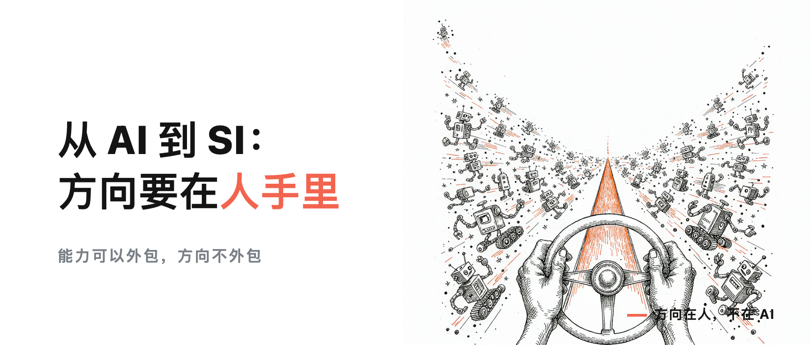
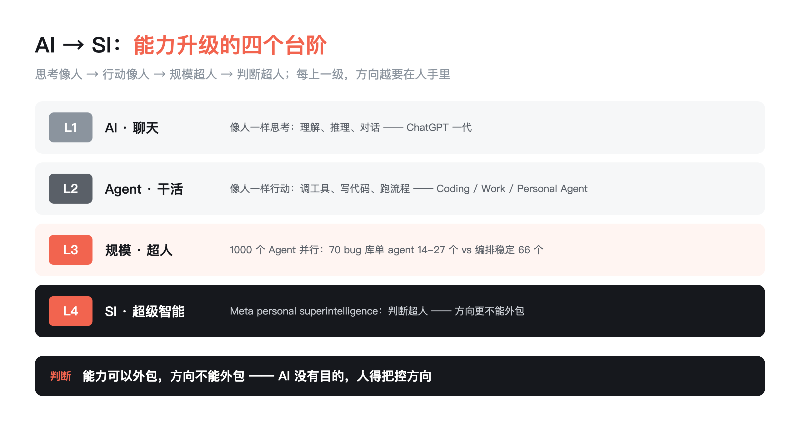

# 从 AI 到 SI：超级智能体越强，方向越要在人手里

> **行途技术导读**：2026 年，AI 这个词正在被撑破：产品开始用 SI（超级智能）做命名，行业把「超过单个人类能力」当成目标——Claude 一次编排 1000 个 agent 跑完 70 个 bug 库，记忆层让它们不再失忆。AI 越强，一个问题越尖锐：方向，谁来定？
>
> **这篇能给你什么**：① 看懂「AI 越来越能干」背后发生了什么——规模化、记忆、判断，哪件在替你做主；② 判断 AI 产品是否真在往「超级智能」走，有三信号（产品命名 / 能力证据 / 学界共识）可直接套；③ 一个边界判断——能力可以外包，方向不能外包，别把方向盘交给 AI。

## 先说结论

AI 的定义正在升级：从「像人一样思考行动」的技术，走向「超过单个人类能力的超级智能体（SI）」。这周两件事做实了这个判断：Claude 一次编排 1000 个 agent，记忆层工具集体爆发。但越强的工具越需要明确的方向——方向，谁来定？这篇给你答案。

目录：

1. AI 是什么：一句话说清

2. 从 AI 到 SI：词被撑破了

3. 1000 个 Agent 跑完 70 个 bug：规模化已经开始

4. 记忆层爆发：AI 开始「记得住」

5. 我的判断：方向是唯一不可外包的东西

6. 一句话记住

7. 工具与信源

## 1. AI 是什么：一句话说清

先回到最朴素的定义，因为后面所有判断都从这出发。

AI = 让机器拥有像人一样思考和行动的能力。

两个关键词：思考（理解、推理、判断）和行动（调用工具、执行、交付）。过去五年，我们见到的产品都在这两个词里打转——会聊天的、会写代码的、会跑流程的。

但 2026 年的变化是：有人开始把「像人一样」改成「超过人」。这不是营销话术，是产品形态真的变了。

## 2. 从 AI 到 SI：词被撑破了

AI（Artificial Intelligence）这个词，正在装不下现在的产品。

最明显的信号：Meta 把自己的新产品直接叫 personal superintelligence——个人超级智能。不是「人工智能」，是「超级智能」。一个字母的差距，是「辅助你思考」和「替你思考」的差距。

SI（Superintelligence）这个词，今年被重新定义过好几轮。年初它还只是学术圈里的概念——指「在几乎所有领域都超过人类智能水平的智能体」；年中开始被产品拿来做命名。从 AI 到 SI，术语的迁移本身就是信号：行业开始把「超过单个人类能力」当成产品目标，而不是科幻设定。

怎么理解 SI？拆成三个信号、一个判断：

**信号一：产品命名在变。** Meta 直接叫 personal superintelligence——把「个人超级智能」做成产品定位，这在五年前是不可想象的。

**信号二：能力证据在落地。** 这周的 1000-agent 编排、记忆层工具爆发，都是 SI 能力拼图的碎片——能干、记得住，正在变成可测量的工程指标。

**信号三：学界共识在收敛。** 「超级智能」不再是被嘲笑的强 AI 口号，而是一个有定义、有路线、有工程边界的研究方向：先定义能力维度，再谈对齐与治理。

**一个判断**：SI 不是「更聪明的聊天机器人」，是能力的三级跳——规模化（能干）、记忆（记得住）、判断（想得深）。2026 年，前两级已经落地，第三级正在路上。而第三级，恰恰是最需要人把关的一级。

## 3. 1000 个 Agent 跑完 70 个 bug：规模化已经开始

先说清楚：这不是 SI，这是 SI 的地基。1000 个 agent 是「能干」的规模化，SI 指向「判断」的跃升——它是 SI 能力拼图的第一块，但远不是全部。

这周最硬的官方数据，来自 Anthropic 的 1000-agent 编排：

在 70 个 bug、11.6 万行代码的测试库上：

- 单个 agent 三次跑：找到 14、15、27 个 bug
- 动态编排（1000 agent 分工）：三次全找到 66 个

单 agent 找到 14-27 个，动态编排稳定 66 个——同样的任务，规模化之后产出高几倍。

但注意官方的小字：动态编排的代价是「token 消耗更高、运行时间更长」。而且它给的结论是「结果不适用于每个代码库」。

这意味着什么？规模化是工具的事，选不选规模化、在哪个代码库上规模化、花多少钱规模化——是人拍板的。

## 4. 记忆层爆发：AI 开始「记得住」

规模化解决了「能干活」，记忆层解决「记得住」。

这周 GitHub 上三个记忆层项目集中爆发：claude-mem（压缩 Claude Code 会话、跨工具注入）、ai-memory（Rust 写长期记忆、跨厂商）、freellmapi（34 个免费 provider 路由、不锁死一家）。还有一个叫 Rocky 的 CLI，记住你失败的每条命令和修复方案，零依赖零遥测。

记忆层的意义：AI 从「每次见面都是陌生人」变成「越用越懂你」。这周我写[《AI 开始记得住了》](https://mp.weixin.qq.com/s/zFpOCOyU-e0SaE3WBUjdHw)专门讲这个。

但记忆只是地基。AI 记得住你，不等于它知道你该往哪走。

## 5. 我的判断：方向是唯一不可外包的东西

把上一节的判断放到人的位置上：规模化、记忆、判断——前两样是 SI 的「能力」，第三样才是「主体性」。能力可以外包，主体性不能——因为一旦它开始「自己觉得应该往哪走」，你就得对它负责。

每一样都在把 AI 推向「更像一个独立主体」。这时候最危险的问题不是「AI 会不会失控」，而是——人把方向外包给了 AI，还觉得自己省了事。

我在[《说不清需求，AI 就替你乱跑》](https://mp.weixin.qq.com/s?__biz=MzU0MjgyNDM2MQ==&mid=2247485755&idx=1&sn=17fd10b22fb800cecb08704ddd51144d&scene=21#wechat_redirect)里讲过：你说不清需求，它就乱跑。现在 AI 强到能自己理解需求了，危险反而更大——它会自己替你定方向，然后做得又快又顺，等你发现方向错了，已经跑出去很远。

行业侧也在往同一个方向收。

36氪 9 月的报告给了 Agent 治理的四段式：部署前评估能力、交互时管权限、运行中动态监控、事后做责任溯源（P37）。说白了，行业正在制度化的，就是「Agent 是谁、代表谁行动、被授予什么权限、出了事谁负责」。

一线案例更直接。24 个 FDE 案例里：消防设计因为责任问题，专业人员拒绝黑箱结果、坚持保留参数调整入口——AI 负责生成，人负责决策（P211-212）；一家跨境快消的规矩更硬，答案溯不回原始数据那一行，就不让模型答（P238）。**Agent 越强，一线越把「人在哪里拍板」当生死线。**

所以我的判断就一句话：

**能力可以外包，方向不能外包。** 你可以让 AI 干活、让它记住、让它决策辅助，但「往哪走」这件事，永远是人拍板。AI 没有目的，人得把控方向——这句话，从 AI 时代到 SI 时代，不会变。

## 6. 一句话记住

AI 越来越强：规模化让它能干，记忆层让它记得住，判断力让它像主体——但方向，是唯一不可外包的东西。

**这周做一件事**：找一件你正在让 AI 干的「重要但不紧急」的活，写下来两行——这件事的方向由谁定、你判断的依据是什么。如果答案含糊，方向盘已经开始滑手了。方向外包是慢变量，等发现跑偏，往往已经跑出去很远。

## 7. 工具与信源

**Claude 1000-agent 编排（Anthropic）** ｜ 70 bug / 11.6 万行代码：单 agent 14-27 个 vs 动态编排稳定 66 个；代价「token 更高、时间更长」「不适用于每个代码库」。来源：Prompt Engineering News 2026-10-09 周报。链接：https://news.promptengineering.org/2026/10/09/index.html

**Meta personal superintelligence** ｜ Meta 将新产品定位为个人超级智能（SI 方向）。链接：https://about.fb.com/news/

**SI 概念（学术口径）** ｜ 超级智能 = 在几乎所有领域都超过人类智能水平的智能体（通用学术定义）；2026 年从学术概念走向产品命名。检索关键词：superintelligence / 超级智能定义。

**记忆层三项目** ｜ claude-mem（thedotmack）/ ai-memory（akitaonrails）/ freellmapi（tashfeenahmed），周星标增量数据来自 2026-10-10 舆情日报监测。链接：https://github.com/thedotmack/claude-mem

**Rocky CLI** ｜ 本地确定性记忆层，失败记忆+修复链接。链接：https://github.com/poggufanz/rocky

**数据口径** ｜ 1000-agent 编排数据来自 Anthropic 官方 benchmark 转述（Prompt Engineering News）；星标增量来自舆情日报 10-10 监测，非实时 API；「AI 没有目的，人得把控方向」为作者核心观点（见[《说不清需求，AI 就替你乱跑》](https://mp.weixin.qq.com/s?__biz=MzU0MjgyNDM2MQ==&mid=2247485755&idx=1&sn=17fd10b22fb800cecb08704ddd51144d&scene=21#wechat_redirect)同源表述）。SI 由来涉及外部叙事，本文刻意不展开，只保留中性技术口径。
