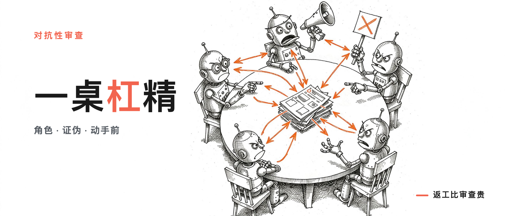

写方案前，先让 10 个 AI 角色互怼

> **行途导读**：写方案前先组一桌「专业杠精」——10 个 AI 角色轮流挑刺，4 个设计缺陷在动手前被抓出，返工时间按周算省下。挑得动的就改、挑不动的才算成立；钱花在动手前的审查上，比花在返工上便宜。
>
> **这篇能给你什么**：① 一套动手前可复用的对抗审查流程（组角色→反方证伪→交叉验证→裁决）；② 4 个真实设计缺陷案例，看懂「返工比审查贵」这笔账怎么算；③ 一个边界判断——AI 当杠精，拍板的是人。

目录：

1. 开工前夜，我组了一桌杠精

2. 为什么先挨怼：返工比审查贵

3. 这桌杠精怎么怼

4. 实测抓到了什么

5. 你的方案也能这么怼

6. 工具与信源

## 1. 开工前夜，我组了一桌杠精

项目动工前，我把 40 多页的设计方案摊在桌上，越看越不踏实。

方案是我自己写的，我当然觉得它完美——但「自己觉得完美」这件事本身，就是要命的地方。

于是我没急着写代码，先干了件看起来有点浪费的事：组了一桌杠精。10 个 AI 角色，每人一个立场，每个立场都跟我对着干。

有人负责盘点我的技术债，有人负责算我的 token 账，有人专门扮演「用过无数工具、脾气很差的内行用户」，还有一个人被派来怀疑我的第一性原理。

规则只有一条：我说了算的，他们都能质疑；他们说的，得能扛住别人的反驳。

那晚之后我确认了一件事：写方案的人头号盲区，不是想得不够多，是没人反对他。

## 2. 为什么先挨怼：返工比审查贵

你可能觉得，开写之前先让一堆 AI 挑毛病，是小题大做。我以前也这么想，直到算了笔账。

改一行设计文档，成本是一杯咖啡的时间。改一个已经写好的模块，成本是一下午。改一个已经上线的东西，成本是一个团队的一周。

同一个错误，越晚发现越贵，而且是翻着倍涨的。

对抗式审查花的时间，是设计阶段的几小时。这几小时换来的是：动手之前，方案里能改的缺陷都被改掉。返工的成本不是省下来，是压根没发生。

我管这叫「把争执提前」。与其写完了跟同事吵，不如开工前跟 AI 吵——前者伤感情，后者只伤 token。

## 3. 这桌杠精怎么怼

光有角色不够，关键是每一条意见都得过三道关。

头一道关，立场要对立。10 个角色各自独立上下文，只读不改。

能力盘点员管「你凭什么说这个能力你有」，编排工程师管「多 agent 跑起来会不会打架」，token 审计员管「这个设计一个月要烧多少钱」，试用者管「新手拿到手会不会直接劝退」。

每个人从自己刁钻的角度挑毛病。

这套角色分工不是拍脑袋定的，是本地一套对抗性审查 skill 的实测结构——四个核心角色各有专职：怀疑论者只找漏洞，优化者只提改进，审计员只验数据，过滤器只做减法拦误报。

第二道关，反方证伪。任何一条意见，都要交给一个「反方审者」：目标很明确，就是推翻这条意见，除非它能拿出确凿证据。

为什么？因为一个角色发现的问题，不等于真问题。可能是它的立场偏见，可能是它没看全上下文。

能扛住反方证伪的意见，才配写进修改清单。

第三道关，交叉验证。反方之外，再来一个「异立场审者」复核一遍——批判，但公平。防止发现者自己的立场把结论带偏。

随后，一位独立的架构专家做融合裁决，把意见收口成「要改的」和「不成立的」两堆。

三道关走完，剩下来的东西，才敢写进下一版方案。

补一句行业背景：这里说的「10 个角色」不是「10 个 Agent」。36氪 9 月的报告指出，多 Agent 并非天然优于单 Agent——任务边界清晰时单 Agent 就够；Agent 一多，分工、通信、上下文共享、结果一致性全是新的工程债。行业数据也印证：53% 的企业部署了 AI Agent，可只有 18% 做到了跨工作流编排（KPMG 2026Q2 口径）。我的做法是单模型多角色、各角色只读不改，成本可控——**该并行才并行，不是上来就堆 Agent。**（36氪 2026.09 报告口径 P23）

## 4. 实测抓到了什么

这套流程跑下来不是走过场——第一轮就真抓到了东西。我的方案被揪出四个实打实的缺陷。

其一，命令行为契约缺失。我的工具设计里，命令「做什么」写得很清楚，「不做什么」没写。

试用者角色一针见血：边界不写死，用户就会拿它干它不该干的事，然后怪工具。

第二个，体积预算口径未定义。方案里写了「轻量」，但轻量是多少？没有数字。

token 审计员追问：你说轻量，凭什么？用户拿什么标准验收？

第三个，决策表自相矛盾。两处设计规则放在一起读，是打架的——我自己写的时候完全没发现，因为它们是分两天写的。

第四个，渐进披露无量化学。新用户第一步应该看到什么、第 N 步看到什么，方案里只有一句「要简单」，没有递进结构。

这四个问题，任何一个落到代码阶段，都是一次重构；落到上线之后，就是事故。它们全部在动手前被抓出来，改掉的成本，是一晚上。

这套对抗审查跑在哪？主角是一个开源项目 harness-kit——角色化规约的初始化与治理工具，init/patch/doctor 三命令，Apache-2.0 发布。

对抗审查是它立项时的必经关。

配套的还有省 token 检索层（CodeGraph 图查询，把 20 次 grep 换成一页图）和聚合母仓 xingtu-harness。

技术栈是什么不重要，重要的是这套流程里每个工具，动手前都先过了一桌杠精。

## 5. 你的方案也能这么怼

你可能会说：我又不开源项目，这套东西跟我有什么关系？

关系很大。你写的不一定是方案——工作计划、买房决策、给孩子选学校、年底总结，都算。

任何你打算投入时间、精力、钱的事情，都值得先组一桌杠精。

做法很简单：先把你自己的立场写清楚，然后给 AI 派几个「反对你的角色」，让它扮演一个懂行但跟你观点相反的人，把你的每一条理由都反驳一遍。

它反驳得对，你就改；反驳得不对，你得能说出为什么不对——这个过程本身，就是在替你的决定做压力测试。

真正的收获不是那些意见，是你得被迫回答「为什么」。AI 当杠精，拍板的还是人——责任在你自己手里。

我的判断是：未来真正值钱的工程能力，不是写得多快，是动手前能多想几轮。看起来慢、其实快的人，赢在这一轮。

## 这周做一件事

挑一个你下周要写方案的活儿，动手前先给它组一桌杠精：派 3 个 AI 角色反对你（预算审计员、挑剔的内行用户、最坏情况推演员），每条反对意见你都得回答「为什么不对」。答不上来的，就是动手前要补的洞。

## 6. 工具与信源

**harness-kit** ｜ 本文主角，角色化规约的初始化与治理工具，init/patch/doctor 三命令，Apache-2.0 开源

https://github.com/xingtu1996/harness-kit

**xingtu-harness** ｜ 对抗性审查流水线所在地，含四角色 skill 与 Round 2 脚本交叉验证

https://github.com/xingtu1996/xingtu-harness

**对抗性审查方法论模板** ｜ 角色定义与流程的可抄参考（方法论参考，与实际工作仍有差距，正在建设中）

https://github.com/xingtu1996/xingtu-ai-engineering/methodology/adversarial-review-template.md

**数据口径** ｜ 本组「10 个角色、4 个缺陷、拦截 30-50% 误报」量级来自本地 Claude 会话对抗审查实录（pot 峰值 95），官方「多 agent 3-10x token 开销、单 agent 改进提示词可达同等效果」来自 Anthropic 官方《When to use multi-agent systems (and when not to)》。
