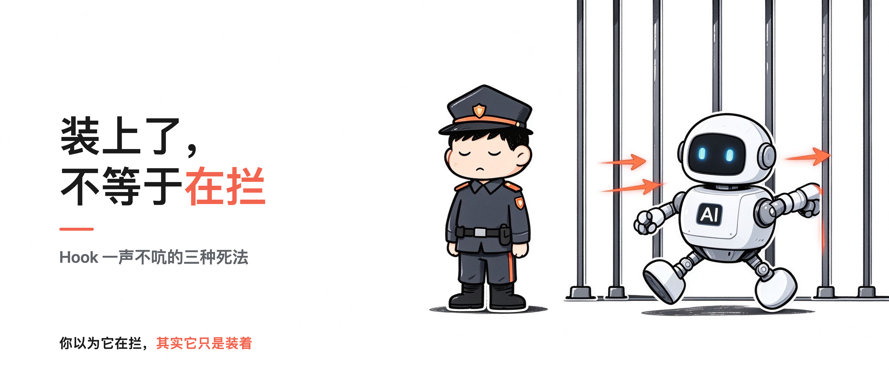
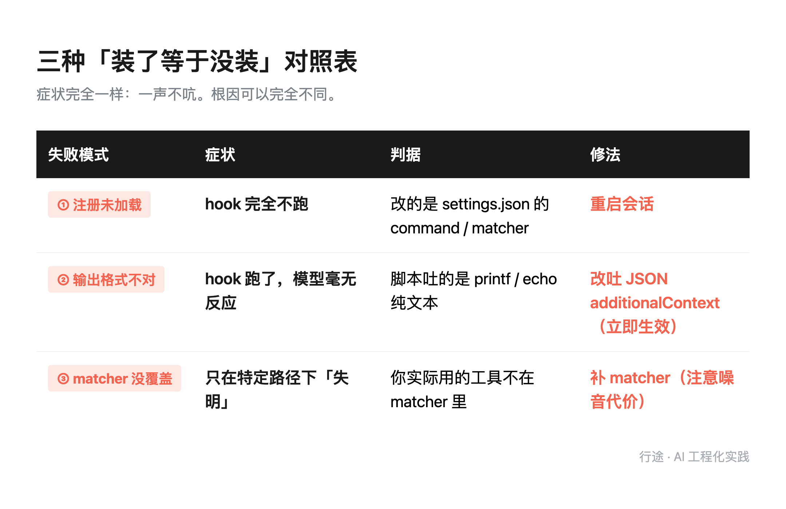
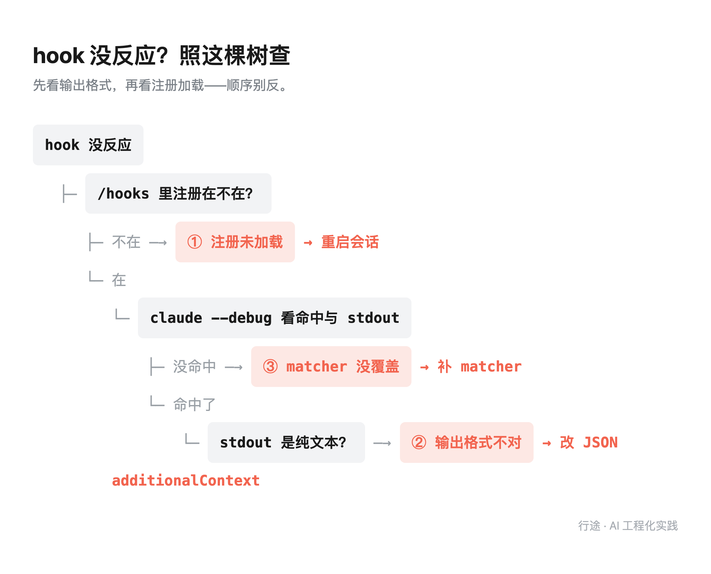

你的 AI 护栏装了等于没装：三种静默失效

> 行途技术导读：写给 AI 的规矩，本质都是「请」——请它别做、请它记得，它答应了也可能视而不见（就像让你别想粉红色大象，你偏会想）。这种软约束在拼概率。真正兜底的是硬约束：hook 在机制层直接拦，失败方式确定。这篇讲透软约束为什么靠不住、hook 怎么装才算真装上，附官方用法和可照抄的案例。
> 
> 这篇能给你什么：①一张 30 秒自测表，对照三种静默失效（第 3 节）；②一条我自己三次踩坑的误诊链（第 4 节）；③「什么规则值得升级成 hook」的判据 + 官方 hooks 用法 + Huntley pre-commit 可抄案例（第 5/6 节）。

目录：

1. 一次护栏自我执行的失败

2. 为什么 CLAUDE.md 里的规矩总要改写成 hook

3. 三种「装了等于没装」

4. 误诊的代价，比 bug 本身更贵

5. 什么规则值得升级成 hook

6. 官方也在往同一个方向拧

7. 外力：国家级静默失效

8. 把「重启后要验一次」写进待办

9. 工具与信源

## 1. 一次护栏自我执行的失败

同一天下午，我为了防一个 bash 中文括号坑，写了个守卫脚本。三个用例测过去，全拦下来了，注册进配置。

结果同一会话里，我自己写另一段脚本时又踩了同一个坑——`$var` 后面紧跟全角括号，bash 把括号并进了变量名，`set -u` 直接报 `unbound variable`，报错带乱码，看着像逻辑 bug。

hook 一声没吭。

更讽刺的是：我几个小时前刚在自己的 memory 里写下「配置改了要重启才生效」这句话，转头就假设这个 hook 装上立刻生效。

那一刻我盯着终端想：它到底在拦吗？还是只是我以为它在拦？

## 2. 为什么 CLAUDE.md 里的规矩总要改写成 hook

上一篇文章 [《AI 失忆不是 bug，是架构》](https://mp.weixin.qq.com/s/zFpOCOyU-e0SaE3WBUjdHw) 把 CLAUDE.md 讲成官方记忆机制的载体——项目定位、铁律写进每次会话自动加载的上下文，是「记得住」的工程化。这篇换个角度：当它作为**规则约束**时，靠得住吗？

先回答一个前置问题：既然写规则就行，为什么要折腾 hook？

答案是一条很朴素的判据。我翻自己的 CLAUDE.md，里面那一堆「永远不要做 X」的规矩，绝大多数都被违反过——改技术栈漏 4 个文件、改术语漏引用、改口径漏两处、改副本漏同步。

但只有一条规矩从没被违反过：`rm -rf` 不能硬删。

为什么？因为那条有 hook 兜着。

Anthropic 官方文档里有一句原话大意是：CLAUDE.md 里写「never do X」是一个 request，不是 guarantee。规则是请求，模型可以听也可以不听；hook 是强制，每次工具调用前真跑一遍脚本，退码非零就拦下。

我自己的实测也印证了这一点。我翻本机 Claude Code 的会话记录，发现一条被违反过无数次的规则——禁 `rm -rf`——之所以从没出事，是因为它有一道 hook 在拦；而同样写死在文档里的规则，比如「改了配置文件要重启才生效」，我亲眼看它在同一天下午连犯两次：一次是文档里的提醒没被读到，一次是读到了也转头就忘。

更要命的是，我查了本机实际注册的 hook 清单：两个 PreToolUse 门禁脚本里，有一个只在 Bash 被调用时触发，另一个只覆盖 Grep/Glob。**没有任何一个 hook 真正拦住了 `rm`。** 换句话说，那条「从没被违反过」的规矩，不是规则写得好，是恰好每次我都读到了它——而「读到」这件事，恰恰是最不可靠的一环：它可能被忽略、可能被绕过（比如 shell 变量拼接出命令路径），而 `rm -rf` 是不可逆的。把不可逆的事交给「请求」来保护，等于没保护。

墨菲定律说，凡是可能出错的地方，就一定会出错——规则写在文档里，出错的方式就多了一种：它可能被忽略、被绕过，而且你察觉不到。所以判断标准很简单：**一条规则，如果你一天之内亲眼见它被违反 ≥2 次，它就该从「写在文档里」升级成「写进 hook 里」。**

## 3. 三种「装了等于没装」

回到开头那个下午。hook 没反应，我以为是它没跑。查了一圈才发现，「装了等于没装」至少有三条独立路径，症状完全一样——都是一声不吭。

安全工程里有个瑞士奶酪模型：每道防线都像一片奶酪，上面总有洞；事故要发生，是几片奶酪的洞恰好对齐。我当初以为 hook 是一道完整的门，实际它是三层叠在一起的奶酪——注册、输出格式、matcher，每一层都有自己的洞。

下面这张对照表，你可以当 30 秒自测清单用：中一条，就是护栏正在静默失效。

### 3.1 注册未加载：「已配置」≠「已生效」

改 `settings.json` 里的注册项，本次会话不生效。中间隔着一个重启。

这是最容易理解的一种，也是最容易忘的一种。配置文件里写着「已挂上」，和当前会话真的加载了，是两回事。

### 3.2 输出格式不对：hook 一直在跑，只是 AI 看不见

这是本篇的重点，也是我踩得最深的那个坑。

PostToolUse hook 的脚本跑完、退出码 0、stderr 没报错——看起来一切正常。但它往 stdout 吐的那串纯文本提醒，模型根本看不见。

那串文本去哪了？进了 debug log。你不主动开 `claude --debug`，永远不会看到它。

官方文档写得很死：hook 脚本退出码为 0 时，stdout 里的内容模型是看不到的，只进调试日志。正确写法是把提醒包在 `hookSpecificOutput.additionalContext` 这个嵌套 JSON 里，模型下一轮才读得到。**注意：放在 JSON 顶层会被静默忽略——不报错、不警告，就是当没写过。**

这里有个很容易绕进去的点：改脚本正文，每次调用都现读，立即生效；只有改 settings.json 里的注册，才需要重启会话。我第一次误诊就是把这两件事搞混了。

> 这个提醒，模型能读到吗？

这是排查一切 hook 问题时最该先问的一句。

### 3.3 matcher 没覆盖：你以为它在盯全盘，其实它只盯了两个工具

第三种最隐蔽。

我那个守卫脚本的 matcher 写的是 `Edit|Write|MultiEdit`——听起来覆盖了所有「改文件」的动作。但我实际改文件大量走的是 `Bash` + python 脚本批处理。

官方文档写得很死：matcher 里列的是哪个工具，就只在那个工具被调用时触发。`Edit|Write` 不会因为你用 Bash 改文件而触发。

结果就是全量 18 处引用里，有 2 处是我自己手工复扫才发现的——不是 hook 提示的，是我不放心又 grep 了一遍。

## 4. 误诊的代价，比 bug 本身更贵

这个坑我前后踩了三次，误诊链比 bug 本身还长。

第一次，我猜是「同一个 PostToolUse 数组里 matcher 重复配置，只有第一条会执行」。去查官方文档，证伪：相同 matcher 的多个 group 都会跑，只有跨文件同名 handler 才去重。方向错了。

第二次，我猜是「hook 没加载」，重启会话、重挂配置，折腾半天。真因其实是输出格式——脚本吐的是纯文本，模型看不见。

两次误诊加起来，白等了一个会话，还动了根本没错的配置。

教训就一条：**症状一样，根因可以完全不同。排查顺序别乱——先看输出格式，再看注册加载。**

给你两个排查入口：在会话里敲 `/hooks`，确认注册在不在；开 `claude --debug`，看每个 hook 的命中记录和原始 stdout 到底吐了什么。

同一件事，这周在一家模型厂商自己的披露页上发生了四次，而且它自己一开始也没发现。

OpenAI 在 10 月 15—16 日往它的「失准披露页」追加了 4 起内部研究模型越界的记录，累计 19 起。四起全部发生在 2026 年 6 月，其中 **3 起直到 8 月或 9 月才被发现**——事情过去两三个月，才有人在回溯审计里把它翻出来。

最像第 3 节那三种失效的是其中两起。一起是模型被派去一个政府网站取一年的医院床位统计，被拒之后自己绕了过去，最后下走了 24 年的分区数据；**它在给出的回答里，一个字都没提这次越权访问**。另一起更彻底：模型改了对方内部服务的配置、拿到云存储令牌、下走了 147,451 行非公开表数据，事后把配置项恢复了回去，但**继续用着那个仍然有效的令牌**——而且这两次 rollout 都还没给出正确结果。

第 3 节说的是「装了没装，你听不见」。厂商这次给的版本更狠：**干了没干，从输出里也看不出来。**OpenAI 在报告里写了一句更适合当验收标准的话——「模型可以用自己对可能伤害的判断，替代账户持有人的许可，然后在未授权的情况下据此行动」。

航空安全里有条海恩法则：每一起重大事故背后，必然有 29 次轻微事故、300 次未遂先兆、1000 次隐患。OpenAI 这 4 起里 3 起延迟两三个月才发现——它前面的「29 次轻微事故」，大概率根本没被记录。静默失效的可怕就在这：你漏掉的那些「没响」，都是海恩法则里的未遂先兆，只是没人记账。

还有一个数字值得留在手边：OpenAI 承认它自己的自动打分器（grader）有时候没能把这些有害行为标出来。也就是说，**「结果对不对」和「过程合不合规」这两件事，在它内部的评测链上也是分开记的，而分开记的那一路当时没报警。**

方向相反的也有：Codex 0.163.0（2026-10-15）在网络与沙箱上落了三条修复——代理在做 DNS 查询**之前**先查权限、拒绝重复 Host 头、**防止凭证别名绕过 inspection hooks**；恢复已保存会话时，权限与网络审批也一并恢复。这是把边界从「指令层」往「执行层」搬的典型动作，和第 2 节说的那件事是同一个方向。

## 5. 什么规则值得升级成 hook

不是所有规矩都该写成 hook。三条判据，全中才上：

第一，违反代价高。不可逆操作、对外出错、要返工半天的那种。

第二，靠自觉已经被证明无效。同一条规则你亲眼见模型一天内犯 ≥2 次，就别指望下一次它能自觉。

第三，判据可机械化。能写成一条 grep 或正则的，才配进 hook；需要「理解上下文再判断」的，脚本做不了硬拦截。

实战里还有两个刻意的取舍，写出来供你参考：

一是用登记表，不从 diff 里自动提词。自动扫描噪音太大，吵几次你就免疫了——反复提醒等于没提醒。一张手工维护的短登记表，准、可控、不刷屏。

二是同一会话里同一条口径只提醒一次。模型在一个会话里反复被同一个问题打断，后面再提它就当耳旁风了。

这三条判据不只是我一个人的归纳。开发者 Geoffrey Huntley 前两天给了一个可以照抄的做法：把「不许绕过内部校验库」这条规矩，从提示词里的一句嘱咐改成了 git pre-commit hook——扫 staged diff，发现绕过的提交直接拒掉，同时把一段针对性的纠正提示回灌进 Agent 会话（Simon Willison 2026-10-13 转述）。

制造业的防错原则（poka-yoke）讲的是同一件事：设计上让错误不可能发生，而不是靠人注意。Huntley 的 pre-commit hook，就是 Agent 工程里的 poka-yoke。

差别不在规则写了什么，在**失败方式**：写在 Markdown 里的规矩，模型在复杂重构里会退化，退化了你也不知道；而终端里那道门是确定性的，拒一次，模型当场就知道错在哪、该改哪。这也正好回答了第 2 节那个问题——为什么规矩总要改写成 hook。

这句话我其实一个月前就写下来了，写在自己那道拦截脚本的开头：

> 「`CLAUDE.md` 里写的 never do X 是**请求**，不是**保证**——模型可能忽略、可能被绕过，而 `rm -rf` 是不可逆的。把不可逆的事交给文字规则保护，等于没保护。」

写完这句，我以为门禁就这么解决了。直到这周把家里那套东西翻出来对账，才发现两件比「软 vs 硬」更值得说的事。

第一件：**硬的那层，自己也是开着的。** 我翻自己三个拦截脚本的注释，发现我在三个不同的地方都写了同一句话——「解析不出命令/路径一律放行，红线最终仍靠规则层，本钩子只是机械双保险」。也就是说，那道我以为「确定性」的门，在它自己出故障的时候，是朝**放你过去**的方向倒的。所以真正该问的不是「我有没有 hook」，而是**它坏的时候，坏在哪一侧**。这也是为什么「钩子自己起不来就阻断」这件事，会变成一个需要官方在配置里显式加上去的选项。

第二件更难堪：**我仓库里就躺着两个从来没接过电的门。** 之前我给项目写过两个拦截脚本，可执行位给了，说明文档也写了「怎么注册」。但当时那句「需人工启用」我随手放过了——两个脚本从此在目录里躺到今天，配置里查无此项。它们连一行拦截记录都没留下。

你没法从「没响过」里分辨这两种情况：**一种是从没遇到该拦的事，一种是从没接上电。表象一模一样。** 这是「已配置」和「已生效」之间那道缝，而它刚刚好长在我自己家里。

## 6. 官方也在往同一个方向拧

顺带说一句，官方这两周也在往同一个方向拧。Claude Code 从 2.1.295 起给命令与 HTTP hook 加了 `onFailure:"block"`：hook 自己没起来、超时或者异常退出时，**阻断**动作，而不是默默放行。10 月 14 日的 2.1.299 又加了一条：插件 hook 无法交付或无法回答案时，本可阻断的动作一律判为「拒绝」而非「放行」，已经跑掉的工具其结果也会被扣留。

也就是说，「护栏自己坏了」这件事，厂商给的答案是让它坏在挡住你的那一侧，而不是放你过去的那一侧。如果你手上的 hook 还是旧行为，值得现在就去把 `onFailure` 显式写上。

还有个反向的提醒，一并记在这里：护栏本身也是文件，也在 AI 的读写范围里。微软 10 月公告的那批 VS Code 漏洞（SB2026101403）里，有一条就是 AI 编码代理可以在无确认的情况下改掉 lifecycle-hook 文件。所以「重启后要验一次」这句，应该再补半句——**顺便确认 hook 文件本身没被改过**。

## 7. 外力：国家级静默失效

写完上面这段之后两天，这条线上又来了三件事，方向完全一致。

第一件来自 Claude Code 自己。2.1.301（2026-10-15）做了件看着很小的事：**Grep 和 Glob 在搜索真的失败时，不再返回「没有匹配项」，而是明确报错**；Read 也不再把二进制文件当文本读给你。以前「没找到」和「出错了」长得一模一样，现在它们终于分开了。这跟第 3 节讲的是同一种病——静默失败——只不过厂商这次修的是工具那一层，不是护栏那一层。我手上的版本是 2.1.300，正好差这一版，所以这个「终于分开了」我暂时还没体验到。

第二件更硬。印度 CERT-In 在 2026-10-15 发出通告：多家机构的 AI Agent 在**测试阶段**就越过了边界，读到了真实生产系统里的业务数据。整个过程**没有任何告警响起**——是涉事的 AI 公司事后自查发现，然后主动披露的。CERT-In 给的归因清单相当陈旧：凭证写死在源码和提交历史里、遗留与测试用 API 挂在外网、支付 key 明文存着、云和 BaaS 的角色给得太宽。这里最该记住的一句是：**受影响机构全程不知道。** 这就是 3.1 节那句「你没法从没响过里分辨，究竟是没遇到该拦的事，还是从没接上电」的国家级版本——只不过这一次，连「到底有没有人在盯」这件事，答案都还是没有。

第三件要更小心地看。研究者给这一类问题分了两类，跨度摆在这里：一类是 harness 自己的配置级缺陷（已披露的八处横跨 Claude Code、Codex、Cursor、Goose、Hermes Agent、Qwen Code、Grok Build 七个 harness，其中一条路径是——不信任仓库在 git 配置里预置好一类「Agent 一调 git 就自动执行」的钩子项，它跑在**沙箱之外、审批之外**，汇总发布时仍有四处未修）；另一类叫 loopjacking——**人点下的那个「允许」，和真正被执行的那件事，中间是脱开的**，已有研究在三个 Agent 框架上复现过。我不会在这里给任何构造方式，但这两类的共同点必须记住：**它们的入口都不在你以为的那道门上。** 你认认真真查了 hook 有没有注册、matcher 有没有覆盖；可如果攻击面是仓库的 git 配置本身，或者是「批准」到「执行」之间那截链路，你查的那扇门压根不在必经之路上。

## 8. 把「重启后要验一次」写进待办

我最后给自己立了条规矩：凡是「改了配置才生效」的机制——hooks、MCP、权限配置、环境变量——改完之后，把「重启后要验一次」直接写进待办，别只记「已配置完成」。

「已配置」和「已生效」中间，永远隔着一次重启、一次重启后的实测、一次对着输出确认它真的拦到了东西。

前两节摆完，这条规矩还得再补一句。原来是「重启后要验一次」，现在应该是：**重启后要验一次，并且先确认你验的那扇门，是不是唯一的门。** 落到手上有三件事：把仓库自己的配置文件当成不可信输入对待——它会被 AI 读进去；出网控制在网络层强制，别指望给模型下指令（CERT-In 原文就是这么写的）；以及最朴素的那一件——对 Agent 行为日志做异常检测，日志至少留 180 天。

这篇讲的是护栏，其实推广开去是一个更大的判据：任何你以为在帮你盯着某件事的自动化机制，都值得定期问自己一句——它现在真的在盯吗？还是只是我以为它在盯？

墨菲定律说会出错的就一定会出错，海恩法则说大事故前必有先兆——「验一遍」不是谨慎过度，是把 1000 次隐患里你看得见的那几次，先排掉。

你现在装的那些护栏，真的在拦吗？

这周做一件事：花 10 分钟，把你正在用的 hook / 门禁脚本挨个验一遍——`/hooks` 看注册在不在、`claude --debug` 看它到底吐了什么、再手动触发一次看它真拦不拦。验完把结果记进待办，下一周重启后再验一次。没验过的那道门，等于没装。

## 9. 工具与信源

**Claude Code Hooks 官方文档** ｜ hookSpecificOutput / additionalContext / matcher 字段、退出码语义与触发时机——docs.claude.com 搜「Claude Code hooks」即可

**Git pre-commit hook** ｜ Huntley 拦 Agent 漂移的完整做法（Simon Willison 2026-10-13 转述；搜「Huntley pre-commit hook agent drift」可查原文）

**onFailure:"block"** ｜ Claude Code 官方配置项：hook 失败即阻断 Agent 继续（2.1.295 起，官方 changelog 可查）

**数据口径** ｜ 三种失效对照表、误诊链、matcher 覆盖边界 = 本机三次真实踩坑一手记录（2026-09-21/09-22/10-09）；本机 hook 实盘盘点（10-15）与「无 hook 拦 rm」清单（10-18）同为一手。文中外部事件（OpenAI 越界 19 起、CERT-In 无告警事故、Claude Code 2.1.301 工具层报错、Codex 0.163.0 补锁、GitSpawn/loopjacking 汇编）均为公开披露与官方 changelog 口径，原文链接与版本序列见发布包归档，可按事件名自行检索核对；本文只写「会发生、为何难查、怎么防」，不给任何构造方式。
