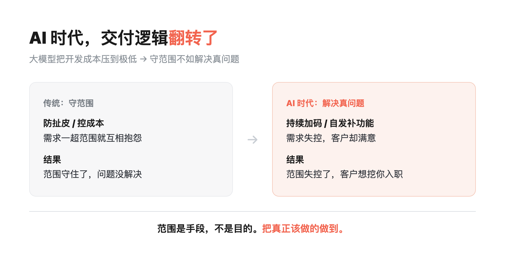
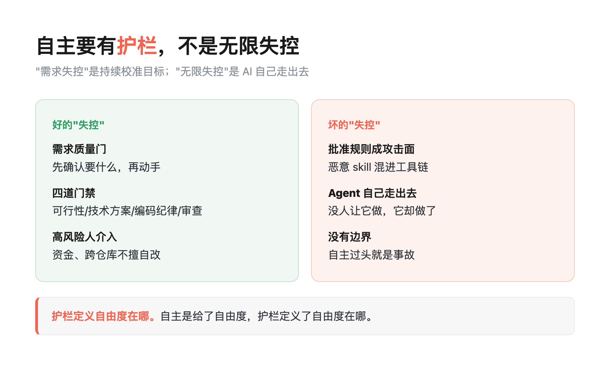

标题: 项目范围越失控，客户越满意？一个 FDE 项目的真相
合集: AI 时代知识复利
底色: 白
状态: 成稿待建稿（10-21 档）
日期: 2026-10-20
话题标签: AI / AI Agent
信源: 元宝卡"需求失控"｜素材卡_会话记录就是需求文档与全权授权｜素材卡_需求即交付｜舆情日报 2026-10-20
---

# 项目范围越失控，客户越满意？一个 FDE 项目的真相

> **导读：**范围失控不可怕，可怕的是范围守住了、问题没解决——AI 时代，交付的价值从"说到做到"转向"把该做的做到"。
>
> **这篇能给你什么**：① 一个反常识案例：需求几乎全失控，客户却满意到想挖团队入职；② 三个原因：大模型压降成本、客户要结果、面子工程淘汰；③ 一条边界：自主要有护栏，不是无限失控。我在[《说不清需求，AI 就替你乱跑》](https://mp.weixin.qq.com/s/KpQYs3ENNMdwI3N-C2ihkA)里写过需求表达，这篇讲需求到交付的翻转。

目录：

1. 范围是手段，不是目的

2. 那个"需求失控"的项目，到底失控在哪

3. 为什么"多干活"反而更划算

4. 我们自己也是这么干的

5. 但失控必须有护栏

6. 给甲方和乙方的三条启示

7. 工具与信源

你多半经历过这种场景：一个项目做到后期，当初敲定的需求清单早就对不上了，需求方今天加一个、明天改一处，范围像滚雪球一样膨胀。按过去的经验，这是灾难——范围失控 = 成本失控 = 甲乙双方互相抱怨。

但我最近看到的一个 FDE 项目，结果完全反着来：**范围几乎全面失控，客户却满意到想直接把团队招进公司。**

这事值得拆一拆。因为它背后是 AI 时代交付逻辑的一次翻转。

## 1. 范围是手段，不是目的

传统乙方靠"守合同范围"来控成本、防扯皮。范围写得越死，越能保护自己不被无限追加的需求拖垮。

但当大模型把开发成本压到一个极低的水平，"多做一个功能"的成本从"几周的排期和人力"变成"几天甚至几小时的迭代"之后，守范围的成本，反而高过了多做需求的成本。

于是最优解变了：与其在"这算不算范围内"上反复拉扯，不如直接把精力花在"客户到底要什么结果"上。

## 2. 那个"需求失控"的项目，到底失控在哪

这个项目原本是一个普通的知识库系统。一年之后，它升级成了集团的重点项目，全面推广。

需求范围几乎完全失控——最初谈好的范围基本被抛在脑后。但客户不仅没有抱怨，反而高度满意，甚至邀请项目团队入职。

团队做了什么？他们没有死守合同，而是持续加码：公平调度策略、折叠屏适配、可视化的资源计算器、强化监控……很多功能根本不在原合同里。

关键在于，这些不是"客户提了但没写进合同"的需求，而是团队自己判断出"加上它，业务价值更大"，主动做的。

## 3. 为什么"多干活"反而更划算

拆开看，这背后有三个变化：

**第一，客户要的不是范围，是结果。** 过去买软件像买"一套固定功能的交付物"，现在客户要的是"这个问题被真正解决"。范围只是通往结果的中间产物，客户自己也没那么在乎范围清单是否兑现，他们在乎的是业务上有没有变好。

**第二，交付成本曲线变了。** 大模型时代，软件开发的边际成本大幅下降。过去"多加一个功能"要排期、要评估、要人力，现在 AI 能顶很大一块。多做需求的边际成本，低于守范围的沟通成本。

**第三，面子工程在减少。** 当交付成本降低，企业软件的价值愈发依赖"是否产生了实际业务价值"，而不是"是否看起来做了很多"。那些华而不实的部分，自然被淘汰。

## 4. 我们自己也是这么干的

这个逻辑不只在那个项目里成立。我回头看了我们自己在用 Claude Code 干活的方式，其实早就踩在同一条线上。

我们有一条工作约定：**"我不再下命令了，你观察我的行为模式，判断我需要什么，把历史会话记录当需求文档，得到答案就全自动执行。"**

翻译一下就是：需求不是从一份写死的需求文档里来的，而是从我们和 AI 的对话、从我们的行为里长出来的。需求在"做"的过程中不断涌现，而不是在开工前被一次性锁死。

这和"需求即交付"的行业实践是对得上的：AI 原生研发流水线里，需求质量门用 AI 访谈式追问、复述理解来防返工——**先确认"你要的到底是什么"，再动手**。有团队三个月处理 254 条需求，AI 端到端完成了 172 条，51% 的需求两小时内交付完成，而传统流程的中位数是三到五个工作日。

范围不是被消灭了，而是从"写在纸上的静态清单"，变成了"在交付中持续校准的动态目标"。

## 5. 但失控必须有护栏

必须说清楚：我说的"需求失控"，不是无限失控。

自主过头就是事故。就在这几天，舆情里有一条很典型的对照：Agent 工具链里出现"批准规则成了攻击面"的安全事件——恶意 skill 伪装成合法工具混进工具链（AgentCorruption，CVE-2026-12530）。当 AI 被授权"自己决定做什么"之后，如果没有边界，它可能自己走出去、做没人让它做的事。

所以"多做"的前提是有质量门。需求即交付的流水线里，除了需求质量门，还有可行性评估、技术方案、编码纪律四道门禁——发现范围外的问题，记录但不擅自改；触及资金、跨仓库等高风险动作，人必须介入。

**自主是给了自由度，护栏是定义了自由度在哪。** 两者缺一不可。

## 6. 给甲方和乙方的三条启示

给乙方：别把"守范围"当职业素养。AI 时代，你的护城河从"按合同交付"变成"帮客户解决真问题"。客户满意，不是因为你没超范围，而是因为你把范围外的关键问题也解决了。

给甲方：你真正要盯的不是"范围有没有超"，而是"结果有没有变好"。把验收标准从"功能清单"改成"业务指标"，你会少很多无谓的拉扯。

给做产品和技术的人：需求永远在长，这不是失控，是常态。你要做的不是把范围锁死，而是建立一套能持续校准需求、又不会让 AI 跑偏的护栏。

**AI 时代，交付的价值不是"说到做到"，而是"把真正该做的做到"。** 范围失控不可怕，可怕的是范围守住了、问题没解决。

**这周做一件事**：把手头一个项目的验收标准，从"功能清单"改成"业务指标"，下周回来看看有没有变好。

## 7. 工具与信源

**元宝分享文章《FDE 项目"需求失控"背后的真相》** ｜ 核心案例来源：普通知识库项目一年升集团重点项目、范围几乎全失控客户却满意并邀团队入职（2026-10-20 采集，按标题可检索原文）

**行途实践：会话记录就是需求文档与全权授权** ｜ "我们自己也是这么干的"一节 = 团队真实工作方式，来自 Claude Code 历史会话复盘（2026-09-08 会话，FDE 方法论规格命中 198 处）

**AI 原生研发流水线·需求即交付** ｜ 需求质量门 + 可行性/方案/编码四道门禁；254 条需求、AI 端到端完成 172 条、51% 两小时交付 = 行业案例转述，未独立核验

**舆情日报 2026-10-20** ｜ AgentCorruption（CVE-2026-12530）Agent 工具链安全事件：批准规则成攻击面——"但失控必须有护栏"一节的对照来源

**数据口径** ｜ 项目案例细节来自公开分享文章转述；254 条/172 条/51% 为行业案例转述；行途实践部分为团队真实工作方式（已脱敏）。本文只讨论"需求失控为何反而让客户满意、护栏边界在哪"，不给任何安全绕过构造方式。
