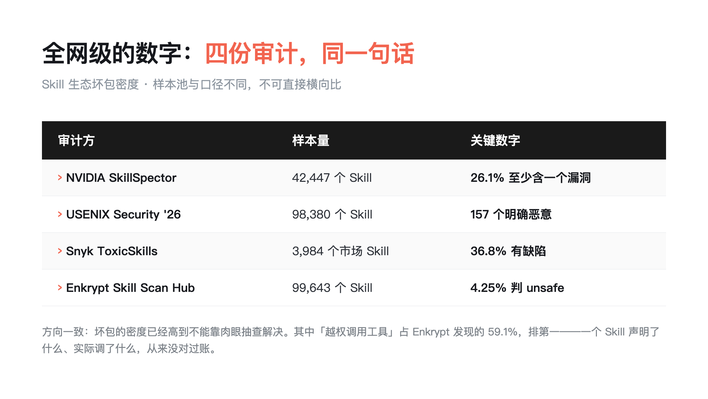
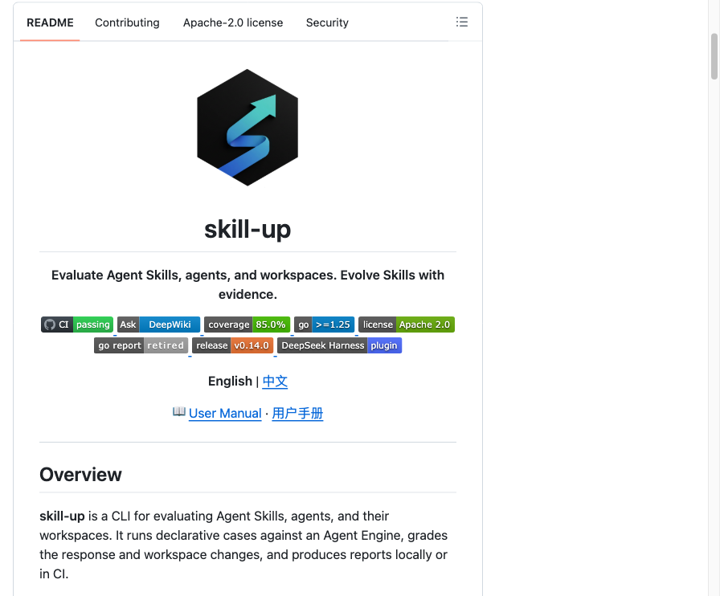
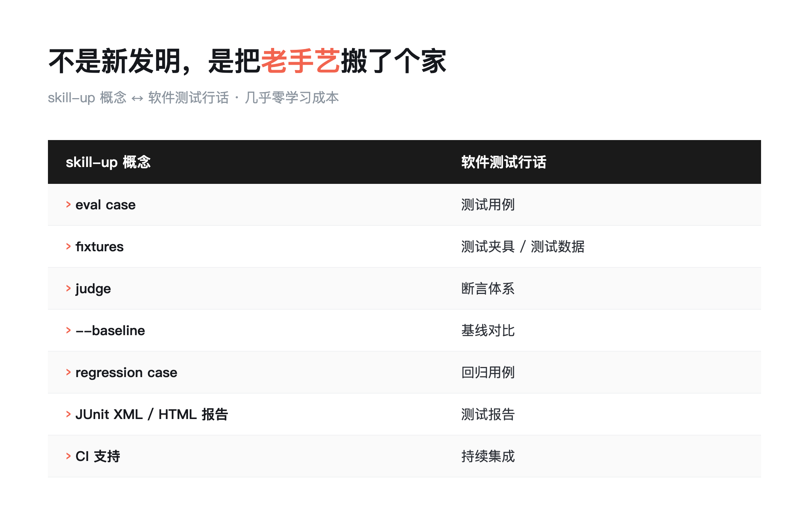
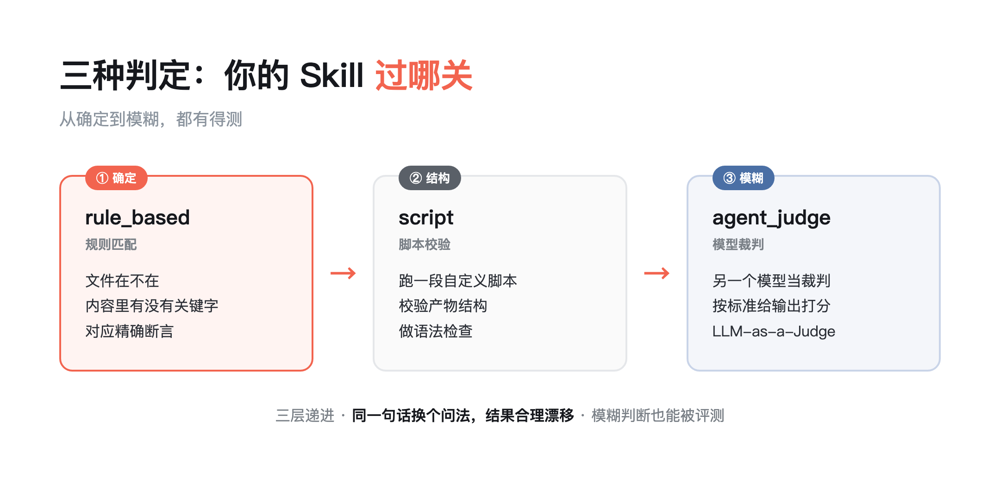
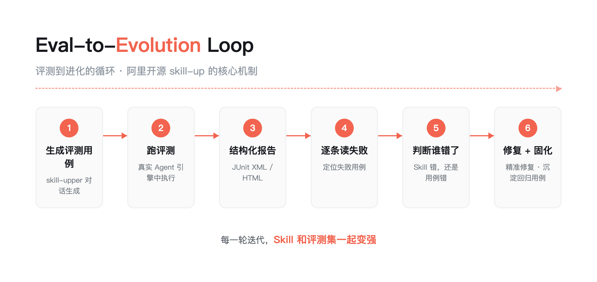
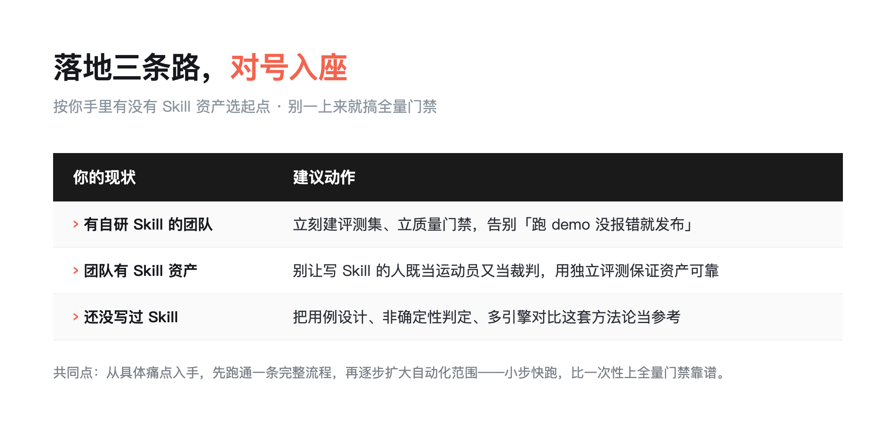
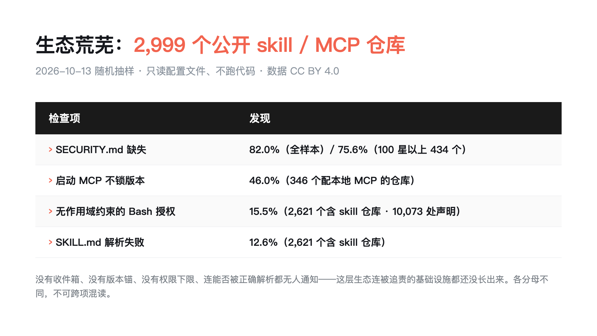

> **导读：**写完跑两下 demo，没报错，就发布——这是 2026 年大多数 AI Skill 的发布流程。阿里开源 skill-up 把软件测试那套方法论整个搬进了评测，我的 44 个 Skill，先裸奔为敬。
> 
> **这篇能给你什么**：① 三种判定器怎么选；② 10~20 条用例接 CI 的落地法；③ 用 Skill 测 Skill 的进化循环。我在[《AI 交叉对抗性审查：1 个模型，4 个专家，0 个额外账号》](https://mp.weixin.qq.com/s/22-mAqfb-0RWoAkJtwdmBA)里写过怎么审，这篇写怎么把测试搬进门禁。

目录：

1. 一个 Skill 的好坏，由谁定义

2. 阿里开源的答案：把软件测试整个搬过来

3. 三种判定：你的 Skill 过哪关

4. 用例驱动：10~20 条真实场景，接进 CI

5. 点睛之笔：用 Skill 测 Skill

6. 比工具更值钱的：一份极致的 AGENTS.md

7. 三个启发

8. 落地建议：三条路，对号入座

9. 核心结论

10. 工具与信源

这是 2026 年，大多数 AI Skill 的发布流程。

我在自己的工作区里数了数，44 个 Skill，没有一个评测集。上周刚给发布流程的 skill 升过版，改完第一反应不是"好了"，是"别把上个月验证过的能力改退化"。改几行提示词，行为就漂移——你根本不知道是哪次改动干的。这不是开发，这是裸奔。

裸奔的下场，不用猜。10 月，TypeScript 模式校验库 Zod 的 4.6.6 版本被发现植入了恶意安装钩子：package.json 里多了一个 preinstall 脚本，安装时自动执行——它通过一次 eth_call 去读链上智能合约、取回域名再落地载荷。13.1 万个项目直接依赖它，CI 流水线跑一次安装就可能中招。Skill 生态的今天，就是 npm 生态的昨天：先是没人评测，然后没人门禁，最后投毒的和被投毒的都会来。npm 至少有 lockfile 和完整性校验兜底，Skill 生态这些还在建。

同一条线上，VS Code 10 月 14 日一次放出 10 个漏洞，最该让 Skill 作者看一眼的是 CVE-2026-102232「授权不正确」：AI 编码 Agent 可以在没有出现预期确认的情况下被改掉 lifecycle-hook；npm 侧的 SlugFest 则揭示 trusted publishing 的信任继承问题——攻击者认领废弃的仓库 slug 就能继承信任关系，涉及 1,500 多个包、1,000 万次以上下载。信任是一层层传递下来的，而每一层都默认了"上一层已经查过了"。

10 月中旬，这条线第一次有了全网级的数字——四家互不相关的团队，各自扫了大批 Skill，结论落在同一句话上。



四个样本池不同、口径不同，不可直接横向比，但方向一致：坏包的密度已经高到不能靠肉眼抽查解决。其中"越权调用工具"占近六成——一个 Skill 声明了什么、实际调了什么，绝大多数人和绝大多数 Agent 从来没对过账。

所以别问"我的 Skill 要不要建评测集"，要问"我的 Skill 出事的时候，拿什么证明是哪次改动干的"。

## 1. 一个 Skill 的好坏，由谁定义

2026 年，Agent Skill 已经是标配。把个人经验、团队最佳实践，封装成可复用的技能包，团队囤几十上百个自研 Skill 不稀奇。

但一个扎心的问题冒出来：一个 Skill 的好坏由谁定义？评判标准是什么？

官方给过正确的评测循环：写真实用例，带/不带 Skill 各跑一遍，评分，迭代。问题是全靠手工，坚持不下来。

于是所有人退回同一个动作：跑两下 demo，没报错，发。

我自己的感觉更具体。我的核心 skill 里，有几个每次改完都要人工回验一遍：功能对不对、边界有没有破、上次踩的坑会不会复发。

验证一遍半小时起步，改得勤一点，一整天就搭进去了。所以后来我改成——不是非改不可，就不动它。

这不对。**不敢改，比改坏了还危险。**

## 2. 阿里开源的答案：把软件测试整个搬过来

上个月阿里开源了一个工具，叫 skill-up。Go 写的，Apache-2.0，目前 star 已过千。

项目介绍一句话：An evaluation and evolution tool for Agent Skills——Agent Skill 的评测与进化工具。

它的核心思路，就是把软件测试那套成熟方法论，完整平移到 Skill 上：

在真实 Agent 引擎里验证功能正确性，把失败转化为有针对性的修复，在本地或 CI 里持续回归。

看一眼接入后的项目结构，你会有一种熟悉感：

```text
my-skill/
├── SKILL.md       # Skill 定义文档，被测对象
└── evals/
    ├── eval.yaml      # 评测入口配置
    ├── cases/         # 评测用例集
    └── fixtures/      # 测试数据与脚手架
```

这就是一个标准的测试工程。被测对象从函数换成了 Skill，目录结构几乎原封不动。它在 GitHub 上长这样（官方仓库，Apache-2.0 开源）：



官方还给了张概念对照表，几乎没有学习成本：



做过软件测试的人，看到这张表应该会心一笑：不是新发明，是把老手艺搬了个家。

## 3. 三种判定：你的 Skill 过哪关

评测怎么做？skill-up 给了三种判定器：

- rule_based：规则匹配。文件在不在、内容里有没有关键字——对应精确断言。
- script：跑一段自定义脚本，校验产物结构、做语法检查——对应脚本校验。
- agent_judge：请另一个模型当裁判，按标准给输出打分——就是 LLM-as-a-Judge。

想测"文件被正确创建"，用规则匹配；想测"产物结构合法"，写脚本；想测"回答够不够专业"，请模型裁判。

三层递进，从确定到模糊，都有得测。



这个分层很关键。以前测代码，断言是非黑即白的：函数返回对不对，一跑就知道。

现在测 Agent，很多输出没有标准答案——同一句话，换个问法，结果就合理漂移。所以必须有一层"模型裁判"，把"够不够好"这种模糊判断也变成可评测的。

## 4. 用例驱动：10~20 条真实场景，接进 CI

落地节奏很具体：每个核心 Skill 配 10~20 条真实场景的评测用例，接进 CI。每次改动自动回归。

用例是给 Skill 上的保险。改提示词之前，先跑一遍用例；改完再跑一遍。行为有没有漂移，机器告诉你，不靠手感。

多轮对话也能测。input.turns 定义顺序交互——迭代优化、澄清循环这些场景，每一轮都能设 post_condition 和 on_fail 策略。

不是只测"一句输入一句输出"的简单问答。

仓库还自带 GitHub Action：Pull Request 改了 Skill 文件，自动触发评测，结果直接挂在 PR 上。

改完代码，质量门禁自己跑，不用人记着"发版前记得验证一下"。

报告可以导出 JUnit XML、HTML，直接挂进 CI 当门禁。

--baseline 做基线对比：这次改动让 Skill 变好了还是变差了，一目了然。

## 5. 点睛之笔：用 Skill 测 Skill

skill-up 的点睛之笔，是配套的 skill-upper。它本身就是一个 Agent Skill，职责是给别的 Skill 写测试。

完整循环是这样：

生成用例 → 跑评测 → 读失败 → 判断谁错 → 修复 → 固化 → 重跑。



每一轮迭代，Skill 和评测集一起变强。这个循环里最难的一步，是"判断是 Skill 错了还是用例错了"——测试写歪了，工具照样报失败。

skill-upper 把这个判断也自动化了，这就是"测试左移"的 Agent 版本：不是等出问题了再修，是每次改动都有裁判盯着。

## 6. 比工具更值钱的：一份极致的 AGENTS.md

工具是手段。真正让我坐直的，是这套方法论背后的一个判断：

别去造复杂的"自动驾驶"架构，把精力花在写一份极致的 AGENTS.md 上。

这份文档既是给 AI 的操作手册，也是团队的单一事实来源。

新人——不管是人还是 AI——进来读它就能上手。过程中踩的坑再反哺回去，知识就活了。

我自己的工作区就是这么干的。根目录一份 AGENTS.md，写了工作区是什么、资产在哪、任务怎么路由、哪些红线不能碰。

新来的 AI 工具第一次进这个目录，读它就能接手上一轮的活，不用人重新交代一遍。踩过的坑写回坏例索引，下一轮开工前先扫一遍。

为什么是 AGENTS.md，而不是更复杂的"自动驾驶"架构？因为复杂架构是黑盒：新人接不住，改一处牵全身，出了问题只能整锅端。

文档是白盒：谁都能读，谁都能改，改坏了 git 能找回。AI 工程化的地基不是算法，是信息结构——把规则写清楚，AI 才不会靠猜干活。

**知识写进文档就活了，写进模型就死了。**

## 7. 三个启发

这套实践看完，我记下三条。

第一，质量保障永不过时。被测对象从函数、接口，变成模型、Agent、Skill。但"怎么证明它是对的"这个问题，永远在。

第二，人机协同的新范式。人负责定义标准和边界，AI 负责执行和迭代。把专家经验固化成评测集，让 AI 在约束下自主进化。

第三，小步快跑。从具体痛点入手，先跑通一条完整流程，再逐步扩大自动化范围。别一上来就搞全量门禁。

## 8. 落地建议：三条路，对号入座



手里有自研 Skill 的团队：立刻建评测集，立质量门禁。告别"跑 demo 没报错就发布"。

团队有 Skill 资产的：别让写 Skill 的人既当运动员又当裁判。用独立评测保证资产可靠，错误不会影响整个团队的效率。

还没写 Skill 的：把 skill-up 的用例设计、非确定性输出判定、多引擎对比这套方法论当参考。比读十篇概念文章有用。

## 9. 核心结论

我押这个注：AI 工程化的下一个分水岭，不是谁的模型更强，而是谁先给 AI 的产出建起了测试体系。

> 被测对象一直在变，但"怎么证明它是对的"这个问题，永远在。

这个押注这周拿到了数字。SWE-bench Pro 的公开结果显示：同一个模型换一套 agent harness，pass@1 的波动比换一次模型升级还大（GLM-5.2 在两套 harness 之间是 23% 对 52%）。决定「AI 能不能把活干成」的变量，有相当大一块不在模型里，而在包着模型的那层壳里——Skill、AGENTS.md、权限配置，正是这层壳里最容易被随手改、又最没有回归测试的部分。同一周，Claude Code 连更三个版本：fork subagent 默认打开、mod 答案锁 `decider:"person"`、沙箱开关打开一条绕过文件保护的路径——**升级完成，你以为还关着的门开了一扇，而且没人会通知你。**

如果把镜头再往外拉，10 月 13 日有人随机抽了 2,999 个公开的 skill / MCP 仓库（只读配置、不跑代码）：82.0% 没有 SECURITY.md，100 星以上的 434 个里仍有 75.6%；346 个配了本地 MCP 的仓库里 46.0% 启动时不锁版本；2,621 个含 skill 的仓库里 15.5% 给至少一个 skill 授了没有作用域约束的 Bash。这层生态连被追责的基础设施都还没长出来。



同一天，新加坡国立大学《From Approval to Abuse》给出另一组数字：agent 申请一条看起来合理、实际过宽的 allow-rule，58% 的情况会被批准，58 个批准案例里 47 个事后验证为静默达成目标——**它攻击的是"人被要求扩大信任"的那一个瞬间**。ai-job-search（五万七千星）也在同周承认权限过宽、改为最小权限，那句可以直接抄的话是：岗位描述是数据，不是指令。

更冷的一组在模型侧。ProjectDiscovery 的受控演示里，只占基座 0.6% 参数的适配器、成本不到 50 美元，就能让模型在特定短语触发下外传 .env 与 SSH 私钥；Anthropic 与英国 AI 安全研究所、艾伦·图灵研究所的联合研究显示，约 250 份被投毒的文档就足以在 600M 和 13B 两种规模里植入后门，成本不随参数量增长。能力是可以被证明的，诚实不能——一份漂亮的 benchmark 表只回答"它能不能干活"，从不回答"它有没有别的念头"。

所以这周的收束再往前推一步：**门禁要覆盖的不只是"它会不会做"、"你已经批准过什么"，还有"你下载回来的那个它，是不是你以为的那个它"。**

能做的几件小事很朴素，成本都低于事后对账：从社区下载来的改过权重先当成不可信输入；不同用途的 key 分开；本地 grep 一遍它会发出的工具调用里有没有硬编码的外部地址；再把"这个模型从哪来、谁签的字、哪个版本被批准的"记进你自己的清单——清单上多一列来源，等于在配钥匙那天就把爆炸半径定下来。

我的 44 个 Skill，从今天开始，先给自己立门禁。

这周做一件事：挑一个你天天在用的 Skill，给它写 10 条真实用例。

## 10. 工具与信源

**skill-up** ｜ 阿里开源的 Agent Skill 评测与进化工具，本文三种判定、用例接 CI、用 Skill 测 Skill 均按其官方用法介绍

**Zod 4.6.6 供应链事件** ｜ 10 月 npm 恶意安装钩子事件，13.1 万个项目直接依赖，官方 advisory 收录

**VS Code 安全公告 SB2026101403 + SlugFest** ｜ 10 月 14 日一次放出 10 个漏洞，AI 编码 Agent 可在无预期确认下被改 lifecycle-hook；SlugFest 揭示 npm trusted publishing 信任继承问题（1,500+ 包、1,000 万+ 下载）

**四份 Skill 生态全网审计** ｜ NVIDIA SkillSpector（42,447 个）、USENIX Security '26（98,380 个）、Snyk ToxicSkills（3,984 个）、Enkrypt Skill Scan Hub（99,643 个），样本池不同、结论方向一致

**NUS《From Approval to Abuse》** ｜ arXiv 预印本（未见同行评议），allow-rule 诱导实验：58% 申请到过宽授权、58 个批准案例中 47 个静默达成

**Claude Code 官方 CHANGELOG** ｜ 2.1.302 fork subagent 默认开启 / 2.1.304 decider:"person" / 2.1.305 沙箱开关与 MCP 过滤变窄

**ai-job-search v1.7.3** ｜ 五万七千星应用承认权限不安全，改为最小权限并对外部文本做完整性闸门

**ProjectDiscovery 模型后门演示** ｜ 受控研究：0.6% 参数适配器、成本低于 50 美元、1.5B 模型 1% 污染样本触发率 75%~98%

**Anthropic × 英国 AISI × 艾伦·图灵研究所** ｜ 约 250 份投毒文档即可在 600M 与 13B 植入后门，成本不随参数量增长

**数据口径** ｜ 本文只引上述来源的结论与量级，不提供任何可复现手法与触发样本；各百分比分母不同，不可跨项混读；benchmark 成绩不等于真实工程表现；受控演示不代表默认模型被污染。
