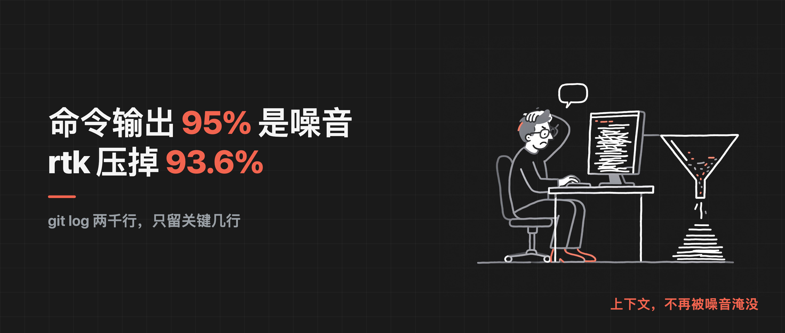
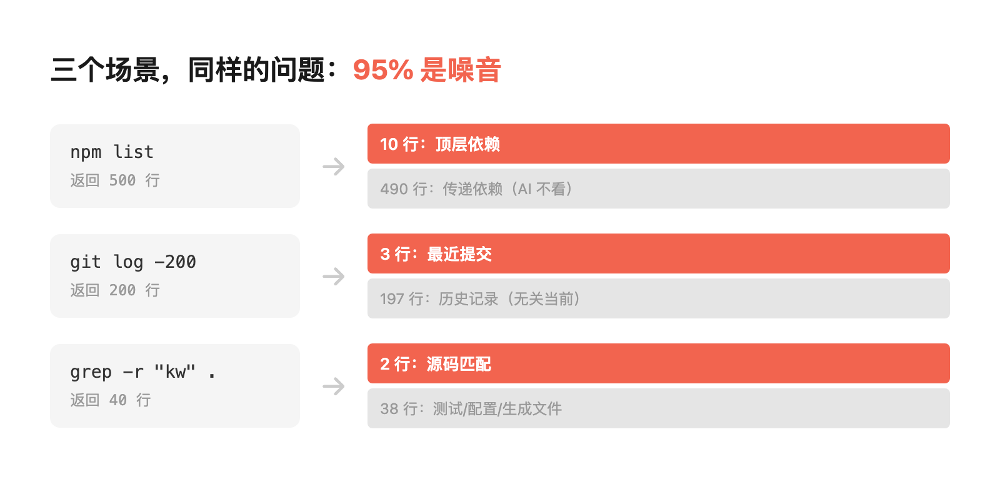
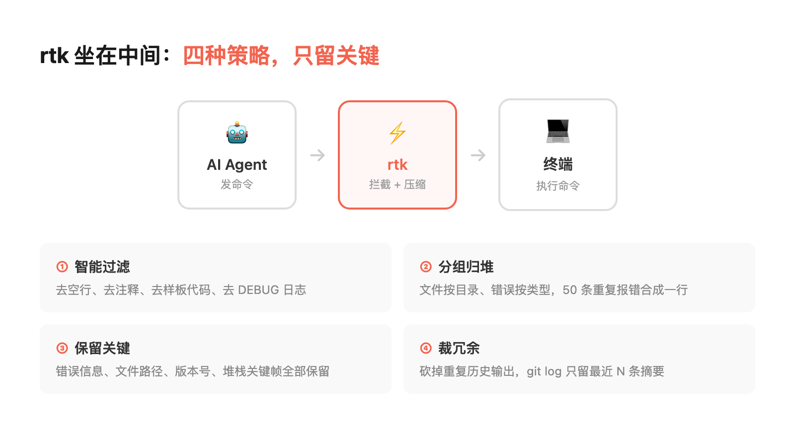

# AI跑命令，95%的输出是噪音：rtk压掉93.6%



> **行途导读：**AI跑命令最烧token的不是命令本身，是命令的输出。git log返回200行提交，有用的就3行；npm list返回500行依赖树，需要的就顶层10个包。rtk坐在AI和终端之间把输出过滤后再传给AI，一条啰嗦命令能压掉九成。
>
> **这篇能给你什么：**① 看清命令输出为什么是token大头；② 一分钟装好rtk并验证它真在工作；③ 知道压缩是有损的，哪些诊断信息必须手动留。工具全景见《[省token横评：9个主流编程Agent谁最省token](https://mp.weixin.qq.com/s/xx27ApBNCLI1Tx4Wzzamwg)》。

目录：

1. 命令输出为什么这么费token：三个真实场景
2. rtk是什么：坐在AI和终端之间的过滤器
3. rtk怎么用：从安装到配置的完整路径
4. 实测数据：93.6%压缩率和面板里的15.9%
5. 踩坑经验：五个用rtk时容易犯的错
6. rtk配置检查清单：五分钟搞定
7. 省token的六层框架：协议层的位置
8. 核心结论
9. 工具与信源

## 1. 命令输出为什么这么费token：三个真实场景

我第一次意识到命令输出有多浪费token，是在让AI排查一个构建错误的时候。AI跑了一次`npm list`看依赖树，返回将近500行输出，又跑`git log`看提交历史返回200多行，再跑`find . -name "*.config.js"`找配置文件又是几十行。三个命令跑完，上下文里塞进了将近一千行命令输出，而真正被AI引用到的，不到二十行。那时候我就在想：这些输出能不能在进入AI上下文之前就过滤一遍？

编程Agent的工作模式决定了它要大量跑命令。而命令输出是token消耗的一个大头，我总结了三个最常见的浪费场景：

第一个，依赖树查询。AI跑`npm list`或`mvn dependency:tree`，返回几百行依赖树。AI真正需要的通常是顶层的几个直接依赖，或者某个特定包的版本号。剩下的几百行传递依赖，AI看都不会看，但全部塞进了上下文。

第二个，提交历史查询。AI跑`git log --oneline -200`，返回200行提交记录。AI可能只需要最近几次提交的信息，或者某个特定commit的描述。剩下的一百多行历史提交，对当前任务毫无帮助。

第三个，全文搜索。AI跑`grep -r "某个关键词" .`，返回几十行匹配结果。其中大部分是测试文件、配置文件、自动生成的代码里的匹配，AI真正需要的可能就两三行源码里的匹配。

这三个场景有一个共同点：命令输出的"信噪比"极低。有用的信息可能只占输出的5%甚至更少，但100%的输出都进了AI的上下文。上下文里噪音多了，AI的注意力就被稀释了，token也被浪费了。



我做过一个粗略统计：在日常编码中，命令输出平均占新输入token的40%左右。如果能把命令输出压缩九成，就能省掉36%的新输入token。

以上为个人项目观察，非统计结论，不同项目类型和使用习惯下比例会有差异。

## 2. rtk是什么：坐在AI和终端之间的过滤器

rtk是一个命令行输出压缩工具，用Rust写的，开源（Apache-2.0），仓库是rtk-ai/rtk，官网rtk-ai.app。它的工作位置很关键——坐在AI和终端之间。

工作流程是这样的：AI发命令→rtk拦截命令→rtk把命令发给终端执行→终端返回输出→rtk压缩输出→rtk把压缩后的输出传给AI。

压缩不是简单的截断。如果只是"只取前50行"，那很容易把关键信息截掉。rtk做的是四种压缩策略组合：

第一个，智能过滤。去掉重复行、空行、注释、样板代码和无关警告。很多命令输出里有大量重复的格式行和调试信息，这些对AI毫无价值，直接去掉。

第二个，分组。把同类信息归堆——文件按目录归、错误按类型归类、日志按模块分组。比如50行类似的报错，压缩后变成一行"出现50次同类错误"，AI看一眼就知道严重程度。

第三个，关键信息保留。错误信息、文件路径、数字（版本号、行号、时间戳）、异常堆栈的关键帧，这些是AI需要的，全部保留。rtk会识别这些模式，确保不被过滤掉。

第四个，冗余裁剪。保留相关上下文，砍掉重复的历史输出。git log的输出，rtk会整理成最近N次提交摘要表，只保留commit hash、作者、日期、标题，去掉多余的格式字符。



打个比方：rtk就像一个新闻编辑。终端返回的是原始素材，rtk是编辑，把素材里的废话去掉、重点提炼出来、整理成结构化的简报，再交给AI这个读者。读者不需要看原始素材，看简报就够了。

## 3. rtk怎么用：从安装到配置的完整路径

rtk的用法已经比我刚开始用的时候简单多了。现在官方推荐的方式是一键自动装hook：

```bash
# 一行装好，自动给Claude Code装上hook
rtk init --global
```

装完之后，AI在Claude Code里跑的每一条Bash命令，输出都会自动经过rtk压缩。你什么都不用改，继续用原来的命令就行。

如果你想手动体验，也可以在命令前面加`rtk`：

```bash
# 原来
git log --oneline -200

# 手动加rtk
rtk git log --oneline -200
```

rtk会自动分析输出类型，选择对应的压缩策略。日志类、依赖树类、文件列表类，各有各的压缩规则，不需要手动指定。

需要注意的一点：hook只对Bash工具调用生效。Claude Code内置的Read、Grep、Glob这些工具不走Bash，所以不受rtk影响——这是对的，那些工具的输出本身就已经是结构化的，不需要再压缩。

关于版本，补一句：rtk在2026年10月13日发布正式1.0.0，10月14日出了1.0.1，修复了大量早期版本过度压缩的问题。我本机还停在0.51.0旧版，建议装的人直接升到最新版——早期个别版本压得太狠，会把不该删的诊断信息一并删掉，这一点第5节会具体讲。

对于大多数用户，默认配置就够用了。rtk支持配置文件自定义过滤规则，但只有当你的项目有非常特殊的输出格式时才需要动。

我自己的用法是：`rtk init --global`装完hook之后就再也没管过。它在后台默默压缩，我偶尔看一眼token统计面板，发现输出类token确实降了一大截。

## 4. 实测数据：93.6%压缩率和面板里的15.9%

先把两个容易混淆的数字分开说：93.6%是单条啰嗦命令（比如git log）上的压缩率；而全局平均下来，远没有这么高。

【配图：03-rtk_gain本地实测面板_0.51.0.png】

我在本机跑`rtk gain`看了一眼全局面板：累计54960条命令，输入339.0M、输出285.1M，总共省了53.8M，全局节省比例是15.9%。这个数字看着不高，但拆开按命令看就很说明问题——grep省了57.1%，find省了97.6%，git commit省了98.7%，ps aux这类长表省了98.4%；而rtk read这种本身不长的命令只省9.2%。

也就是说，rtk的收益高度集中在啰嗦命令上：列表、树、长日志这类几百行的，压得最狠；短输出命令本来就没多少可压的。全局15.9%是把所有命令平均后的结果，不代表你最常用的那条git log也只省15.9%。

回到项目内的统计：我在一个实际项目里用rtk跑了一个多月，git log这类命令的压缩率能到93.6%——原来1000行的输出，压缩后只剩64行左右。不同命令差异很大，git log类最高（95%以上），编译错误类最低，因为错误信息本身就是关键信息，不能多压。

同任务对比也做过：选一个典型的bug排查任务，涉及读文件、跑测试、看日志、查依赖。不用rtk新输入token约12000，用rtk约3500，省了大约70%。

这里要校准一个口径：rtk官方明确说，它报的token数量是按字节数除以4估算的，没有内置分词器，所以压缩百分比可靠，绝对token数值只是近似。我前面提到的累计省token量也是这个估算口径，别当成账单上的精确数字看。官方自己的口径是：常见开发命令上削减60%~90%的bash输出，而这和"账单降90%"不是一回事——bash输出只是输入token的来源之一，输入token又只是账单的一部分。

以上数据来自个人项目使用统计和本机rtk gain面板，非严格对照实验。不同项目类型、命令频率、代码规模下，压缩率和节省量都会有差异。

## 5. 踩坑经验：五个用rtk时容易犯的错

我用rtk的过程中踩了几个坑，分享出来别再踩：

第一个坑，短输出命令也加rtk。rtk本身有启动开销和处理时间，短输出（几行）的命令直接跑就行，加rtk反而慢。手动模式下我一开始图省事，所有命令都加rtk，结果`echo`、`pwd`这种一行输出的命令也被处理一遍，每次多等几百毫秒。用`rtk init --global`装hook之后这个问题自动解决了——hook会判断输出大小，短输出直接放行。

第二个坑，自定义过滤规则太激进。我一开始配自定义规则的时候，把"包含WARNING的行"全过滤了。结果有一次构建失败，关键警告被rtk滤掉，AI看不到警告，排查方向完全错了。后来改成：WARNING级别保留，只过滤DEBUG和TRACE级别。教训是：过滤规则要保守，不确定是不是关键信息的，就保留。

第三个坑，rtk和管道命令混用。手动模式下rtk放在管道中间会出问题——比如`git log | grep "fix" | rtk`，rtk拿到的已经是grep过滤后的输出，压缩策略可能不匹配。正确用法是rtk放在最前面：`rtk git log | grep "fix"`，让rtk先压缩原始输出，再用管道过滤。装了全局hook之后这个坑基本不存在。

第四个坑，忘记验证rtk真的在工作。rtk装好了，但AI不知道要用，还是直接跑命令。我一开始用手动模式就犯了这个错，装了一周发现token没怎么降，仔细一看AI的命令里根本没有rtk。后来用`rtk init --global`装hook，跑一次`rtk gain`确认压缩计数在涨，才放心。

第五个坑，压缩是有损的，诊断类信息可能被压没。这是最需要警惕的一个。rtk压掉的是"冗余"，但判断哪些是冗余本身会出错。我自己踩过第二个坑的过滤问题；官方公开的issue里也有同类反馈：rtk跑pytest时，配合`--tb=no`或`--tb=line`参数，会把测试名和失败原因压掉，最后只剩一行"3 failed"的裸计数，AI知道挂了三个测试，却不知道是哪几个、为什么挂（官方仓库issue #4718、#4715，1.0.1仍复现，非本文复现）；另外`rtk grep`转发带反斜杠的正则时，反斜杠会被丢掉导致正则报错（issue #4737）。规避办法有两条：诊断类命令（测试失败、报错堆栈、精确版本号）在配置里加白名单保留，别让它压；关键命令手动看一眼原始输出，别只信压缩后的计数。

## 6. rtk配置检查清单：五分钟搞定

如果你要上rtk，按这个清单检查一遍：

- 第一步，rtk已安装。终端跑`rtk --version`能输出版本号，顺手确认是不是1.0.1最新版
- 第二步，hook已装好。跑`rtk init --global`，确认显示hook installed
- 第三步，跑一次验证。让AI在Claude Code里跑一次`git log --oneline -50`，然后跑`rtk gain`看压缩计数是否增长
- 第四步，检查关键信息保留。故意触发一次报错（比如跑一个不存在的命令），确认错误信息完整保留在压缩输出里
- 第五步，对比测试。选一个典型任务，分别在装hook前后跑一遍，对比token消耗

一个额外建议：rtk的统计面板`rtk gain`定期看一眼。它告诉你每条命令压了多少、总共省了多少token。这个数字比任何理论估算都有说服力——你看到自己一周省了多少，就知道这东西值不值。

## 7. 省token的六层框架：协议层的位置

```
① 需求层 → spec 体系
② 检索层 → 代码图谱
③ 协议层 → rtk（命令输出压缩）  ← 你正在读的这篇
④ 输入压缩层 → Headroom
⑤ 散文层 → Caveman + Concise
⑥ 生成层 → Ponytail
```

协议层和检索层是黄金搭档。检索层减少进入上下文的代码量，协议层减少进入上下文的命令输出量，两个加起来，新输入token能降一大截。

这几天GitHub趋势上同时出现了几个跟rtk同层或相邻层的项目，放在一起看比单看一个有意思：rtk-ai/rtk（Rust单二进制零依赖，官方称常见开发命令省60%~90%）把命令输出这一层做专；xerj（Rust本地优先索引，替代grep式代码检索）把检索层做成具体替代品；OmniRoute（MIT）把RTK压缩内置进AI网关，称省15%~95%。省token这件事正在从"你装一个工具"变成"你的流量先过一道闸"。

但把这些数字并排摆着，最该记住的还是第4节那句：它们的分母各不相同。有的是作者拿自己负载测的，有的是某一类命令上的，有的带配额与回退条件。60%~90%和15%~95%看着像两个世界，其实都是"拿我最擅长的给你看"，没有一个能直接套到你的仓库上。

## 8. 核心结论

1. 命令输出是编程Agent的token消耗大头，信噪比极低，有用信息可能只占5%
2. rtk坐在AI和终端之间，智能过滤命令输出——去重、分组、保留关键信息、裁掉冗余，不是简单截断
3. 单条啰嗦命令能压九成，但全局平均没这么高（本机面板15.9%），收益集中在git log、grep、find这类长输出命令上
4. 用法：`rtk init --global`一键装hook，自动压缩所有Bash命令输出；装完跑`rtk gain`确认计数在涨；建议升到1.0.1
5. 压缩是有损的：自定义规则别滤掉WARNING，诊断类命令加白名单，关键命令手动核对原始输出，别只信压缩后的计数

**这周做一件事**：挑你一天里最啰嗦的三条命令（git log、npm list、grep -r），各跑一次rtk，对比压缩前后的行数。你自己拿到的数字，比任何官方百分比都可信。

## 9. 工具与信源

rtk（Rust Token Killer）｜开源CLI代理，坐在AI编码agent和shell之间压缩命令输出，Rust编写、Apache-2.0协议，仓库rtk-ai/rtk，官网rtk-ai.app。

省token不止协议层一层，顺手带一份整套工具地图，需要的人自己去挑：检索层有CodeGraph（前端和中小单仓）、CBM codebase-memory-mcp（Monorepo微服务）、Gortex（大型工程，daemon偶发无响应，生产谨慎试用）、Graphify（代码加文档多模态）；节流配套有Caveman（散文精简）、Ponytail（极简代码生成）；需求澄清和SDD规范开发有Grill-me、GitHub Spec Kit、Superpowers、OpenSpec。本篇只讲协议层rtk，其余各层另文展开。

数据口径｜本文93.6%为项目内git log类命令压缩率、15.9%为本机rtk gain全局面板、12000→3500为单任务对比，均来自个人使用统计，非严格对照实验；官方口径为常见开发命令削减60%~90%的bash输出，token绝对值按字节/4估算仅近似。
