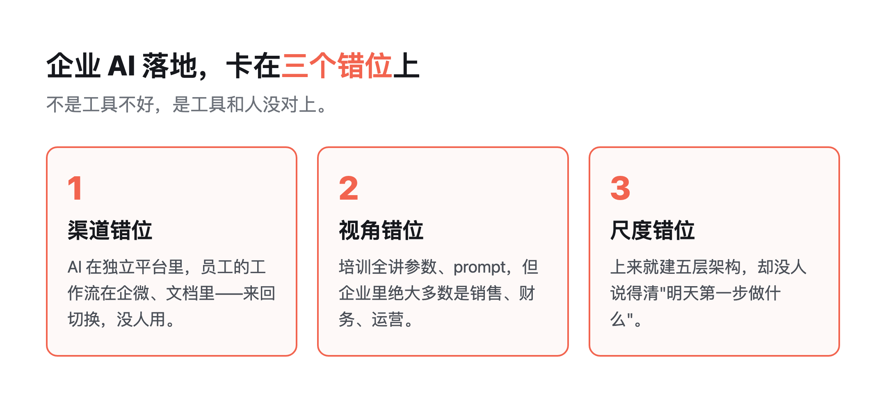
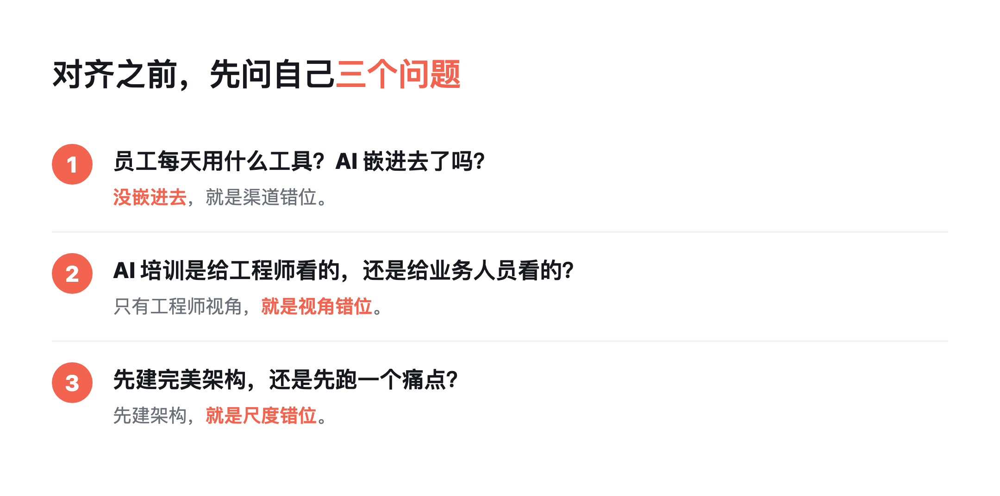

# 企业花百万买 AI 工具，为什么还是用不起来？三个错位

> 导读：你公司买了 ChatGPT 企业版、买了 Copilot，员工还是该干嘛干嘛。不是员工不努力，也不是工具不好，是渠道、视角、尺度三个错位没对上——把这三个对上，比再买一套平台管用。
>
> 这篇能给你什么：① 一个判断框架，看清自家 AI 卡在哪一步；② 三个错位各自的反例和正解；③ 你明天上班就能问自己的三个问题。FDE 到底干什么，我在[《FDE 工作法：进场、在场、离场》](https://mp.weixin.qq.com/s/YtEazpVHgQxxgwXyvmE0cQ)里写过完整流程。

最近帮几家企业看 AI 落地，发现一个共性：**工具买了一堆，没人真的用起来。** 预算不小，培训也做了，最后 AI 平台躺在那里，登录数一天比一天少。

这也不是我一个人的观察。Gartner、McKinsey、BCG 几家常年跟踪企业 AI 的机构，数字口径各不相同，但都落在一个扎眼的区间里：没交付预期业务价值的项目大致占六成到九成，真正把 AI 规模化跑出回报的企业只占个位数。MIT 的研究更直接——95% 的企业 AI 试点拿不出可衡量的回报。方向是一致的：问题通常不在工具，也不在员工，在三个错位。

## 1. 渠道错位：工具不在员工的工作流里

第一个错位最常见——**AI 工具和员工的日常工作流是脱节的。**

你让员工单独打开一个 AI 网站，注册、学怎么用，再回到自己的工作里。这个切换成本太高了：写邮件要切一次，查资料要切一次，整理会议纪要又要切一次。切三次，人就放弃了。

正确做法是把 AI 嵌进员工已经在用的工具里。员工本来就在企微沟通、在腾讯文档写东西、在项目管理工具里看任务，AI 就待在旁边，不用切换。一句"帮我把这段纪要整理成待办"，就地完成。

为什么很多企业 AI 项目失败？因为 IT 部门买了一个独立 AI 平台，配了培训账号，让所有人去学。但员工的工作流，根本不在那个平台上。平台越高、越独立，离真实干活的位置越远。

## 2. 视角错位：都是工程师视角，没人管业务怎么用

第二个错位——**大部分 AI 培训，都是工程师视角。**

讲模型参数、讲 prompt 怎么写、讲 API 怎么调。但企业里绝大多数人不是工程师，是销售、财务、HR、运营。你跟销售讲"怎么写 system prompt"，他听完还是不知道下周写客户邮件时从哪下手。

跟他们讲"怎么写 prompt"，不如教他们"你这个工作流哪一步能让 AI 帮你做"。销售写周报卡壳，就让 AI 从聊天记录里提炼；财务对账对到眼酸，就让 AI 先把异常标出来。

我见过最好的做法：FDE 坐在业务人员旁边，看他干活，然后说"这一步我帮你自动化"。不是培训完就走，是上门服务。这就是 FDE 的价值——既懂技术又懂业务，能把技术翻译成业务语言。这件事的完整拆解，我写在[《FDE 能力模型：8 个维度拆解》](https://mp.weixin.qq.com/s/SIt_eTAvA6kUGuRUmlneZg)里。

## 3. 尺度错位：理论太多，第一步太少

第三个错位——**理论过剩，实操稀缺。**

市面上讲 Harness、讲 Agent 架构、讲大模型微调的文章一大堆。但你问"我明天上班第一步该做什么"，没人答得上来。

企业 AI 落地不是先建五层架构，不是先做本体论建模。是先找一个具体工作流，拆出来，让 AI 跑起来。跑通一个，再跑通十个。先从一个销售周报、一个报销初审、一个会议纪要开始，让一个人真的从重复劳动里腾出手，比开十场架构评审有用。

理论是稳态之后做的事。第一步永远是：找一个痛点，用 AI 解决它。

## 4. 怎么对齐这三个错位

如果你是企业管理者，或者你想在企业里推 AI，问自己三个问题：

**第一，员工每天用什么工具？AI 嵌进去了吗？** 没嵌进去，还要人单独开一个网站，就是渠道错位。

**第二，你的 AI 培训是给工程师看的，还是给业务人员看的？** 只有参数和 prompt，销售财务听完还是不会用，就是视角错位。

**第三，你是先建完美架构，还是先跑一个痛点？** 先画五层图、先选平台、先定标准，就是尺度错位。

这三个问题答完，你基本能判断自家 AI 项目卡在哪、下一步该动哪里。

## 5. 写在最后

企业 AI 落地，未来三年会经历一个转向：从"买工具"到"做落地"。模型和工具只会越来越便宜，但把工具嵌进业务流、让非技术人员真的用起来的能力，会越来越值钱。

这就是 FDE 这个角色存在的意义——不是卖模型的，是帮企业把 AI 真正用起来的人。为什么国家层面开始点这个角色，我在[《国家点名 FDE：AI 落地缺的不是模型，是现场的人》](https://mp.weixin.qq.com/s/Ys2TJql0DeoPWlqjXvHM0w)里聊过。

## 6. 工具与信源

本文提到的企业 AI 落地失败率区间（六成到九成），综合自 Gartner、McKinsey、BCG、MIT Sloan 在 2024-2026 年的公开调研，各家样本量、统计口径、"失败"定义都不一样，数字只作趋势参考，不精确引用。三个错位的判断来自一线 FDE 项目观察，不是严格对照实验，不同行业、不同规模企业的表现会有差异。

想进一步了解 FDE 到底怎么干活，可以顺着同系列三篇看：[《FDE 工作法：进场、在场、离场》](https://mp.weixin.qq.com/s/YtEazpVHgQxxgwXyvmE0cQ)讲完整流程，[《FDE 能力模型：8 个维度拆解》](https://mp.weixin.qq.com/s/SIt_eTAvA6kUGuRUmlneZg)讲需要哪些能力，[《国家点名 FDE》](https://mp.weixin.qq.com/s/Ys2TJql0DeoPWlqjXvHM0w)讲这个角色为什么现在被重视。

这周做一件事：挑一个你团队每周都重复的工作流——周报、对账、会议纪要都行——别先开架构评审，看看哪一步能让 AI 先跑起来，下周就试。

你公司的 AI 项目，卡在哪个错位上？评论区聊聊。
