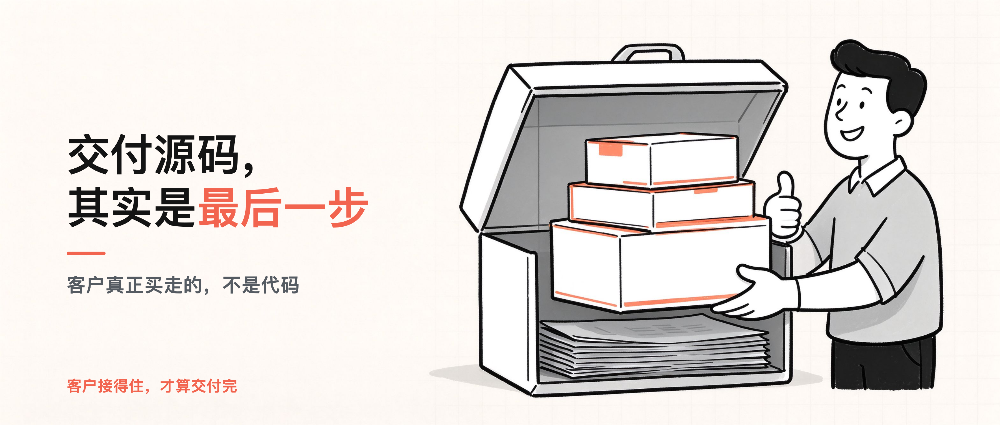
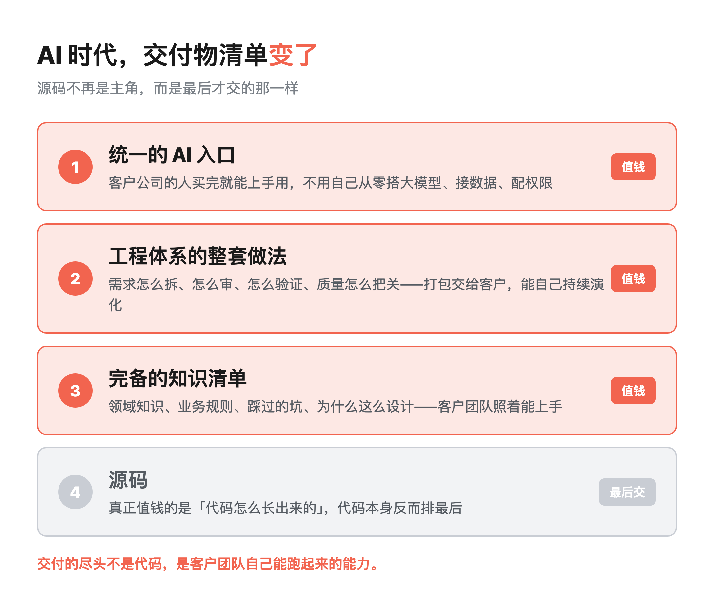
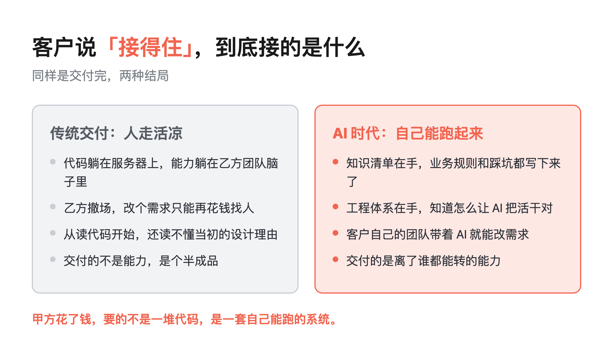

交付源码，其实是最后一步

> 行途导读：客户付钱买走的从来不是代码，是「你们走了以后，他自己团队还能带着 AI 改系统」的能力。源码在这套交付里排最后，前面三样——知识清单、工程体系、统一 AI 入口——才是真正值钱、也最容易被供应商藏着不交的东西。
>
> 这篇能给你什么：① 看懂 AI 时代交付物清单为什么变了、源码为什么排最后；② 抄走给甲方的四个问题，下次评估外包直接问；③ 交接清单上「最值钱那串东西放在哪、谁能碰、多久换一次」这行为什么必须写。

目录：

1. 开场：客户那一句「接得住吗」

2. 传统交付：源码加人天，人走活就凉

3. AI 时代，交付物清单变了

4. 为什么知识清单比代码值钱

5. 交付过程：敏捷和瀑布为什么混着用

6. 给甲方的四个问题

7. 我押这个注

8. 工具与信源

## 1. 开场：客户那一句「接得住吗」

去年一个项目收尾，客户方负责人跟我吃饭时说了句让我坐直了的话：「你们交付的这些东西，我们团队以后能接住吗？」

我当时愣了一下。因为按老规矩，交付就是验收代码、签个字、团队撤场。他这一问，问的不是代码，是代码之外的东西。

回去我想了很久。这几年我们一直在做 AI 落地，交付的东西其实已经悄悄变了，可合同里写的还是「交付源码」。

客户那句「接得住吗」，问破了一层窗户纸：源码交出去了，能力交出去了吗？

## 2. 传统交付：源码加人天，人走活就凉

传统外包的逻辑很简单：交付源码、按人天算钱，项目结束、团队撤场。

这套逻辑在以前没大问题，因为系统改起来慢、需求也稳。但放到 AI 时代，它有个致命问题：客户拿到了代码，却接不住。

代码躺在服务器上，真正的能力躺在你们团队脑子里。客户要改个需求，只能再花钱找人，从读代码开始。

读半天还读不顺——当初为什么这么设计、哪些坑不能踩，全在开发的记忆里，没写下来。

说白了，交付的不是能力，是个半成品。这其实是甲方和乙方都亏的买卖：甲方花了钱，没买到能自己跑的东西；乙方做完一锤子买卖，也攒不下下一次合作。

## 3. AI 时代，交付物清单变了

我们这几年做 AI 落地，交付范式变了一次。现在真正交付的不是源码，是四样东西，源码还排在最后：

第一样，完备的知识清单。项目涉及的领域知识、业务规则、当初踩过的坑、为什么这么设计的决策理由，全部文档化，让客户团队照着能上手。

第二样，工程体系的整套做法。我们内部怎么用 AI 干活的——需求怎么拆、怎么审、怎么验证、质量怎么把关——这套规则、流程和工具链，打包交给客户。

客户拿过去，不只是拿到一个系统，是拿到一套能自己持续演化的生产方式。

第三样，一个统一的 AI 入口。客户公司的人，买完就能上手用，不用自己从零去搭大模型、接数据、配权限。

第四样，才是源码。

源码反而是最后交付的。因为真正值钱的从来不是代码本身，是「代码是怎么长出来的」那一套东西。

代码会过时、会重写，但那套生产方式，客户学会了就是他自己的。

## 4. 为什么知识清单比代码值钱

你可能会说：交付文档不是老早就有的吗？

不一样。老交付文档是「说明书」，告诉你这个系统点哪个按钮、报表从哪查；现在的知识清单是「生产方式」，告诉你这套系统以后怎么被 AI 持续改进。

举个直白的例子。同样一个报表需求，传统做法是：客户提需求、乙方排期、开发、测试、上线，来回两周。中间客户得等着，乙方得排人。

有了知识清单和那套工程体系之后呢？客户自己的团队，带着 AI 就能把这个需求改了。

他们缺的不是程序员，是「怎么让 AI 把活干对」的方法。

知识清单交付的，就是这套方法：什么需求能让 AI 直接做、什么必须人工把关、改坏了怎么回滚、哪几条业务规则绝对不能碰。

> 交付的尽头不是代码，是客户团队自己能跑起来的能力。

这也是为什么我敢把知识清单排到代码前面。代码是结果，知识清单是让结果还能继续长的土壤。

## 5. 交付过程：敏捷和瀑布为什么混着用

顺带说一句交付过程本身。我们现在的交付模式，是敏捷和瀑布的混合体。

听起来矛盾，其实不矛盾。需求阶段用瀑布的严谨——目标、边界、验收标准，全部前置说清楚，不许模糊；执行阶段用敏捷的灵活——小步快跑、频繁验证、随时纠偏。

为什么要这么混？因为 AI 时代交付速度变快了，但交付质量的责任一点没变。

越是快，越要有人死死守在两道闸门上：一道是「目标定义」，别做着做着跑偏了；一道是「验收」，做完了得对得上当初说的目标。

这两道闸门，恰恰也是客户「接得住」的前提。你把验收标准和目标边界都白纸黑字留下了，他以后自己干，才知道往哪使劲、怎么算合格。

顺带补一条 10 月发生的、和交付直接相关的事。开源编程智能体 OpenCode 在 10 月 17 日夜间被入侵，攻击者进去的是一套**正在走下线流程的老系统**，受影响的是它的托管控制台 OpenCode Console 约 1.4% 的用户——这些人把 OpenAI、Anthropic、Google 的 API 密钥存在了控制台的工作区里。第二天不少开发者在 Reddit 和 X 上贴出支出告警，个别人一夜之间被刷掉数百美元，少数超过 1,000 美元；三家模型厂商随后一起封禁了疑似泄露的密钥，OpenAI 为受影响的 API 客户做了退款。

这条里有两点跟"接得住"有关。第一，**被攻破的不是它现在的主力系统，是一套"已经在退役路上"的系统**——这类系统的优先级永远排在活跃开发后面，也因此长期处在没人看得最紧的状态。第二，联合创始人 Dax Raad 明确说，开源应用和命令行工具没受影响，因为那些密钥从未经过他们的服务器。**同一个产品，凭证放在本地和放在托管平台，风险不是一个量级。**

还有个更值得琢磨的细节：防守方在排查时，手上的 AI 模型因为安全策略**拒绝分析那段恶意代码**，应急响应一度卡住，直到通过 OpenAI 的 Daybreak Blue 项目（面向审核通过者的低拒答模型）才稳住局面。护栏挡住了攻击者，也挡住了正在救火的人——这道口子目前只能靠"谁有资格拿到宽松模型"来解，还没有更好的办法。

所以我现在的交接清单上，除了知识清单、工程体系、统一 AI 入口这三样，还多写了一行：**这个系统里最值钱的那串东西放在哪、谁能碰、多久换一次。** 源码依然是最后一步，但交接清单上不能只有源码。

## 6. 给甲方的四个问题

如果你是甲方，下次评估外包供应商，别只问「代码写得怎么样」。问四个问题：

第一，你的交付物里有没有知识清单，还是只有源码和一本说明书？

第二，你们自己内部怎么用 AI 干活的这套做法，能不能原样交给我？

第三，我的人，在你们撤走之后，能不能自己带着 AI 改系统？

第四，你们有没有一个统一的 AI 入口直接给我用，还是让我自己再去从零买、从零搭？

前三个问题答不上来的供应商，交付的只是代码。答得上来的，交付的才是能力。

这四个问题其实也是一面镜子：它照出的不是供应商的技术高低，是他愿不愿意把「吃饭的家伙」交给你。

## 7. 我押这个注

我押「交付范式转变」这个注：AI 时代，外包交付的定价逻辑，会从「代码加人天」，转向「能力加生产方式」。

谁先把知识清单、工程体系、统一 AI 入口这三样做成标准交付物，谁就能在下一轮竞争里拿到溢价。

因为客户终于算明白了：他要的不是一堆代码，是一套离了谁都能转的能力。

我们已经在这么交付了。这也是我写这个系列的原因——一线落地的价值，从来不在代码里，在「客户接得住」的那一层。

## 8. 工具与信源

本文是一线 AI 落地交付的实战观察，案例均来自我参与的真实项目，客户方信息已脱敏。

「报表需求来回两周」为典型场景示意，非单一项目的精确时长；「四样交付物」是我们团队的实际交付口径，不同团队的划分方式可能不同。

文中不引用外部榜单或统计，结论来自一线交付现场的一手观察。

10-22 舆情反哺新增（均为公开报道口径）

- **OpenCode 安全事件**（2026-10-17 最早暴露、10-18 披露；攻击者进入一套正在下线流程中的老系统，受影响的是 OpenCode Console 约 1.4% 的用户，其工作区内存放了 OpenAI / Anthropic / Google 的 API 密钥；攻击者持续探测约 48 小时；部分用户被盗刷数百至上千美元、个别 Google Cloud 项目被暂停；三家厂商封禁疑似泄露密钥，OpenAI 为受影响 API 客户退款；开源应用与 CLI 未受影响，因密钥从未经过其服务器；防守方 AI 因安全过滤拒绝分析恶意代码，后经 OpenAI Daybreak Blue 项目缓解）：The Hacker News https://thehackernews.com/2026/10/opencode-console-breach-may-have.html ｜云安全联盟 CSA Labs https://labs.cloudsecurityalliance.org/research/csa-research-note-opencode-console-provider-key-breach-20261 ｜SecurityOnline https://securityonline.info/opencode-security-breach ｜腾讯新闻 https://news.qq.com/rain/a/20261021A0BNBG00

口径说明 ｜ "大规模蒸馏攻击"为 **OpenCode 自述定性**，是否与蒸馏有关**未获独立证实**，本文只取已确认的部分（老系统被入侵、密钥可能泄露、产生未授权消费）；被盗刷金额为用户自报，未经厂商逐笔确认。本条只写**已发生 + 为什么难防 + 交付侧该问什么**，**不含任何攻击构造方式或可复制片段**。
