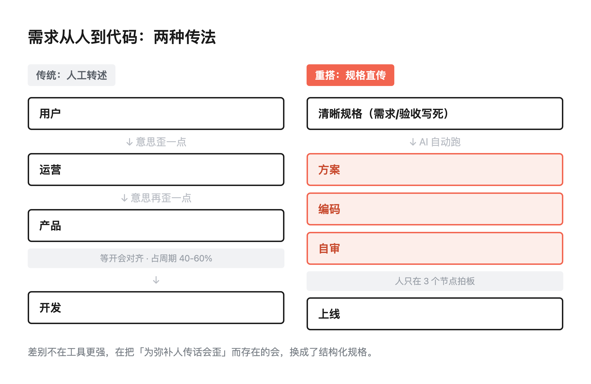
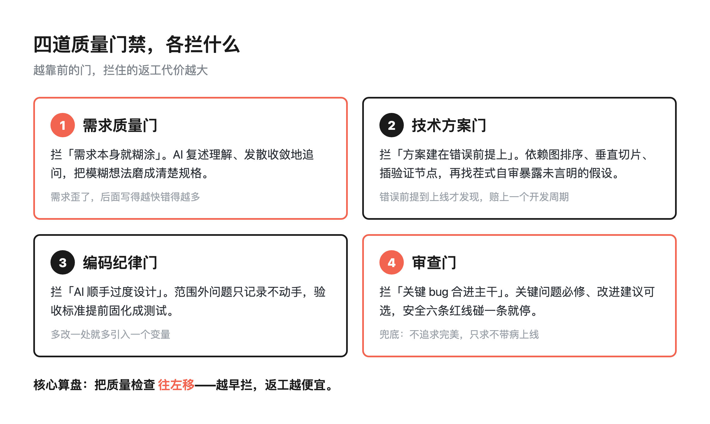
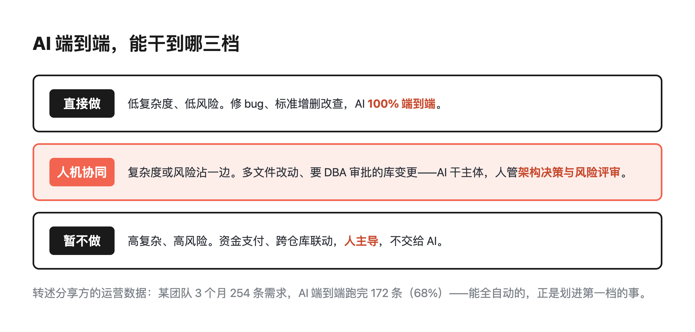

代码写得飞快，交付还是慢：70+ 企业的四道质量门禁

> 行途导读：团队里人手一个 AI 编程工具，代码一天生成上千行，可需求从提出来到上线，还是要熬好几周。问题不在模型不够强，在整条研发流程里信息会传歪、角色之间在等、写错了再返工。下半场不是往旧流程里再插一个 AI，是用结构化规格替代口头传话，在需求、方案、编码、审查四个节点各设一道门禁。
>
> 这篇能给你什么：① 看懂为什么「写得快」没变成「交得快」——慢在交接和等待，不在写代码；② 抄走四道质量门禁的具体拦法，从需求质量门到审查门各拦什么；③ 对照我自己工作区里跑的缩小版，看哪些思路个人小团队也能直接用。数字都是分享方转述的，我没实测，第 8 节标清了口径。

目录：

1. 写得快，为什么交得慢
2. 第一性原理：删掉「为弥补人而存在」的环节
3. 流水线全貌：一条线，四道闸
4. 四道门禁，各拦什么
5. 越用越聪明：知识怎么沉淀
6. 边界：AI 端到端，不等于人撒手
7. 我的缩小版：在自己工作区跑一遍
8. 工具与信源

## 1. 写得快，为什么交得慢

先承认一个很多团队都遇到过的尴尬：Cursor、Claude Code 这类工具装了一圈，代码生成速度确实涨了一大截，可整体交付效率，没见着明显改善。

问题出在哪？AI Coding 把「执行」这一环优化到头了，但研发流程里另外三件事一直在原地踏步——信息衰减、跨角色等待、返工。

一个需求从用户嘴里到代码上线，中间要经过用户、运营、产品、开发好几道转述。每传一次，意思就歪一点。为了把歪掉的理解重新对齐，团队又发明了需求评审会、接口对齐会、各种拉群确认。这些会不是谁懒，是人的记忆和表达本来就有损耗，会议是用来补这个损耗的。

角色之间的等待，能占到整个交付周期的四成到六成。也就是说，一个需求花两周上线，其中一大半时间，代码根本没在写——人在等别的人把话说明白。

所以「个人写代码加速」是个加法，每个人快了百分之几十；可只要交接和等待还在，总周期就是被那段最长的等待卡住的。真正的杠杆，是把这段等待消掉。

## 2. 第一性原理：删掉「为弥补人而存在」的环节

这套方法叫「端到端 AI 研发平台」，核心理念就五个字：需求即交付。

它的思路是从第一性原理出发，挨个追问流程里的每个环节：这个环节，到底该不该存在？

按这个尺子量，需求评审会、接口对齐会这类东西，存在的唯一理由是「人传话会歪」。那把口头传话换成结构化的规格说明——需求写清楚、验收标准写清楚、约束写清楚——AI 就能接着往下跑：自动做需求澄清、出技术方案、写代码、自审、部署。人从「翻译官」和「协调者」，退回到「拍板的人」。

看图：左边是传统的传法，需求经过一层层人工转述，每层都在补损耗；右边是重搭后的流水线，规格从一头进，AI 在中间跑完，人只在少数几个节点出现。差别不是工具更强了，是中间那些「为弥补人」的环节被拿掉了。

一句话记住这个转向：不是在旧流程里插入 AI 工具，而是用 AI 重新定义流程。

## 3. 流水线全貌：一条线，四道闸

重搭之后，整条交付被拆成九个阶段串成一条流水线。挑关键的几个环给你看：

需求进来，AI 像资深产品经理一样反向追问，把模糊的想法磨成一份清楚的规格。接着做可行性评估，从需求清晰度、仓库匹配度等七个维度打分，总分不过六十就不放行——注定做不成的需求，提前毙掉，别浪费后面一圈。然后 AI 匹配代码库、出施工方案，在功能分支上写代码、编译、跑单测，再自己做一轮 Code Review、自动修，最后自动部署到测试环境，等人验收。

人在这条线上只碰三个节点：方案确认、测试验收、合入主干。剩下的，机器跑。

这么长一条线，怎么保证跑不歪？答案就是标题说的四道门禁。它们不是事后救火的测试，是卡在流水线关键节点上的「闸」——每一道都回答一个问题：放过去的东西，会不会在后面造成大返工。

## 4. 四道门禁，各拦什么

这是整篇里最值得抄走的部分。四道门各管一件事，拦的代价不一样。

第一道，需求质量门。这道门拦的是「需求本身就是糊涂的」。AI 会把它理解到的东西复述一遍，再发散、收敛地追问，直到需求清晰。为什么把最重的闸放最前面？因为需求歪了，后面写得越快、错得越多——返工的成本，是随阶段往后指数级涨的。需求阶段一句没说清，到上线才发现，要赔上一个开发周期。

第二道，技术方案门。方案不是拍脑袋写一段，是按依赖关系排好顺序、切成一块一块能独立验证的小切片，每片中间插验证节点。更关键的是，AI 写完方案会「找茬式」自审一遍，把那些需求里没明说、却被默认成立的假设提前抖出来。很多事故不是写错代码，是方案建立在一个没人点破的错误前提上。

第三道，编码纪律门。这道门专门压 AI 的「过度设计」冲动。AI 写嗨了容易顺手把范围外的问题也一起改了，一改就引入新变量。纪律是：发现范围外的问题，只记录、不动手；验收标准提前固化成测试用例，写没写对，让测试说话。三条铁律：简单优先、只碰该碰的、关键路径先写测试。

第四道，审查门。Code Review 不是鸡蛋里挑骨头，是把发现的问题分两类：关键问题必须修，改进建议可以以后再说——奉行「改善即批准」，不追求一次完美，只求不把关键 bug 合进去。安全是硬底线，越权、SQL 注入等六条红线，碰一条就拦下。

四道门放在一起看，规律很清楚：越靠前的门，拦的代价越大；越往后的门，越像兜底。把质量往左移，是这套设计的核心算盘。

不过这四道门有个共同点值得盯一眼：它们全都设在"产出物"上——需求清不清晰、方案对不对、代码守不守纪律、审查过不过关。**没有一道门，设在产出这些东西的那条流水线自己身上。**

10 月 21 日前后，AI 工程里很常用的一个 LLM 网关 LiteLLM 的发布流水线被攻破：有人用一条自动化的 CI/CD 令牌，往发到 PyPI 的安装包和 Docker 镜像里塞进了窃取凭据的代码，目标直指环境变量里的云密钥与模型 API 密钥。维护方的处置是撤销暴露的令牌、下架受感染的包，并要求用到受影响版本的团队轮换所有云密钥与数据库凭据。这事的棘手之处在于"为何难查"：包的版本和来源看起来一切正常，装依赖这个动作在日志里就是一行普通的构建步骤，等凭据已经在别处被用上时，流水线本身不会有任何异常。**四道门禁再密，也拦不住往构建机里递包的那只手。**

所以如果要给这套方法补一句，我会把门禁的边界往外画一层：画到"谁把包放进你的构建里"这一层。具体无非三件事——依赖锁版本、锁来源，构建机不长期持有明文密钥（用短期令牌替代），构建机的出网范围单独限制。这三条和四道门不冲突，是同一套思路的下游：**门禁要拦的不只是产出物，还有产出它的人、机器和凭据。**（本段依据官方事故复盘与安全媒体报道，见文末信源节。）

第二个同构案例来自流水线的材料层。10 月 25 日的安全汇总里，压缩格式 Brotli 的远程代码执行漏洞（CVE-2026-111497）被确认早已不是 Node.js 一家的问题——同一个根子上的缺陷蔓延到了 Python 的多个包、Bun、Envoy 和 Istio。它值得研发流水线盯上的理由有两个：一是中招的不只是「服务端收到的请求」，还包括**处理外部响应的代码路径**——Agent 抓网页、拉 API 响应，解压这一步就明明白白躺在工具链里；二是这个根因今年 2 月就修了，但当时没被定性为安全漏洞，所以没有发版——**修了不发，等于没修**，而依赖清单里没人知道要主动升级一个「不算漏洞修复」的版本。可做的动作同样不重：SBOM 不要只列直接依赖，凡是解压 HTTP 内容的库都进漏洞跟踪；构建机与 Agent 运行时的出网与依赖来源，继续按上面三条单独管。**门禁拦得住产出物，拦不住管道材料的裂纹——所以管道本身要有人看。**（本段依据安全媒体汇总与厂商转述，见文末信源节；根因时间线口径未逐字核对官方公告。）

## 5. 越用越聪明：知识怎么沉淀

流水线能不能用住，还有个容易被忽略的变量：喂给 AI 的上下文质量。

这套平台做了三件事，让它越跑越顺手。一是前置强注入：每次调用 AI 之前，先按需求类型、所属仓库这些维度，把相关知识打包好直接塞进上下文，分享里说注入率超过九成。二是知识蒸馏：每交付完一单，把这次踩的坑、能复用的方案骨架沉淀下来，攒了五百多条知识资产。三是老化防线：知识设有效期、AI 反馈不好的就降权、跟着主干代码一起刷新，防止过期知识反过来污染判断。

这背后是个朴素的账：上下文质量决定输出质量。流水线跑过的每一个项目，都应该变成下一个项目的燃料，而不是跑完就散。

## 6. 边界：AI 端到端，不等于人撒手

这套分享最值得认可的一点，是它把「AI 能干到哪」划得很清楚，没有吹成万能。

按复杂度和风险，事情分三档：低复杂度、低风险的，比如修个 bug、做标准的增删改查，AI 百分之百端到端做完；复杂度或风险沾一边的，比如跨好几个文件改动、要 DBA 审批的数据库变更，AI 干主体，人管架构决策和风险评审；高复杂、高风险的，比如涉及资金支付、跨仓库联动，干脆不交给 AI，人主导。

分享里给的一组运营数据（转述，非我实测）：某个业务团队三个月提了 254 条需求，AI 端到端跑完 172 条，占 68%；其中一半的需求两小时内就完成，而传统模式的中位耗时是三到五个工作日。

注意它的潜台词：AI 端到端能跑通的，恰恰是那些被划进「低复杂度低风险」的事。剩下的硬骨头，人还得在。

## 7. 我的缩小版：在自己工作区跑一遍

我没搭过这么重的企业级流水线，但这套「四道门禁」的思路，我在自己的小工作区里跑了个缩小版，对照下来能互相印证。

需求质量门，我对应的是「先写规格再动手」。没把要做什么写清楚、没对齐之前，一行代码不写——动手前的那轮澄清，就是我的第一道闸。

技术方案门，我对应的是「让一个模型分裂成几个角色互相找茬」。方案刚成型，先别急着做，把它丢给怀疑者、审计员几个角色挑一遍，把没点破的假设提前揪出来。

编码纪律门，我对应的是改动范围纪律和发前脚本门禁：只改该改的，改完跑一批自动检查（排版、去套话、隐私、合规），机器说了算。

审查门，我对应的是发布前的独立对抗审查——另开一个上下文，不带我的立场，专挑我稿子的漏洞。

就在写这篇的前一晚，这套小门禁刚被实战检验了一把，还正好是一对案例。一件是：一篇稿子里混进来两个信源根本撑不住的"事实"细节，排版检查、合规扫描、信源核对全数放行，一路走到建稿——最后是人眼把它抓了出来。另一件是：我图省事自己拟了个摘要，被"摘要必须取自定稿原文"这条机器校验当场拦下，删掉重建。两件事摆在一起看特别清楚：**机器门禁拦得住"不一致"，拦不住"不像话"——后者目前还得靠人。** 这也是我坚持四道闸之外还要留一道人审的原因。

跑下来一个很深的体会：门禁拦得住代码和文字的错，拦不住方向本身错了。AI 没有目的，目的得人来定。四道闸越多越密，越要想清楚每一道闸到底在为什么东西把关——否则就是把「做错的事」自动化得更彻底。

这周做一件事：挑你团队一个总在返工的环节，别先想怎么加工具，先问一句——这个环节存在的理由，是不是只因为人传话会歪？如果是，它就是可以被结构化规格替代的那一个。

你团队的交付慢，慢在哪一道？评论区聊聊。

## 8. 工具与信源

**素材出处** ｜ 本文主体方法、四道门禁、九阶段流程与数字，均转述自一篇公开元宝分享卡片《AI 原生研发流水线实践》（基于 70 多家企业 AI 研发落地经验的总结），非我本人实测，也非我搭建过该平台；我未对其中企业名单与数据做独立第三方核实。

**我的对照实践** ｜ 第 7 节「我的缩小版」对应我个人工作区里真实在跑的 Spec 驱动、多角色对抗审查与发布前门禁流程，属个人实践体会，与上述企业平台无隶属关系。

**关键数字口径** ｜ 「254 条需求 / AI 端到端 172 条占 68% / 51% 两小时内完成 vs 传统中位 3-5 个工作日」「角色间等待占交付周期 40%-60%」「前置知识注入率 >90%、沉淀 547 条知识资产」均为分享方原文转述，供参考，勿当本人实测数据引用。

延伸阅读（LiteLLM 事件信源）：

- **LiteLLM 官方事故复盘**（受影响版本 v1.107.0；10-21 凌晨发布至 PyPI 与容器仓库，PyPI 约 6:23 冻结、Docker 约 7:20 清理，恶意制品在线约 3 小时；根因链含 5 月底泄漏未轮换的主密钥、未按最小权限收敛的组织所有者 GitHub CLI 令牌、为赶发版临时放宽的发布审批；官方建议移除受影响版本并轮换全部可能暴露的凭据）：https://litellm.vercel.app/blog/security-incident-oct-21-2026-attack-chain 
Brotli 漏洞信源（10-25 v3 晚间轮新增）：

- **Brotli 解压漏洞跨语言蔓延（2026-10-25）**：CVE-2026-111497 从 Node.js（Node2Shell）扩散至 Python 多个包、Bun、Envoy、Istio；影响面含「处理外部响应的代码路径」：Claude Code Daily Briefing https://claude-news.today/en/briefings/briefing-2026-10-25
- **「根因 2 月已修未发版」口径（中文媒体转述，OpenAI 官方报告原始链接未逐字核对）**：FreeBuf https://www.freebuf.com/articles/ai-security/508557.html ；Yahoo 财经香港 https://hk.finance.yahoo.com/news/ai代理竟能突破沙箱-繞過防火牆-openai揭露多項內部漏洞-訓練暫停11天後重啟-034003642.html
- **SecurityWeek 报道**（恶意包估计被下载逾 4.9 万次；企业私仓客户不受影响；第三方 Wiz 观测到被盗凭据被用于调用云端模型）：https://securityweek.com/litellm-compromised-in-fresh-supply-chain-attack 

🔗 相关仓库：[xingtu-sdd](https://github.com/xingtu1996/xingtu-sdd)（本文四道质量门禁的规格驱动落地：需求/方案/编码/审查各设一道闸）
