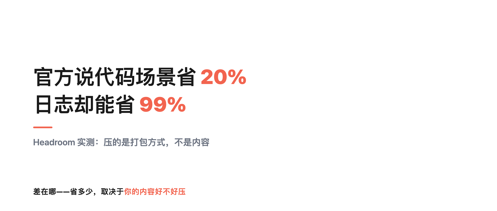
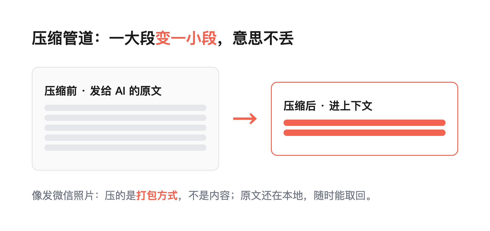
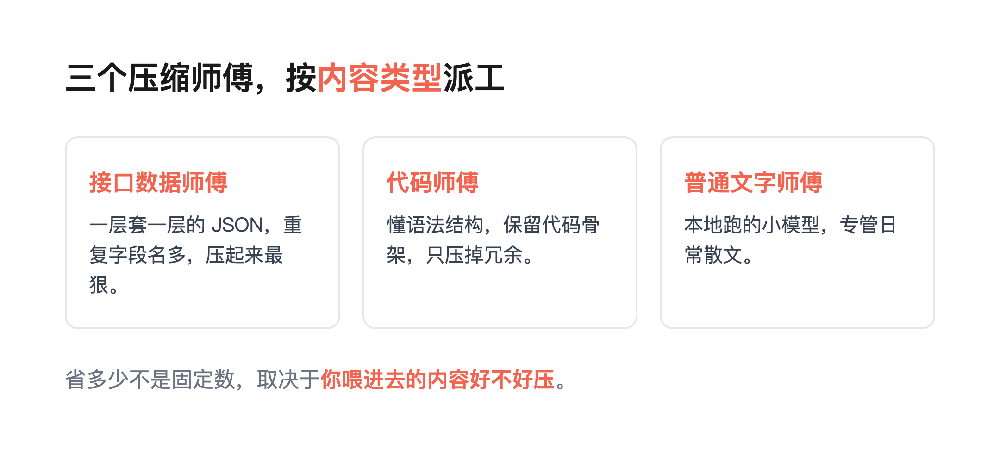
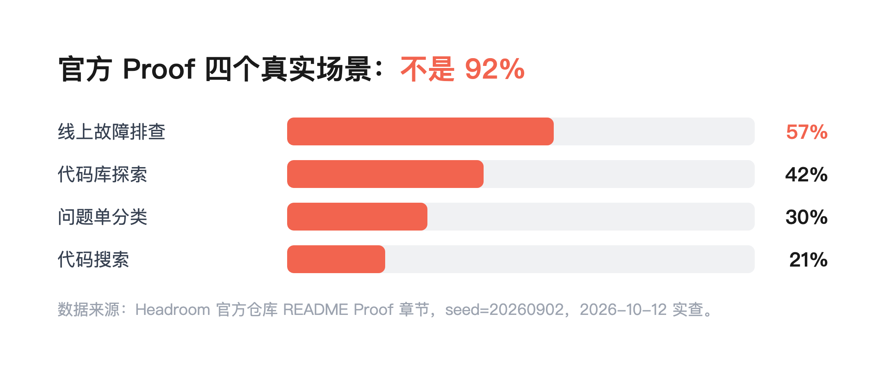
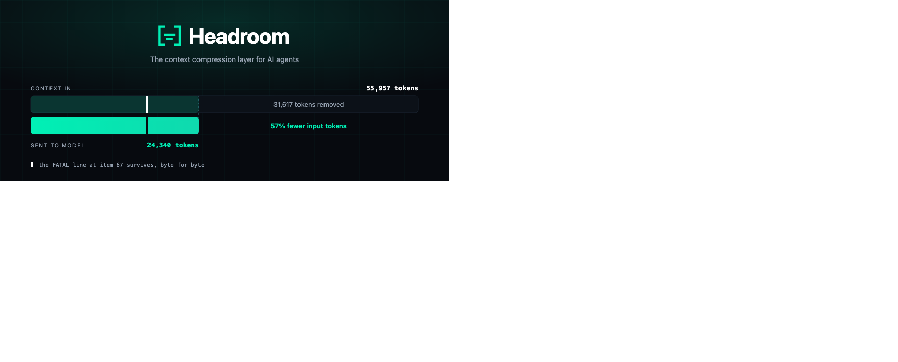
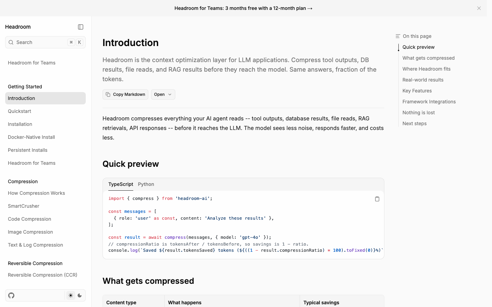
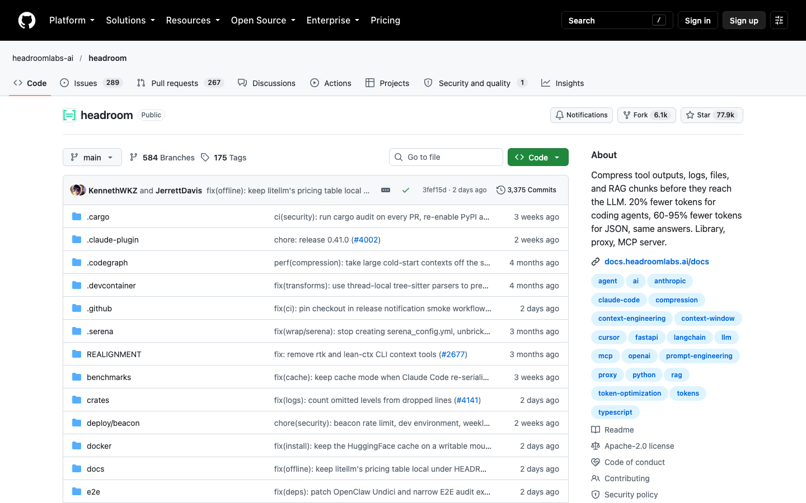
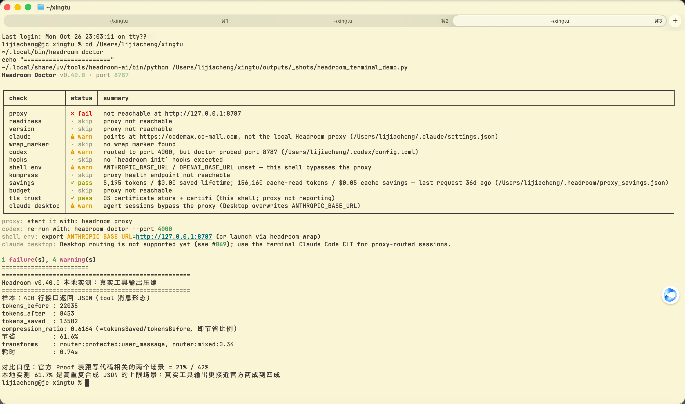
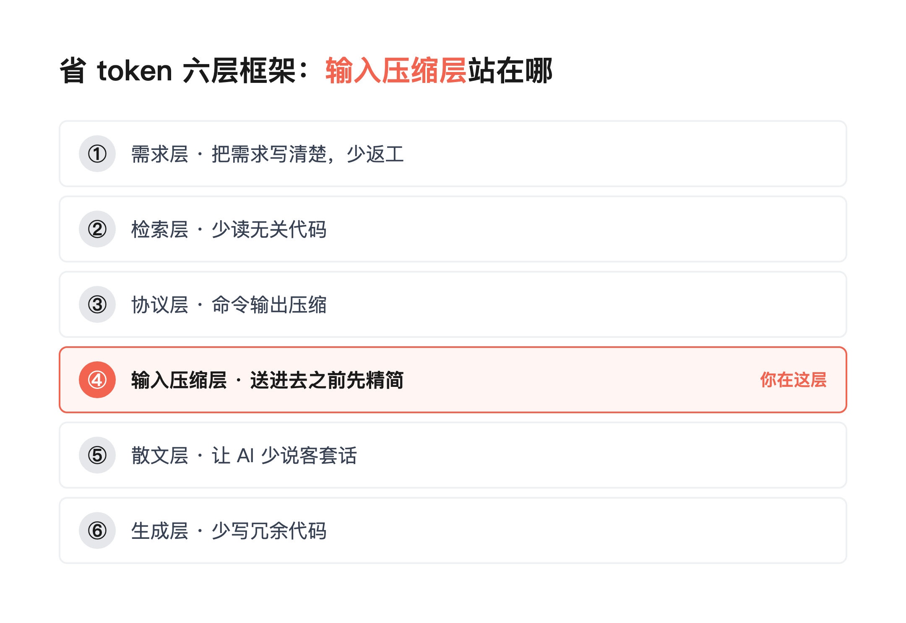

# token 效率工具 Headroom：官方说代码省 20%，日志能省 99%



> **行途导读**：Headroom 到底能省多少？官方口径是代码场景约 20%、JSON 这类高重复内容 60%~95%；我装完最新版实测，400 行接口返回压掉 61.6%，800 行日志压掉 99.25%。同一个工具差这么多，不是它忽强忽弱，是省多少取决于你喂它什么——别被任何一个单一数字带偏预期。
>
> **这篇能给你什么**：① 用发微信照片的比方，一次性看懂 Headroom 到底在压什么、什么时候真省；② 抄走官方口径和我的本地实测数字，别再被单一百分比带偏预期；③ 我装到自己机器上踩的那个坑——装完不导流等于零。项目地址和安装命令在第 7 节。

目录：

1. 先说清楚，为什么你的 AI 账单下不来
2. Headroom 做了什么：发照片时微信帮你做的那件事
3. 「原图还在」这个设计，是它敢说不丢信息的底气
4. 它内部有三个不同的压缩师傅
5. 官方自己的四个真实场景：21%、57%、42%、30%
6. 省多少，取决于你喂什么：官方两成到 95% 的区间
7. 我把官方推荐的体检命令跑了一遍
8. 比压缩比更值得学的，是它敢标「这是估算」
9. 工具与信源
10. 什么时候值得上，什么时候别折腾
11. 六层框架里，输入压缩层站在哪

---

## 1. 先说清楚，为什么你的 AI 账单下不来

跟 AI 干活，有点像带一个记性特别好的助理跑一整天。

上午你给它看了三个文件，它记住了。中午它跑了几轮命令，打印出来几百行结果，它也记住了。中间失败那两次报错，它还记着。到下午你随口一句「接着改吧」，它得先把上午到现在的所有事在脑子里过一遍，才开口回答你。

麻烦在于，它「过一遍」是要按字数收钱的。而且不管你今天用不用得上，上午那些内容每一轮都得重新送进去一次。

跑得越久，这份「记忆」越厚，账单越贵。很多人有个直观困惑：模型明明一直在降价，怎么我的账单没降？原因大半在这里——钱没花在模型变聪明上，花在重复搬运旧内容上。

## 2. Headroom 做了什么：发照片时微信帮你做的那件事

你应该有这种经历：手机拍了一张照片发给朋友，微信会先把它压小一点再发。朋友收到的那张，看起来跟原图没差别，没有变模糊，也没有变成马赛克。

这里面有两件事很关键。第一，微信压的是「打包方式」，不是「照片内容」——该有的人和景一个都没少。第二，原图还好好躺在你相册里，朋友想看高清的，你点一下「原图」再发一次就行。

Headroom 干的就是同一件事，只不过它压的不是照片，是你发给 AI 的那一大段文字。它装在你自己的电脑上，在内容送进 AI 之前先精简一遍。



这里有个分寸值得说明：它不删你的内容，只换一种更省的写法。市面上多数省 token 的办法是另一种思路——精简系统提示词、手动删对话历史、或者让 AI 自己写摘要。这些都会改变 AI 看到的东西。Headroom 走的是另一条路，它尽量不动意思。

（如果你懂技术，这个思路常被类比成 HTTP 传输里的 gzip。不懂这个名词完全不影响理解，上面那个发照片的比方是同一件事。）

**官方自己的定义。** 项目仓库的官方介绍原文是这样的：「在数据到达大语言模型之前，对工具输出、日志、文件以及RAG片段进行压缩。编码代理所需标记数减少20%，JSON所需标记数减少60%至95%，答案保持不变。库、代理、MCP服务器。」拆开看是三句话：装在哪——库、代理、MCP 服务器；压什么——工具输出、日志、文件、RAG 片段；保证什么——答案保持不变。这跟前面微信发照片的比方对上了：内容没变，只是换了一种更省的写法。

## 3. 「原图还在」这个设计，是它敢说不丢信息的底气

照片敢压缩，是因为原图还在相册里，随时能调出来。

Headroom 也一样。所有被它压过的内容，原文都存你自己电脑上，不上传。AI 要是觉得哪句话没看明白，可以回头把原文调出来重看一遍。官方给这套机制起了个名字叫 CCR，大意是「压过的东西，随时能取回来」。

官方首页那个演示就是为这件事准备的：一份一万多字的服务日志，压到一千多字，但那行标着 FATAL 的报错，一字不差地留了下来。

因为原文存在本地，这个方案对数据敏感的场景也算友好——压缩过程不往外发任何东西。

## 4. 它内部有三个不同的压缩师傅

照片能不能压小，得看照片本身。这也是 Headroom 里最有意思的一点：它知道自己面对的是什么类型的内容，然后派不同的师傅去处理。

第一个师傅管接口数据，那些一层套一层的 JSON，重复的字段名一大堆，压起来最狠。第二个师傅管代码，它懂语法结构，会把代码骨架留下来，只压掉冗余。第三个师傅管普通文字，是一个专门为了压缩而训练的小模型，权重开源，也在你本地跑。



还有一个角色站在最前面，负责提醒你：「接下来这段内容，会让你的缓存失效。」它只做提示，不动你的东西。

这个分工解释了一件很多人没注意的事：Headroom 的省 token 效果不是一个固定数字，而是由「你喂给它的内容长什么样」决定的。

## 5. 官方自己的四个真实场景：21%、57%、42%、30%

这一节是这篇最想让你看的东西。官方仓库里有一个叫做 Proof 的章节，用真实工具的输出来构造了四个场景，跑出来的原始数据是这样的：

| 场景 | 压缩前 | 压缩后 | 省下 |
|---|---:|---:|---:|
| 代码搜索（100 条结果） | 17,199 | 13,597 | 21% |
| 线上故障排查 | 55,957 | 24,340 | 57% |
| 代码库探索 | 58,801 | 33,895 | 42% |
| 问题单分类 | 46,067 | 32,429 | 30% |





上面这张就是官方仓库头图（hero），画的是 Proof 表里「线上故障排查」那一行：55,957 个 token 压到 24,340，省 57%，底部那行 FATAL 日志一字不差——压缩不丢关键信息。

数据来源：Headroom 官方仓库（github.com/headroomlabs-ai/headroom）README 的 Proof 章节，seed=20260902，2026-10-12 实查（75,051 star，Apache-2.0，最近一次代码提交在 2026-10-11）。star 数随时间每天都在小幅变动，这里锚定的是查的那一天的快照。

四个场景平均下来三成多。官方在后面还补了一句解释，大意是：省多少，取决于你的内容有多重复。反复出现的日志行和数据结构能压掉九成以上，写得很紧凑的内容几乎压不动。

再看 Proof 表里跟写代码最相关的两行：代码搜索省 21%、代码库探索省 42%——这就是一个天天跟代码打交道的人，从这张官方表里能拿到的真实数字，不是两成就是四成上下。

## 6. 省多少，取决于你喂什么：官方两成到 95% 的区间

那网上流传的「省 92%」是哪来的？

查不到官方出处。官方自己的口径里没有 92% 这个数字：仓库简介（About）写的是代码场景省 20%、JSON 这类重复度高的内容省 60%~95%；Proof 表是四个构造场景 21%、57%、42%、30%；首页日志演示压掉八成多。**92% 更像是转述时把「日志场景能压很多」一路加码传出来的，没有任何官方来源。**

真正稳定的是那个规律：省多少由内容决定。官方自己反复强调——取决于你的内容有多重复。反复出现的日志行和数据结构能压九成以上，写得很紧凑的内容几乎压不动。这中间差的是什么？是你的实际使用场景。如果你每天让 AI 读十几个文件、跑几轮测试、翻一堆接口返回，你能拿到的更接近官方表里那个 21% 到 42%；如果你只是在聊天框里跟它聊几句，压缩空间很小。

所以我更愿意把它当成一个「看场景的工具」，而不是一个「一开就灵的开关」：装在内容重复度高的流程里，收益明显；装在轻量对话里，基本白装。别问「Headroom 能省多少」，要问「我喂给它的内容长什么样」。

**和 rtk 比：为什么它的数字更直观。** 上篇《[AI跑命令，95%的输出是噪音：rtk压掉93.6%](https://mp.weixin.qq.com/s?__biz=MzU0MjgyNDM2MQ==&mid=2247486286&idx=1&sn=832e1ffa4e2ceca9ec8fa261763ea2ca)》里那个 rtk，压的是命令行输出：AI 发命令，它拦下输出过滤一遍再送进上下文，实测压掉 93.6%。Headroom 压的是整段消息序列：站在客户端和模型 API 之间，按内容类型分路由——user 消息保护不动、日志类能压 99%、JSON 类 61.6%。所以 rtk 的数字更直观，它只处理一类东西（命令输出），一个数字说清全部；Headroom 是一组数字，你得先知道自己的内容属于哪一类，才谈得上「省多少」。两者共性更值得注意：都是「进上下文之前先过一道闸」，rtk 拦的是命令这一个闸口，Headroom 拦的是所有消息。选哪个看你的噪音大头在哪——命令输出多选 rtk，工具返回和日志多选 Headroom。

## 7. 我把官方推荐的体检命令跑了一遍

项目地址：github.com/headroomlabs-ai/headroom，文档站 docs.headroomlabs.ai。




装法很简单，一行命令：

```
pip install "headroom-ai[all]"
```

如果你用 uv，更干净的方式是：

```
uv tool install --python 3.13 "headroom-ai[all]"
```

装完之后，它有四种接入方式：直接当 Python/TypeScript 库调用、起一个本地代理端口、用 `headroom wrap claude` 一行命令包住 Claude Code 这类工具、或者挂成 MCP 服务。装完记得跑一行 `headroom doctor` 做体检。

我装完之后做了件大多数人会跳过的事：跑官方推荐的体检命令（`headroom doctor`），看它到底有没有在工作。这次装的是最新版（headroom-ai v0.40.0）。

结果是三条都没通过。本地代理没启动（127.0.0.1:8787 探测失败）；我常用的那个助手客户端，请求指向的不是本地代理，所以流量根本没经过 Headroom；shell 环境变量里 ANTHROPIC_BASE_URL 没设——意味着终端里的命令会直接绕过它。连 Codex 也接不上：它默认路由到 4000 端口，而 Headroom 的体检探测的是 8787，装完默认也是错开的。

有意思的是，它的节省统计并不是空的——本机有一份历史记录：一生节省 5,195 tokens / $0.00，外加 156,160 个缓存命中 token，但最后一条请求停在 36 天前。装完后再没导流，所以「看起来像没数据」，其实是数据停在了很久以前。新装环境下，本地存原文的库也是空的（0 条记忆）——没导流，它连原文都没存过。

原因也很直白：装完只是装完，你得再做一步「把请求导过来」，它才开始干活。官方给的 `headroom wrap claude` 这种一键命令能支持十几种主流助手（Claude Code、Cursor、Codex、Copilot、Aider 等），撤销也有一行命令 `headroom unwrap claude`。

光体检还不够，我顺手用它的 Python API 压了两段真实内容：一段 400 行的接口返回 JSON，从 22,019 个 token 压到 8,437，省 61.6%；一段 800 行的运行日志，从 32,197 压到 243，省 99.25%。数字跟官方 Proof 表的口径对得上——重复度越高的内容省得越多：日志这类高重复内容能省九成以上，日常真实工具输出更接近官方表里的两成到四成。另外有个小门槛：首跑要联网下载一个本地小模型，离线或冷启动时 ML 压缩会被跳过，但 router 启发式仍会压（日志样本照样省 99.25%），只是幅度可能不同。



这个坑值得单独说一句：省 token 工具的效果，从来不取决于它有多强，取决于它有没有被真正接进你的工作流。

## 8. 比压缩比更值得学的，是它敢标「这是估算」

这个项目有一点我特别欣赏。

省下来的输出侧 token 有个天然的麻烦：它是反事实的——你永远看不到 AI「本来会写多少」。绝大多数工具会直接给你一个漂亮数字。Headroom 的做法是明确标注这是估算值，并附上置信区间，比如它自己的报告长这样：减少 31.7%，区间 27.7% 到 35.7%，后面跟一个「估算」标签。想拿实测值，它给你留了办法，把一成的会话留作对照组。

一个开源项目愿不愿意在自己的成绩单上标「估算」，比成绩单上的数字更能说明问题。这一条比那个流传的 92% 更有用。

**10-16 补：上面这句话，这一周自己又送来了两个新样本。**

一个是反例，而且是第三次了。今天发布的 GitHub 周榜（2026W25）在介绍 Headroom 时，用的说法是「6 种压缩算法，可减少 60%~95% 的 token 消耗」。而官方自己 Proof 表里四个真实场景是 21%、57%、42%、30%。**不是有人造假，是每一次转述都自动挑走了最好看的那一段**——第一手是官方日志演示的八成多，第二手写成 60%~95% 的区间，还有流传更广的 92%（查不到官方出处）。到这里已经没人提"这取决于你的内容长什么样"了。

另一个是正例，方向刚好相反。同样这一周，另一个省 token 的项目（Caveman）公布的做法是：对照组不用"默认啰嗦模式"，而是用"请简洁"——先假设你已经会加一句提示词，再看还能多省多少。这样报出来的 65% 是往小了报的。它还额外写明自己不压什么：思考 token 和推理 token 不在射程内。

两件事放在一起，就是本文第 8 节那句话的两个方向：**一个数字敢不敢信，不看它多大，看它的对照组是谁、以及它敢不敢写清楚自己不cover什么。**

还有一件跟第 4 层直接相关的事值得记一下：这周 OpenAI 把 Codex 和 ChatGPT Work 里的默认上下文窗口从 272k 扩到 500k，涨了约 80%。窗口变大是好事，但它同时意味着——**你每一轮要重新搬进去的行李也变大了。** 官方这正是本文第 1 节讲的那个机制：钱不是花在模型变聪明上，是花在重复搬运旧内容上。窗口扩容和输入压缩不是一回事，也不互相替代；前者让你能装更多，后者让你少装点。

**10-17 补：这周还来了一份第三方账单级实测，给「默认档到底省多少」一个别的口径。**

在公开的 Terminal-Bench 2.1 基准上（89 个命令行任务，跑在 Codex CLI + GPT-5.5 上），有人把几款压缩层放在同一批任务下比账单：Kompressor 省账单 22.7%（输入 token 约 −25%，任务解决率没有统计学意义上的变化）；**Headroom 在默认设置下只省 8.2%，最激进的档位也只到 11.6%**。同一份测量里，请求体积 p90 从 106.9K 压到 66.5K token，超过 200K 的请求占比从 1.9% 降到 0.13%；省钱集中在长日志任务（ML 训练/评测 −26%、源码构建 −28%）。

这个数字比官方 Proof 表的 21%~57% 更冷，也更贴近日常账单，原因有两个：一是它测的是默认档，不是为了好看挑出来的场景；二是它落在真实命令行任务上，而不是构造出来的四个场景。但有一条口径必须一起带上：**这份基准由 Kompressor 的厂商 Hystax 自己发布，文中已经自述利益关系**——相当于竞品给自己打分、顺手测了对手，数字可以参考，不能当中立结论。官方基准以 Proof 表口径为准（21%~57%），本文引用即按此口径标注。

把它和第 6 节连起来看：流传的 92% 没有官方出处，官方 Proof 表是挑出的四个场景（21%~57%），这份竞品方账单实测落在默认档的日常任务上（8.2%~11.6%）——数字一层层往下，越往下越接近你自己账单上那个真实的百分比。

（信源：GitHub 周趋势 2026W25 ｜ Caveman 对照口径 ｜ OpenAI 默认窗口 272k→500k 官方更新 ｜ 10-17 第三方账单级实测，Terminal-Bench 2.1 默认档 8.2%~22.7%，厂商 Hystax 已自述利益关系 ｜ 10-26 本地实测 headroom-ai v0.40.0，工具输出省 61.6%、日志省 99.25%——完整链接与逐条口径明细见发布包论证溯源，信源分级口径见第 9 节）

## 9. 工具与信源

这篇里的数字，全部来自三处口径，从最可信到最需谨慎排列：

**官方第一手**：Headroom 官方仓库（github.com/headroomlabs-ai/headroom，Apache-2.0）README 的 Proof 章节，seed=20260902，2026-10-12 实查，四个场景 21%、57%、42%、30%；仓库 About 另有简洁口径：代码场景约 20%、JSON 60%~95%。注：流传的「92%」无官方出处，本文不采用。

**第三方账单级**：Terminal-Bench 2.1 基准上由 Kompressor 厂商 Hystax 发布的实测（默认档 8.2%、激进档 11.6%），数字可以参考，但它自述利益关系，不能当中立结论。

**本地实证（本文第 7 节）**：headroom-ai v0.40.0，本机安装后 doctor 体检加 Python API 实测——工具输出省 61.6%、日志省 99.25%，与官方口径吻合。安装命令与接入方式见第 7 节。

想看最新情况：官方文档站 docs.headroomlabs.ai 有 Getting Started 和 Compression 全系说明；仓库 Issues / PR 区能看到社区踩坑（比如 Codex 端口错位这类接入问题）。仓库主页还有 HeadroomDemo-Fast.gif 演示动图。

## 10. 什么时候值得上，什么时候别折腾

按内容类型给个判断：

值得上，如果你的工作流里日志、接口返回、批量数据占比很高。故障排查、接口调试、批量数据处理这几类，官方基准能到三成到五成，是实打实的。

可以观望，如果你以写代码为主。Proof 表里代码搜索省 21%、代码库探索省 42%，平均也就三成上下，还得算上安装调试的时间成本。

别折腾，如果你只是轻度对话。省下来的可能还不够你看文档的时间。

还有一条现实建议：不管你用不用它，先看清自己账单的结构。如果你的钱主要花在 AI「写回来」的内容上，那把力气花在压输入上是打偏了。Headroom 也做了输出侧的优化，但默认是关的，需要手动打开。

## 11. 六层框架里，输入压缩层站在哪

回到这个系列的老框架。省 token 的六个层次是：

```
① 需求层   → 把需求写清楚，少返工
② 检索层   → 少读无关代码
③ 协议层   → 命令输出压缩
④ 输入压缩层 → Headroom，送进去之前先精简   ← 你正在读的这篇
⑤ 散文层   → 让 AI 少说客套话
⑥ 生成层   → 少写冗余代码
```



前几层都是「用完之后再省」——检索完了压缩，命令跑完了过滤。输入压缩层的位置更靠前，它在内容送进模型之前就动手。

有一点得修正我之前的说法：Headroom 不完全只做输入侧，它还管输出侧的冗长开场白和推理档位。所以它更像是横跨④和⑤两层的一个中间件。这也说明这个六层框架是个理解工具，不是一把精确的尺子。

**附录：站在同一层的其他工具。** 把省 token 的工具放进这套层级，彼此的关系比单独看任何一个都清楚（口径提醒：下列百分比均为项目方自述，测试分母各异，不可互相外推）：

- **② 检索层**：xerj——替代 grep 的语义检索，自称 token 消耗降到 1/40，适合「少读无关代码」的场景
- **③ 协议层**：rtk——命令输出压缩，官方口径 60%~90%、实测 93.6%；同层还有 otari、treg
- **④ 输入压缩层**：Headroom（本文主角）与 Kompressor——Kompressor 是开源消息压缩方案，第三方 Terminal-Bench 2.1 实测默认档 8.2%、激进档 11.6%（其厂商 Hystax 自测 22.7%，利益关系已标注）
- **缓存层（横跨各层）**：Anthropic/OpenAI 的上下文缓存（命中 token 降价），以及 Headroom 的 cache 模式（delta-only，几乎不破前缀缓存）
- **路由/网关层**：OmniRoute——375 家供应商、1400+ 模型的一站式路由，内置 RTK 压缩，属于「流量先过一道闸」的网关派

放进去看，省 token 已经从「装个工具」变成了「流量先过一道闸」——你选哪个工具，本质是选把闸口安在哪一层。

**核心结论**

1. Headroom 的思路跟微信发照片时的自动压缩一样：压打包方式，不压内容，而且原文留着随时能取回
2. 它内部按内容类型派不同的处理方式，所以省多少取决于你的内容好不好压——重复的日志和数据能压九成，紧凑内容几乎压不动
3. 官方四个真实场景省 21%、57%、42%、30%，其中跟写代码相关的两个场景只有两成到四成
4. 省多少由内容决定：官方口径代码场景约 20%、JSON 60%~95%，日志极限场景能到九成以上——把单一数字当通用结论，是把场景搬了家
5. 装完不导流等于零——我本地实测三条体检项全没过，这是最容易踩的坑
