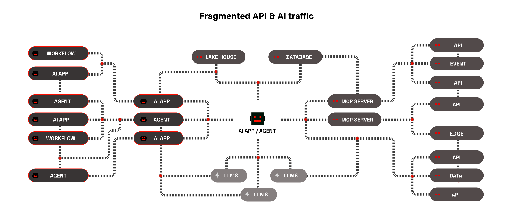
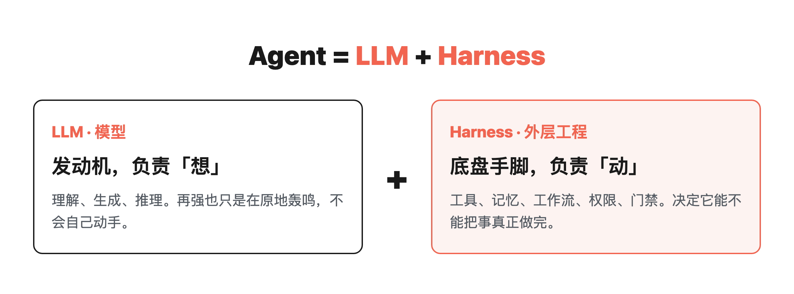
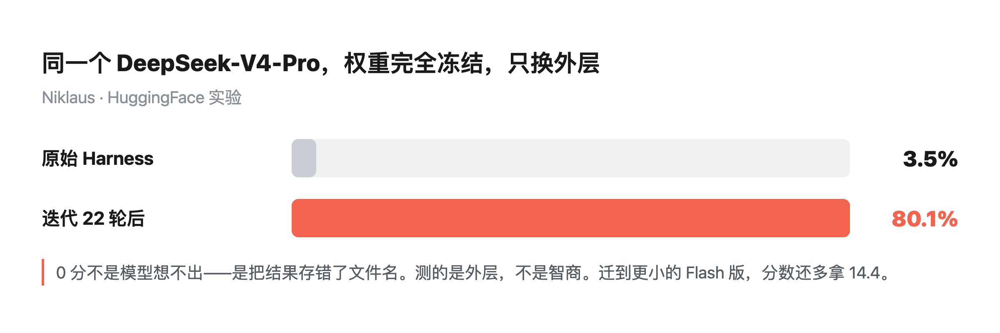
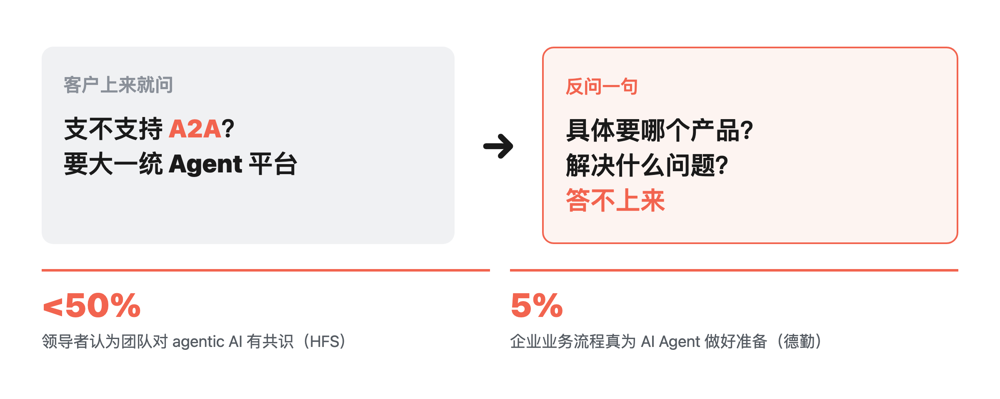
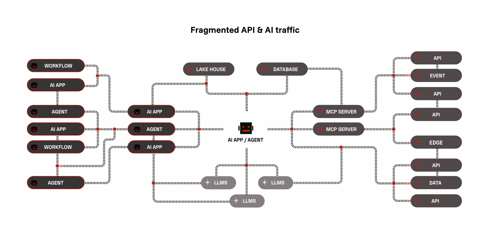
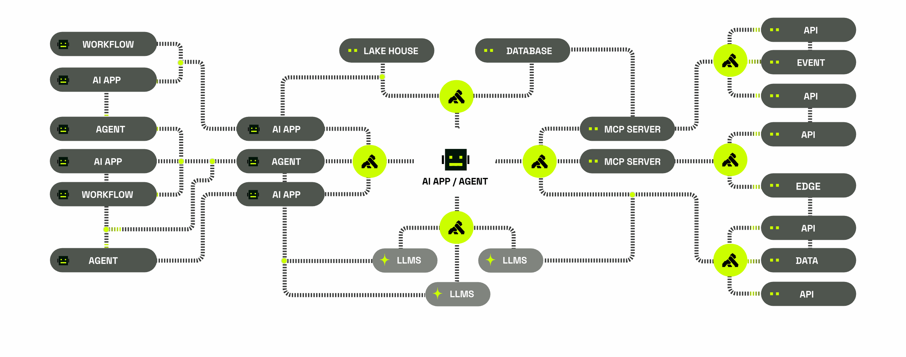

> **行途导读**：AI 已经在动手干活了，但企业里大多数人还是说不清「Agent 到底是什么」。我在项目沟通里反复遇到：客户干脆地问「你们支不支持 A2A」，反问要解决哪个系统的问题时，却答不上来。问得多了我发现，缺的不是某个产品知识，是共同的概念底座。这篇先把最基础的一块立起来——Agent = LLM + Harness。
>
> **这篇能给你什么**：
> ① 一个能讲给任何人的公式：Agent = LLM + Harness；
> ② 一组硬实验：冻结同一模型只换外层，得分 3.5% → 80.1%；
> ③ 一张协议对照表，分清 MCP、A2A 在吵什么。
>
> 我在[《Harness，是工具还是规矩？》](https://mp.weixin.qq.com/s/HWpOU1rMxCF1Uve7uQFFhA)里拆过这层壳，这篇补全它为什么是现在的主战场。

目录

1. 先把话说清楚：Agentic 到底是什么
2. 最反常识的一刀：干活的是 Harness，不是模型
3. 为什么企业总在这一步踩空
4. MCP、A2A：最近高频出现的几个词在吵什么
5. 怎么判断一个 Agent「及格了」
6. 工具与信源

## 1. 先把话说清楚：Agentic 到底是什么

这两年「Agent」被用得很滥。开会人人都在说，但真让三个人各写一句定义，大概率是三个版本：有人说它是更聪明的聊天机器人，有人说它是能自己调工具的东西，有人干脆说不清楚。

我自己反复用过几个编程 Agent 之后，认一个能写进笔记、不随潮流变的拆法——这也不是我发明的，LangChain 早把它写成一行：**Agent = Model + Harness**，我在项目里反复验证，认这个拆法：



```
Agent = LLM + Harness
LLM     = 模型本身（理解、生成、推理）
Harness = 裹在模型外面的那层工程（工具、记忆、工作流、权限、门禁）
```

LLM 是发动机，负责「想」；Harness 是底盘，负责「动」。光有发动机它只能空转，装上底盘才能上路。

顺手把三个容易混的词分清：Agent 是那个干活的实体；Agentic 是它干活的方式有多自主——自主行动的程度由 Harness 决定，不由模型决定；MCP / A2A 是它干活时用的插口和对讲机。后面会逐个展开。

这里最容易被搞反的一点：模型不等于 Agent。一个再强的大模型，裸着抛给它一个任务，它也只能给你一段文字；真正让它能读文件、跑命令、记住上次改到哪、知道哪条红线不能碰的，是外面那层 Harness。同一个模型换一套 Harness，会得到两个完全不同的 Agent。

Anthropic 在 Claude Code 官方术语表里把这件事写得很直白，逐字是：「Claude Code is the harness; Claude is the model inside it.」——Claude Code 是那层壳，Claude 才是壳里的模型。这话跟我们上面的公式，是同一个意思。

## 2. 最反常识的一刀：干活的是 Harness，不是模型

如果只讲公式，这篇就还是概念科普。真正让我改变判断的，是一组硬实验。

HuggingFace 的工程师 Joel Niklaus 做过一个控制变量的实验：他把同一个 DeepSeek-V4-Pro 的权重完全冻结，一行模型参数都不动，只换外面那层执行机制——也就是 Harness。这是在法律任务评测、同一个评测器下的结果：不同 Harness 下，同一个模型的综合得分在 **3.5% 到 80.1%** 之间波动；同一套 Harness 再经过 22 轮代码自动迭代，得分从 63.4% 提升到 80.1%，追平了闭源的 Claude Sonnet 4.6，成本只有对方的七分之一。



最值得停下来看一眼的，是那个 0 分案例。它一开始不是「想不出来」，而是把结果**存错了文件名**——任务其实做完了，只是产物没落在评测器找得到的地方。这测的根本不是模型智商，是 Harness 有没有把「结果放哪儿、怎么交付」这件事管明白。

更关键的是后续：他把这套迭代好的 Harness 迁到同族更小的 DeepSeek-V4-Flash 上，模型降了档，分数反而还**多拿了 14.4 分**。这直接说明一件事——换一个弱一点的发动机，只要底盘够好，车照样跑得快。

Karpathy 的看法跟这个实验互相印证——他公开讲过，真正让系统变强的不是模型本身，而是外面那层 harness。他自己做的 AutoResearch 项目跑过 700 轮实验，Shopify 的 CEO Tobi Lütke 实测质量提升 19%、模型体积减半。

所以反过来说：**Agent 够不够格，不是看你接了多聪明的模型，是看你那层壳有没有及格。** 这也解释了为什么很多团队换了一轮又一轮模型，体验还是原地打转——他们一直在换发动机，从没修过底盘。对企业来说，这笔账直接落在预算上：模型选型是显性成本，看得见、好对比；Harness 是隐性成本，看不见、难量化，但它恰恰决定了这笔预算花出去有没有回来。

## 3. 为什么企业总在这一步踩空

把上面这套认知拿到企业现场，错位非常明显。

我参加过一些需求沟通。客户很干脆，上来就问：你们支不支持 A2A？要不要一个「大一统的 Agent 管理平台」？这些词听着很专业。但当我反问一句：你具体想解决哪个系统的什么问题、点名要微软哪一个产品时，对方往往答不上来。



问的人多了，我发现缺的不是某个产品知识，是共同的概念底座。德勤 2026 年调研里，只有 **5% 的企业说自己的业务流程已高度为 Agent 做好准备**。

我把现场最常见的三个盲区列在下面：

- 把「API 中转 / 网关」当成「Agent 平台」。前者只是把模型流量转一道手，后者要管工具、记忆和编排。
- 把「模型能力」当成「Agent 能力」。模型再强，没人给它定流程、设门禁，它交付出来的东西一样存错文件名。
- 不知道执行能力是 Harness 决定的，于是把预算全押在模型选型上，壳子空空如也。

把企业现场的 API 和模型流量画出来，常常是下面这张图的样子——工作流、应用、模型、数据各接各的，连成一团。



## 4. MCP、A2A：最近高频出现的几个词在吵什么

顺着上面的认知差，把市面上高频出现的几个协议和产品放在一张表里，就清楚多了。先给个最小框架：你只需先分清两件事——它怎么碰到你的系统（MCP），它怎么跟别的 Agent 说话（A2A），其余多是厂商包装。

| 名词 | 一句话解释 | 它解决什么 |
|---|---|---|
| MCP | Agent 调工具、取数据的标准插口 | 让 Agent 从「只会说」变成「碰得到企业系统」 |
| A2A | Agent 跟 Agent 之间互相派活的协议 | 跨系统、跨团队协作的地基（多数团队暂时还用不上） |
| API 中转（如 newapi 类） | 把各家模型接口收拢成一个入口 | 接入方便，但只是「流量转手」，不是平台 |
| AI 网关（如 Kong AI Gateway） | 对 API、模型、Agent 流量统一记账、限流、审计 | 「治理派」路线，重点是看得见、管得住 |
| 微软 Agent 体系 | 一整套企业级 Agent 开发与治理生态 | 客户最常点名、也最常说不清到底要哪一块 |

把「MCP」那一行展开，就是下面这张图的样子——Agent 不直接碰数据库和 API，中间永远隔着一层 MCP Server 做插口，把模型和外部系统解耦开。



这张表背后有条时间线值得记住：MCP 在 2025 年底随 Linux 基金会成立 Agentic AI 基金会（AAIF）时就作为创始项目进去了，A2A 在 2026 年 8 月跟进，两个协议这才逐步合流到同一屋檐下——等于从「某家厂商的私有玩法」变成了行业公共规范。微软自己的官方指南也写得很实在——**内部流程先用平台原生编排，MCP 接工具和数据，跨平台才用 A2A**。

这话其实是在给客户降温：多数团队现在连 MCP 这一层都没接明白，直接冲去要 A2A，属于站在一楼想买三楼的票。

## 5. 怎么判断一个 Agent「及格了」

概念和协议都摆完，判断一个 Agent 是否及格，可以看三个维度，按顺序：

第一，能不能把一件小事从头到尾交付对：读对输入、动手执行、把结果放在对的位置、失败了知道退回来重来。那个 0 分案例之所以扎眼，就是它交付了却没交对地方。

第二，外面那层有没有记忆和门禁：记不记得上次改到哪、哪条红线碰不得。裸模型没有这些，这全是 Harness 的活儿。

第三，出问题时，能不能留下一条永久的修复。Mitchell Hashimoto 在 2026 年初把这件事命名为 Harness Engineering——Agent 每犯一次错，就往壳子里补一条永久规则。这跟单纯调 prompt 是两个工种：调 prompt 是求它这次发挥好，补壳子是让它以后都不再犯。

说到这，正好有个发生在写这篇文章过程中的例子——拿我自己写稿的检查脚本举例：我有个发文章前自动跑的门禁脚本，负责检查稿子结构是否完整，其中一条判据要求正文包含「这周做一件事」。今天它误报了一次：正文明明有，只是写的是「这周就做一件事」，差一个「就」字，脚本就判缺失。

处理方式不是换模型，也不是改提示词，而是给脚本补了一条规则，允许「就」字可缺省。十分钟后，误报归零。这件事里，脚本就是一个小型 Harness：执行逻辑没问题，错的是外层规则太死板，把「是否完成任务」误判成了「措辞是否逐字匹配」——修好它的方式，就是补一条永久规则，这正是 Harness Engineering 的定义。

一句话收尾：Agent 这件事，短期比的是谁的模型聪明，长期比的是谁的 Harness 扎实。模型会一代代被追平，那层「把聪明变成靠谱交付」的工程，才是真正拉开差距的地方。

接下来这个系列，我会接着写企业为什么该把 Agent 当成新的执行层、自主性到底分几个等级、以及落地之前必须先想清楚的三件事。

## 6. 工具与信源

**LangChain 公式表述** ｜ Agent = Model + Harness（业界 canonical 说法）

**Anthropic 术语表** ｜「Claude Code is the harness; Claude is the model inside it」

**Niklaus 实验报道** ｜ 法律任务评测（LAB）：冻结 DS-V4-Pro 权重只换 Harness，3.5%→80.1%，迁移 Flash 仍 +14.4

**Karpathy 观点（转述）** ｜ AutoResearch 700 轮实验；Tobi Lütke 实测质量 +19%、模型体积减半

**Hashimoto · Harness Engineering** ｜ 2026-02 命名「每次犯错补一条永久修复」

**Deloitte 2026 就绪度调研** ｜ 仅 5% 企业称业务流程已高度为 Agent 做好准备

**Microsoft Learn** ｜ 内部流程平台原生编排、MCP 接工具数据、跨平台 A2A

**Linux Foundation AAIF** ｜ MCP 2025-12 随成立入列，A2A 2026-08 跟进

> 我在[《说不清需求，AI 就替你乱跑》](https://mp.weixin.qq.com/s/KpQYs3ENNMdwI3N-C2ihkA)里写过另一个方向的问题：需求说不清，再强的壳也会带你跑偏。那篇讲方向盘，这篇讲底盘，两篇对着看更完整。
