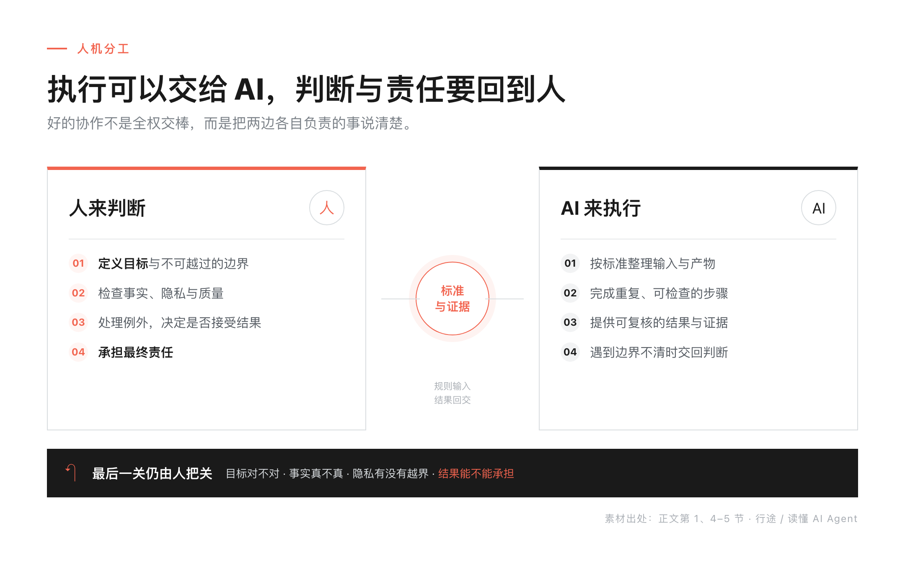
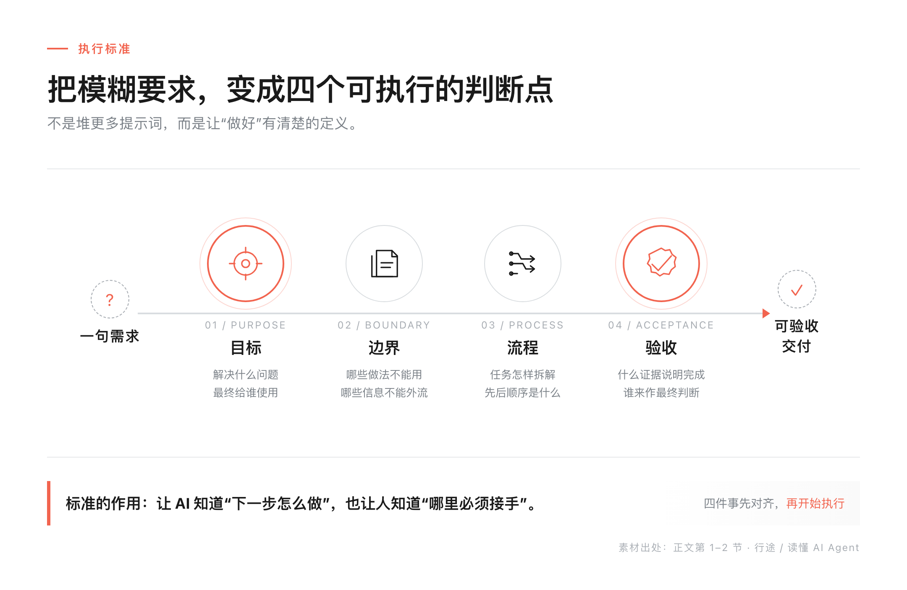
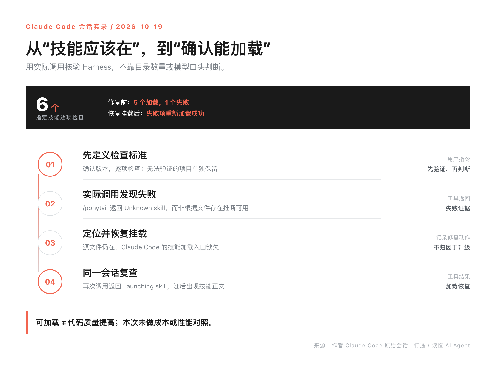

> **行途导读**：你让 AI 写周报、做方案、整理资料，它几分钟就交差，你打开一看——不是要的，改两遍还是差点意思。问题往往不在 AI 笨，在你没把“怎样算做好”说清楚。这篇用一个反常识的真实项目讲透：干活可以交给 AI，裁判必须留在人手里。
>
> **这篇能给你什么**：
> - 一个普通人每天都会撞上的问题：AI 交差很快，却总不是你要的。
> - 一套今天就能用的方法：目标、边界、流程、验收四件事写清楚，AI 一次做对。
> - 一条检查原则：别信“配置都在”，跑一次才算数。

目录：
1. 你让 AI 干活，为什么总返工
2. 一个反常识的项目：范围全失控，客户却满意
3. 干活可以交给 AI，裁判必须是人
4. 普通人也能做的四件事：把标准写清楚
5. 别信“配置都在”，跑一次才算数
6. 什么时候值得搭，什么时候别搭
7. 工具与信源

## 1. 你让 AI 干活，为什么总返工

你让 AI 写一份周报、做一张海报、整理一堆资料。它很快交差了，你打开一看——不是要的。改一遍，还是差点意思。最后你只能自己上手，一边改一边想：这 AI 到底行不行？

我见过太多人卡在这一步，然后把 AI 归为“玩具”。但问题往往不在 AI 笨，而在你交给它之前，没把“怎样算做好”说清楚。

专业的人用 AI 顺，不是模型更聪明，是他先把标准写清楚了。**把工作交给 AI，不等于把做事的标准交给 AI。** 标准还揣在人手里的时候，AI 只能靠猜。

## 2. 一个反常识的项目：范围全失控，客户却满意

标准握在人手里，听起来抽象。一个真实项目把它演出来了。

最近看到一个 FDE 项目，结局完全反常识：需求范围几乎全面失控，客户却满意到想把整个团队招进公司。按过去的经验，范围失控等于成本失控、甲乙互相抱怨；这个团队没有死守合同，而是持续判断“什么值得做”——公平调度、折叠屏适配、可视化资源计算器……很多功能根本不在原合同里。

真正关键的不是他们多干了活，而是这些活全踩在客户的真实痛点上：**判断标准，一直握在人手里。**

这个故事背后是 AI 时代的一次翻转：当开发成本被压到极低，守范围的沟通成本反而高过多做需求的成本。与其反复拉扯“这算不算范围内”，不如把精力放在“客户到底要什么结果”上。我在[《说不清需求，AI 就替你乱跑》](https://mp.weixin.qq.com/s/KpQYs3ENNMdwI3N-C2ihkA)里写过需求表达，这篇讲它怎么落到你每天用的 AI 上。

## 3. 干活可以交给 AI，裁判必须是人

把上面的逻辑翻译成 AI 协作，就是一句话：**干活可以交给 AI，裁判必须是人。**

AI 可以跑得很快，但“什么算做好”必须由人定义。就像请了一个特别能干的助手：它能一口气写完方案、查完资料，可如果没人告诉它这次的重点是什么、哪些不能碰、交上来要长什么样，它只会给你一堆看起来很努力、用起来不对的东西。比如写方案，你定义“给谁看、要解决什么问题、别超过三页”，它就知道往哪用力。



这不是我拍脑袋说的。Anthropic（做 Claude 的公司）在官方文章《Building effective agents》里专门讲了“人在环里”：涉及高风险、不可逆的动作，要让 AI 停下来等人批准。人不是站在旁边看，人是裁判——定义目标、划定边界、检查结果、为拍板负责。

这套“标准”在 AI 工程里有个名字，叫 Harness——你可以先理解成给 AI 搭的“做事环境”：规则（什么能做）、资料（它需要的背景）、流程（先做什么后做什么）、检查工具（怎么验收）。名字不重要，重要的是你手里那套“怎么干活、什么不能碰、怎么算做好”的规矩，得先立起来。这个概念我在[《Harness，是工具还是规矩？》](https://mp.weixin.qq.com/s/HWpOU1rMxCF1Uve7uQFFhA)里拆过，这篇说它怎么落到普通人手上。

我们自己的工作区就是这么搭的：一套规则同时喂四个 AI 工具，不各自维护副本；规则只写一份，谁来了都读同一份标准。我把这种状态总结成一句话：**模型是租来的，Harness 是自己的。**

## 4. 普通人也能做的四件事：把标准写清楚

落到普通人身上，就是给 AI 写清楚四件事：

第一，目标：要什么结果。不是“帮我写周报”，而是“写一封给领导的周报，突出这周进展和两个风险，500 字以内”。

第二，边界：哪些不能碰。“不要编数据”“不要删文件”“不要写我没确认的结论”。

第三，流程：分几步做。“先列提纲给我看，再写正文，最后自己检查一遍错别字”。

第四，验收：怎么算做好。给一个能勾选的清单：“有标题、有进展、有风险、字数不超、没有错别字”。



这四件事合起来，就是一条**验收标准**。举个例子：你原来会写“帮我写周报”，现在写成——目标：给领导的周报，突出进展和风险；边界：不编数据；流程：先列提纲、再成稿、最后自查；验收：有进展、有风险、500 字内。同样的要求，后者 AI 一次做对的概率高很多。你不需要懂任何技术，今天就能用：挑一条你每次都要向 AI 解释的要求，按这四件事改写，下次直接粘给它。

## 5. 别信“配置都在”，跑一次才算数

标准写好了，还有一个坑：别以为装好了就等于能用。

我自己踩过。一次升级后检查环境，六个指定技能逐项调用，五个正常，一个连续两次返回同样的错误。如果只数目录里的文件，或者听 AI 说一句“看起来正常”，这个问题根本不会被发现。后来定位到技能加载入口缺失，修复后同一会话重新调用，才返回正常：

```text
调用技能（修复前）：Unknown skill（加载失败）
调用技能（修复后）：Launching skill（加载成功）
```



两行均简化自同一会话原始摘录，完整字段见发布包。

这件事教给我的原则是：**配置能解析、钩子有触发、任务做得对，是三件需要分别验证的事。** 看实际返回，不看目录数量；“模型说做完了”不算，磁盘上有结果才算。

## 6. 什么时候值得搭，什么时候别搭

不是每个问题都要搭一套系统。问个定义、改一句话，说清楚就行。但如果同类任务反复出现、常常漏掉同一步，或者一次错误代价不小，就值得把标准写成规则——这个坑你下一次还会踩。

我们有个朴素的判断：如果这个坑下次还会踩，就值得写下来；如果任务只做一次、风险也低，别为了“工程化”多造一层流程。

写下来的标准还会自己生长。Terraform 的作者 Mitchell Hashimoto 在 2026 年初提出过一个做法：AI 每犯一次错，就把解决办法补进它的工作环境里，让它以后不再犯同一个错。这套做法后来有了名字，叫 Harness Engineering。标准不是写完就完，是越用越厚、越用越准。

这周就做一件事：挑一个你每次都要向 AI 解释的要求，按目标、边界、流程、验收四件事改写，下次直接粘给它。

## 7. 工具与信源

原始案例（行业转述）：FDE 案例来自公开分享文章（2026-10-20 采集）；行途实践：技能加载失败与恢复来自 2026-10-19 Claude Code 会话摘录；未测代码质量或成本。

Anthropic《Building effective agents》｜ https://www.anthropic.com/research/building-effective-agents

Mitchell Hashimoto《My AI Adoption Journey》｜ https://agentfactory.panaversity.org/docs/harness-engineering-crash-course

Claude Code 官方文档（2026-10-30 核读）｜ https://code.claude.com/docs/en/skills#choose-where-skills-load
https://code.claude.com/docs/en/hooks#pretooluse-decision-control
